# Gamétogenèse et spermatogenèse

13 schémas. Pour en afficher un dans le chat : ``.

## 0. Quatre étapes : les mots, ce qui démarre tout, la fabrication, le résultat.

`https://cdn.jsdelivr.net/gh/alxhe3-lab/schemas-medecine@main/Anatomie/CM1/fig00-96681d5c.svg`

## 1. Embryon ou fœtus ? Tout dépend de la date

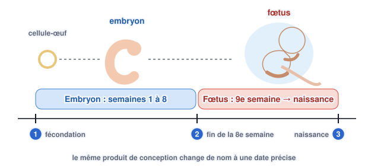

`https://cdn.jsdelivr.net/gh/alxhe3-lab/schemas-medecine@main/Anatomie/CM1/fig01-fe0cc1bf.svg`

## 2. Pourquoi dit-on que la gonade est une glande mixte ?

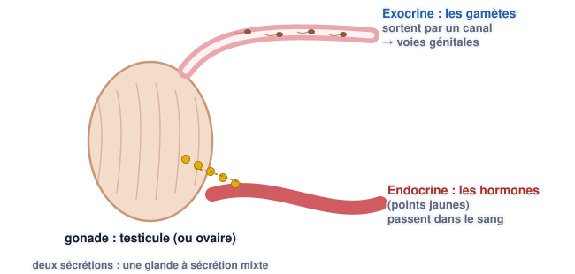

`https://cdn.jsdelivr.net/gh/alxhe3-lab/schemas-medecine@main/Anatomie/CM1/fig02-d0f8362a.svg`

## 3. Dans quel ordre les gamètes traversent-ils les organes ?

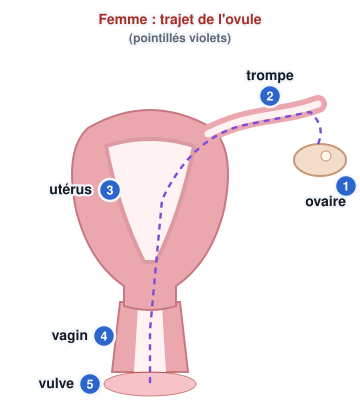

`https://cdn.jsdelivr.net/gh/alxhe3-lab/schemas-medecine@main/Anatomie/CM1/fig03-51b9075c.svg`

## 4. Que veulent dire diploïde, haploïde et « 2 chromatides » ?

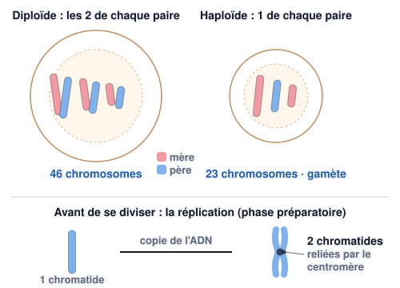

`https://cdn.jsdelivr.net/gh/alxhe3-lab/schemas-medecine@main/Anatomie/CM1/fig04-82bd362a.svg`

## 5. Pourquoi appelle-t-on l'hypophyse le chef d'orchestre ?

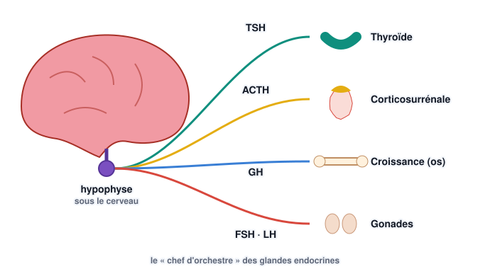

`https://cdn.jsdelivr.net/gh/alxhe3-lab/schemas-medecine@main/Anatomie/CM1/fig05-783a7026.svg`

## 6. D'où partent les gonocytes, et où arrivent-ils ?

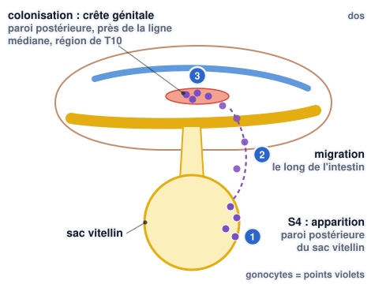

`https://cdn.jsdelivr.net/gh/alxhe3-lab/schemas-medecine@main/Anatomie/CM1/fig06-ecdf343b.svg`

## 7. Combien de temps dure chaque étape ?

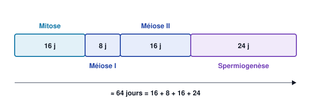

`https://cdn.jsdelivr.net/gh/alxhe3-lab/schemas-medecine@main/Anatomie/CM1/fig07-344f2994.svg`

## 8. Où se fabriquent les spermatozoïdes ? Coupe d'un tube séminifère

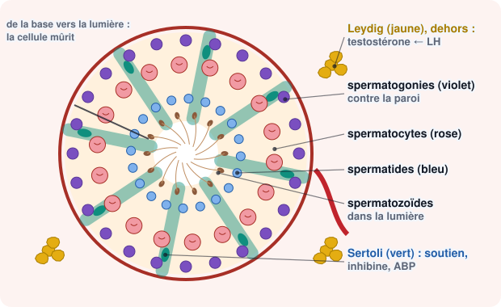

`https://cdn.jsdelivr.net/gh/alxhe3-lab/schemas-medecine@main/Anatomie/CM1/fig08-142f6691.svg`

## 9. Pourquoi une spermatogonie donne-t-elle 8 spermatozoïdes ?

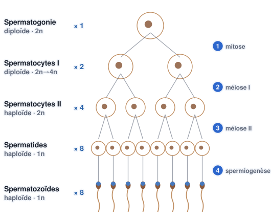

`https://cdn.jsdelivr.net/gh/alxhe3-lab/schemas-medecine@main/Anatomie/CM1/fig09-af858f07.svg`

## 10. À quoi sert chaque pièce du spermatozoïde ?

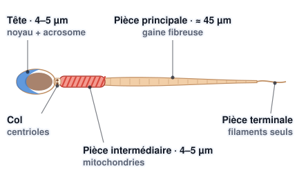

`https://cdn.jsdelivr.net/gh/alxhe3-lab/schemas-medecine@main/Anatomie/CM1/fig10-8d643ac8.svg`

## 11. Que voit-on sur une coupe du flagelle ?

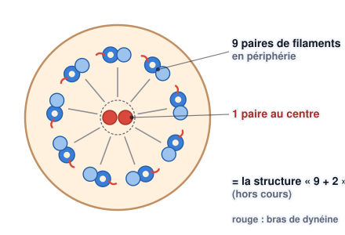

`https://cdn.jsdelivr.net/gh/alxhe3-lab/schemas-medecine@main/Anatomie/CM1/fig11-ee8398b4.svg`

## 12. Où passent les seuils de la prof ?

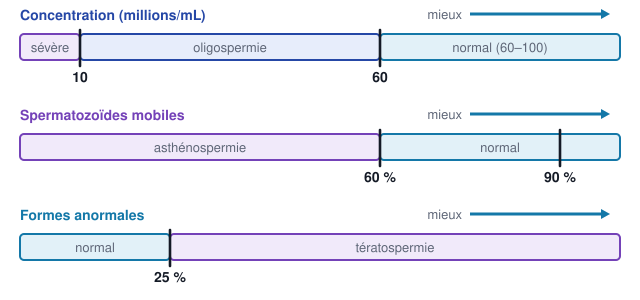

`https://cdn.jsdelivr.net/gh/alxhe3-lab/schemas-medecine@main/Anatomie/CM1/fig12-0c4734dd.svg`
