# L'ovogenèse et le cycle

11 schémas. Pour en afficher un dans le chat : ``.

## 0. Un follicule grossit, ovule, puis devient corps jaune.

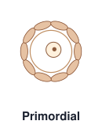

`https://cdn.jsdelivr.net/gh/alxhe3-lab/schemas-medecine@main/Anatomie/CM2/fig00-8c072b0e.svg`

## 1. Pourquoi une femme naît-elle avec tous ses ovocytes ?

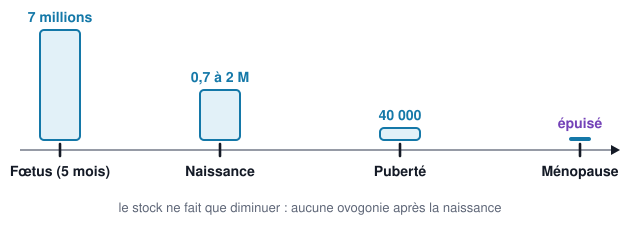

`https://cdn.jsdelivr.net/gh/alxhe3-lab/schemas-medecine@main/Anatomie/CM2/fig01-3eb6df3b.svg`

## 2. Pourquoi 1 ovogonie ne donne-t-elle que 2 ovules ?

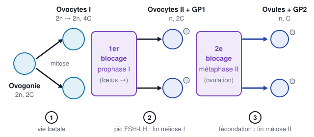

`https://cdn.jsdelivr.net/gh/alxhe3-lab/schemas-medecine@main/Anatomie/CM2/fig02-9819286e.svg`

## 3. Qu'est-ce qui change d'un stade à l'autre ?

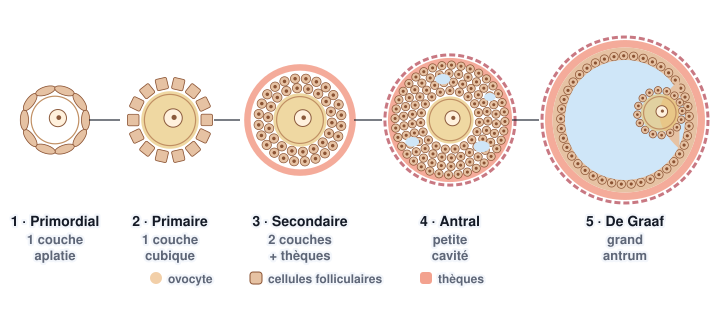

`https://cdn.jsdelivr.net/gh/alxhe3-lab/schemas-medecine@main/Anatomie/CM2/fig03-2baa57b8.svg`

## 6. Où est l'ovocyte dans le follicule de Graaf ?

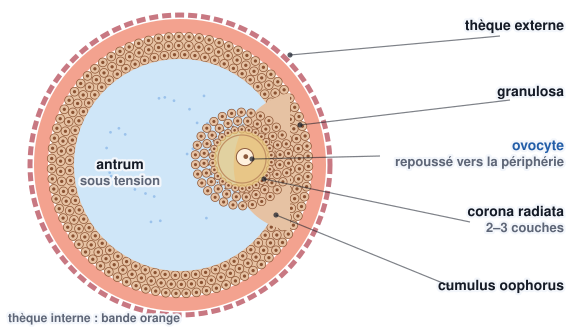

`https://cdn.jsdelivr.net/gh/alxhe3-lab/schemas-medecine@main/Anatomie/CM2/fig06-ed26252a.svg`

## 8. Comment les hormones évoluent-elles pendant les 28 jours ?

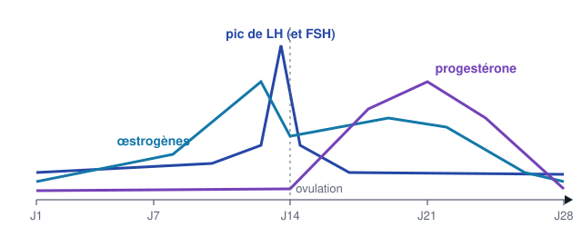

`https://cdn.jsdelivr.net/gh/alxhe3-lab/schemas-medecine@main/Anatomie/CM2/fig08-cbbd0f47.svg`

## 9. Comment l'ovocyte passe-t-il de l'ovaire à la trompe ?

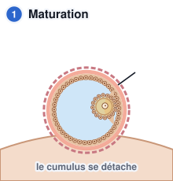

`https://cdn.jsdelivr.net/gh/alxhe3-lab/schemas-medecine@main/Anatomie/CM2/fig09-53bbfcdb.svg`

## 10. Que devient l'ovocyte II, avec ou sans fécondation ?

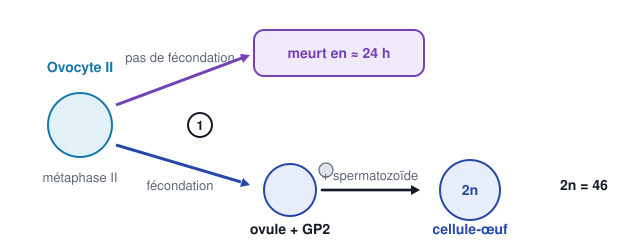

`https://cdn.jsdelivr.net/gh/alxhe3-lab/schemas-medecine@main/Anatomie/CM2/fig10-34adeaed.svg`

## 11. Que devient le corps jaune, avec ou sans grossesse ?

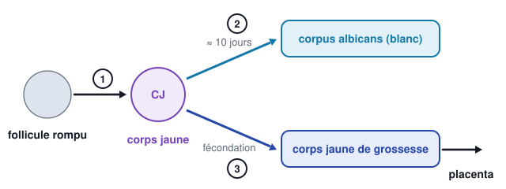

`https://cdn.jsdelivr.net/gh/alxhe3-lab/schemas-medecine@main/Anatomie/CM2/fig11-3419fd4c.svg`

## 12. Pourquoi l'endomètre s'épaissit-il puis se détache-t-il ?

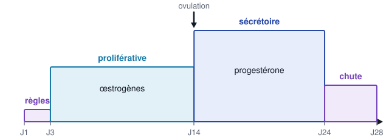

`https://cdn.jsdelivr.net/gh/alxhe3-lab/schemas-medecine@main/Anatomie/CM2/fig12-7741b313.svg`

## 13. D'où viennent les vrais et les faux jumeaux ?

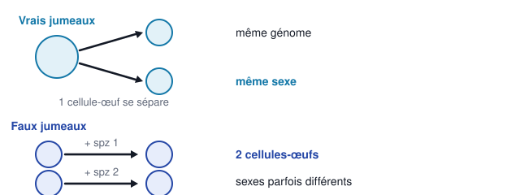

`https://cdn.jsdelivr.net/gh/alxhe3-lab/schemas-medecine@main/Anatomie/CM2/fig13-18038842.svg`
