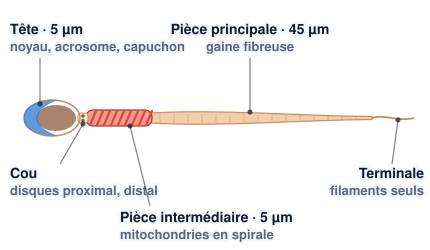
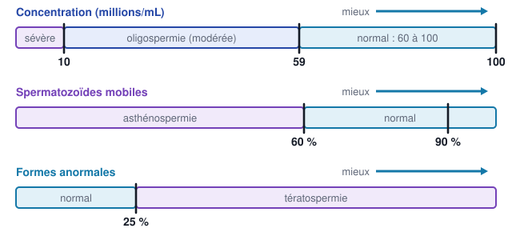
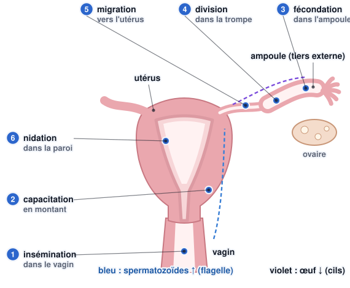
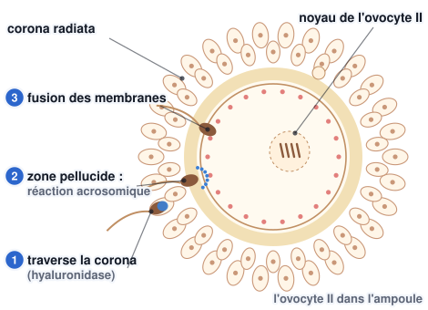
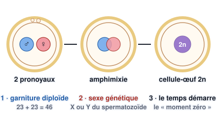
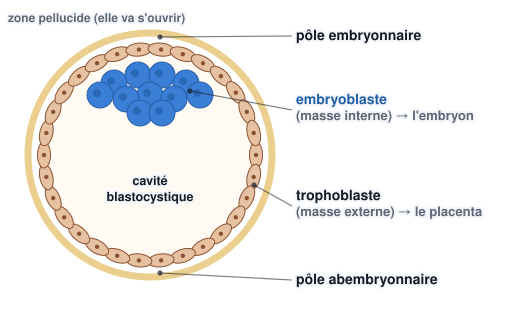
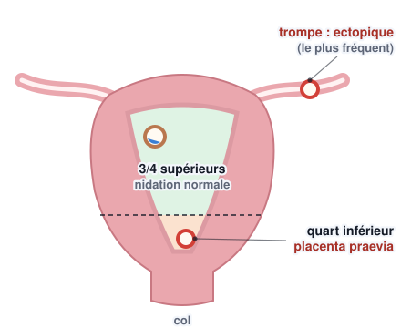
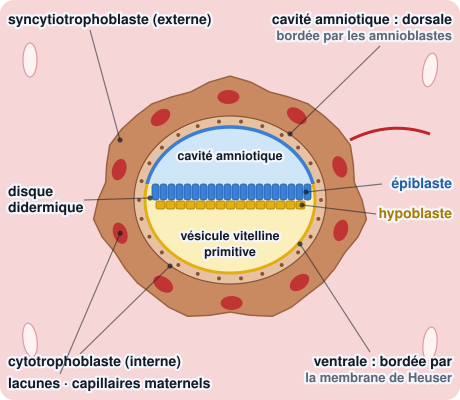

# Fécondation et première semaine

9 schémas. Pour en afficher un dans le chat : ``.

## 0. La 1re semaine : de la cellule-œuf au blastocyste.

`https://cdn.jsdelivr.net/gh/alxhe3-lab/schemas-medecine@main/Anatomie/CM3/fig00-353fa825.svg`

## 1. À quoi sert chaque partie du spermatozoïde ?

`https://cdn.jsdelivr.net/gh/alxhe3-lab/schemas-medecine@main/Anatomie/CM3/fig01-316a621e.svg`

## 2. Où passent les seuils ?

`https://cdn.jsdelivr.net/gh/alxhe3-lab/schemas-medecine@main/Anatomie/CM3/fig02-12e36bfa.svg`

## 3. Où se passe chaque événement ?

`https://cdn.jsdelivr.net/gh/alxhe3-lab/schemas-medecine@main/Anatomie/CM3/fig03-a316b884.svg`

## 4. Quelles barrières le spermatozoïde traverse-t-il, et comment ?

`https://cdn.jsdelivr.net/gh/alxhe3-lab/schemas-medecine@main/Anatomie/CM3/fig04-da42e7fb.svg`

## 7. Que produit l'union des deux pronoyaux ?

`https://cdn.jsdelivr.net/gh/alxhe3-lab/schemas-medecine@main/Anatomie/CM3/fig07-86c5fe8a.svg`

## 9. Comment est organisé le blastocyste ?

`https://cdn.jsdelivr.net/gh/alxhe3-lab/schemas-medecine@main/Anatomie/CM3/fig09-d1a3f07c.svg`

## 10. Où l'œuf peut-il s'implanter, normalement ou non ?

`https://cdn.jsdelivr.net/gh/alxhe3-lab/schemas-medecine@main/Anatomie/CM3/fig10-3c1619a1.svg`

## 11. Comment est organisé l'embryon au 9e jour ?

`https://cdn.jsdelivr.net/gh/alxhe3-lab/schemas-medecine@main/Anatomie/CM3/fig11-200d4aba.svg`
