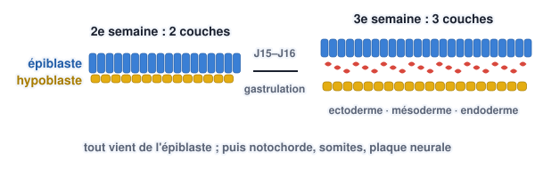
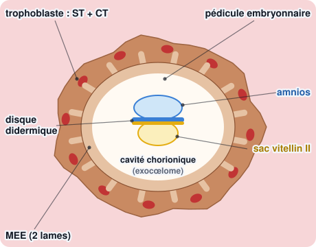
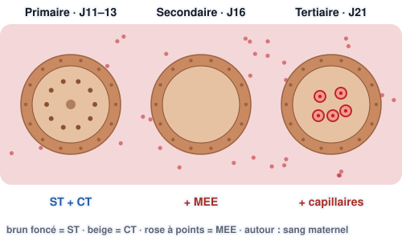
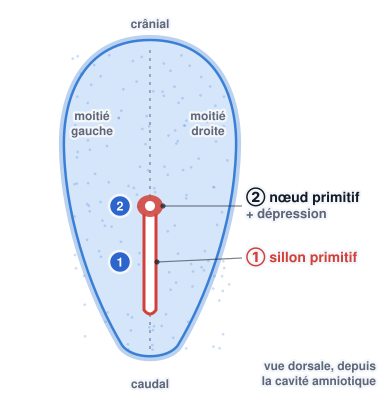
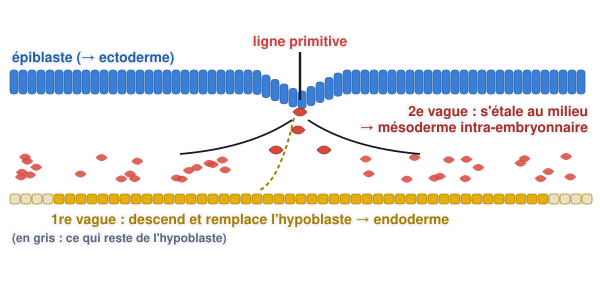
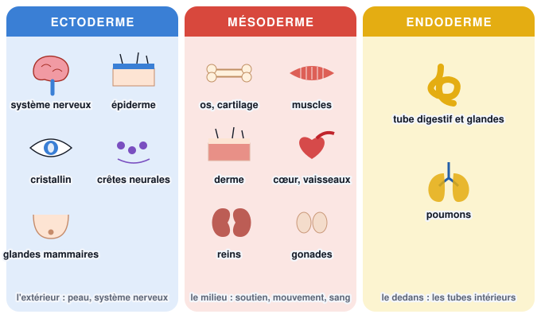
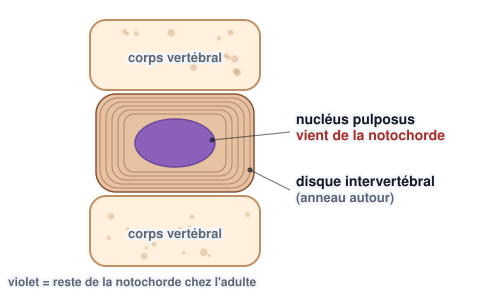
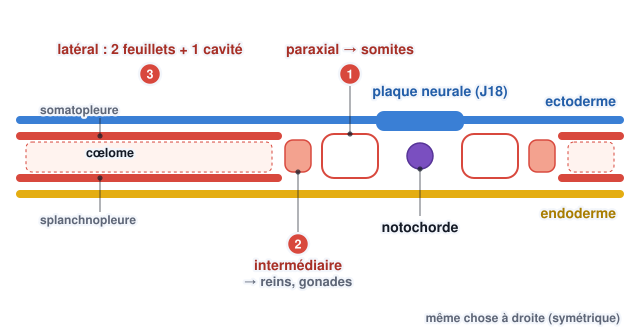
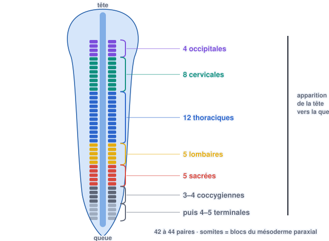
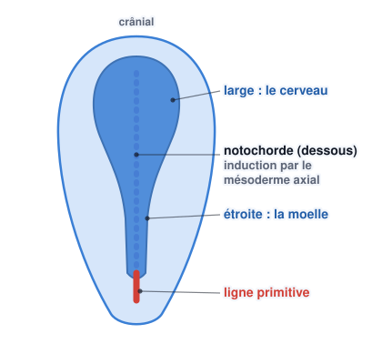

# Fin de la 2e semaine et 3e semaine

10 schémas. Pour en afficher un dans le chat : ``.

## 0. Le grand changement de la 3e semaine : de 2 couches à 3.

`https://cdn.jsdelivr.net/gh/alxhe3-lab/schemas-medecine@main/Anatomie/CM4/fig00-7abe7bfe.svg`

## 1. Que trouve-t-on autour de l'embryon à la fin de la 2e semaine ?

`https://cdn.jsdelivr.net/gh/alxhe3-lab/schemas-medecine@main/Anatomie/CM4/fig01-56fef3a8.svg`

## 2. Qu'est-ce qui s'ajoute d'une villosité à la suivante ?

`https://cdn.jsdelivr.net/gh/alxhe3-lab/schemas-medecine@main/Anatomie/CM4/fig02-afcbdbff.svg`

## 3. Comment repère-t-on la ligne primitive sur le disque ?

`https://cdn.jsdelivr.net/gh/alxhe3-lab/schemas-medecine@main/Anatomie/CM4/fig03-b183bef3.svg`

## 5. Par où passent les cellules, et où vont-elles ?

`https://cdn.jsdelivr.net/gh/alxhe3-lab/schemas-medecine@main/Anatomie/CM4/fig05-b3132e63.svg`

## 6. Que donnera chaque feuillet ?

`https://cdn.jsdelivr.net/gh/alxhe3-lab/schemas-medecine@main/Anatomie/CM4/fig06-7c6d6bb1.svg`

## 7. Que devient la notochorde chez l'adulte ?

`https://cdn.jsdelivr.net/gh/alxhe3-lab/schemas-medecine@main/Anatomie/CM4/fig07-ad6b3350.svg`

## 8. Comment le mésoderme se range-t-il autour de la notochorde ?

`https://cdn.jsdelivr.net/gh/alxhe3-lab/schemas-medecine@main/Anatomie/CM4/fig08-1990d7ec.svg`

## 10. Combien de paires de somites, et dans quel ordre ?

`https://cdn.jsdelivr.net/gh/alxhe3-lab/schemas-medecine@main/Anatomie/CM4/fig10-41abc6eb.svg`

## 11. Pourquoi la plaque neurale se forme-t-elle là, et que donnera-t-elle ?

`https://cdn.jsdelivr.net/gh/alxhe3-lab/schemas-medecine@main/Anatomie/CM4/fig11-aea4c236.svg`
