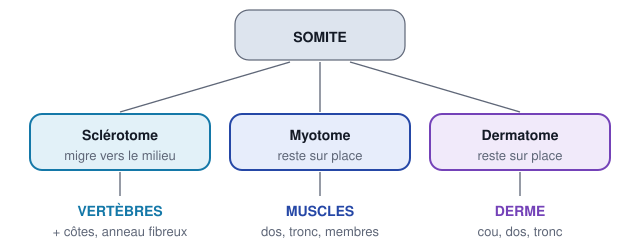
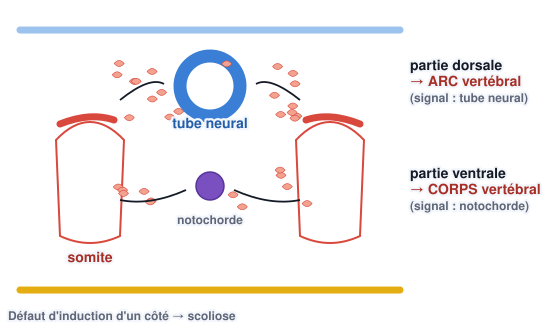
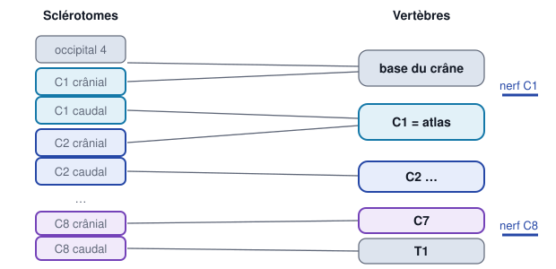
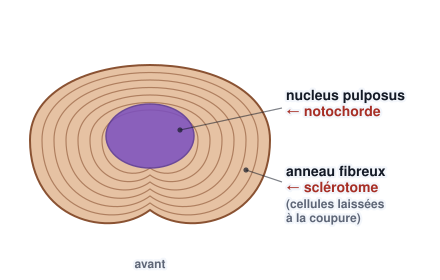
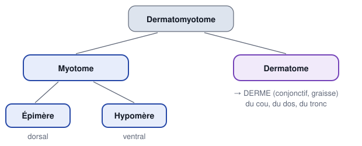
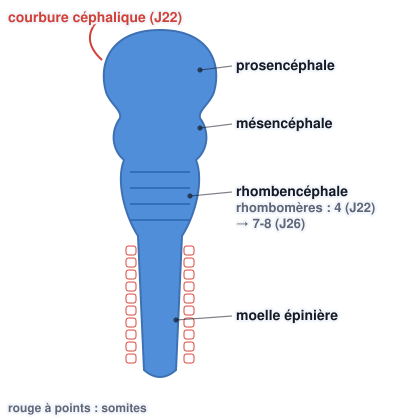
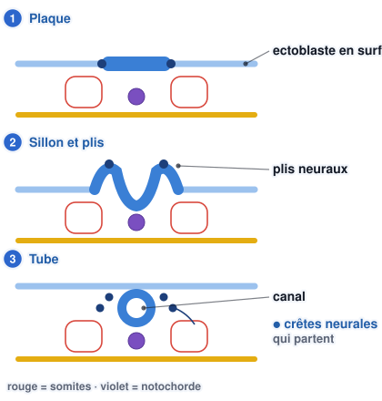

# 4e semaine : somites, tube neural, crêtes

7 schémas. Pour en afficher un dans le chat : ``.

## 0. Le schéma à savoir refaire de mémoire.

`https://cdn.jsdelivr.net/gh/alxhe3-lab/schemas-medecine@main/Anatomie/CM5/fig00-bae97955.svg`

## 1. Coupe transversale : où va le sclérotome

`https://cdn.jsdelivr.net/gh/alxhe3-lab/schemas-medecine@main/Anatomie/CM5/fig01-5ddc6d95.svg`

## 2. La resegmentation : les vertèbres se forment entre les somites, les nerfs sortent entre les vertèbres

`https://cdn.jsdelivr.net/gh/alxhe3-lab/schemas-medecine@main/Anatomie/CM5/fig02-0b361f79.svg`

## 3. Le disque intervertébral, vu de dessus

`https://cdn.jsdelivr.net/gh/alxhe3-lab/schemas-medecine@main/Anatomie/CM5/fig03-3ecc6354.svg`

## 4. Du dermatomyotome aux muscles et au derme

`https://cdn.jsdelivr.net/gh/alxhe3-lab/schemas-medecine@main/Anatomie/CM5/fig04-1a9bf9d9.svg`

## 5. La plaque neurale vers J22 (vue dorsale)

`https://cdn.jsdelivr.net/gh/alxhe3-lab/schemas-medecine@main/Anatomie/CM5/fig05-5d68b2b7.svg`

## 6. Trois étapes, en coupe transversale

`https://cdn.jsdelivr.net/gh/alxhe3-lab/schemas-medecine@main/Anatomie/CM5/fig06-e92b204b.svg`
