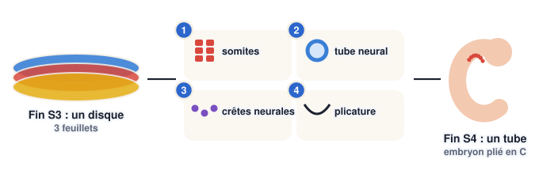
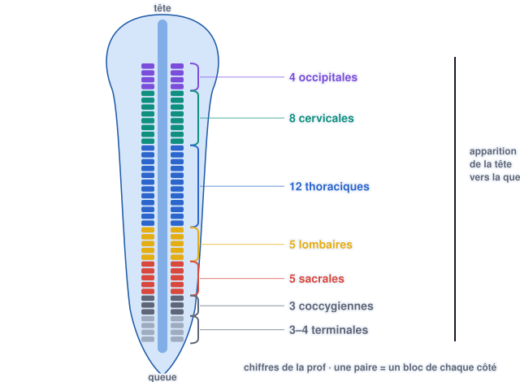
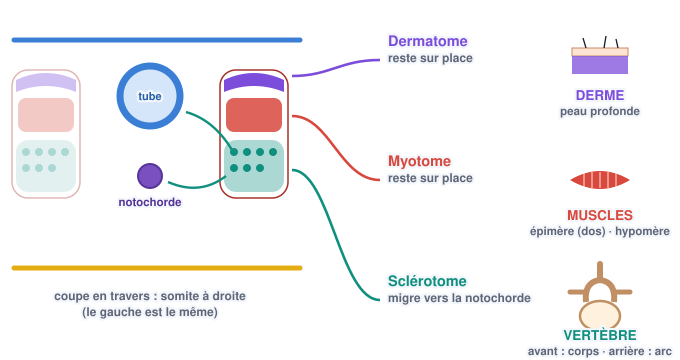
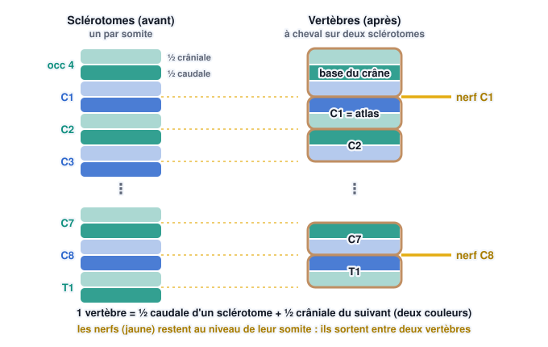
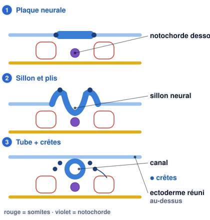
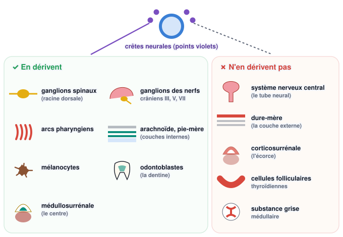
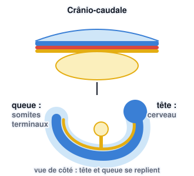
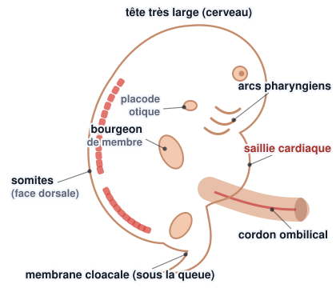
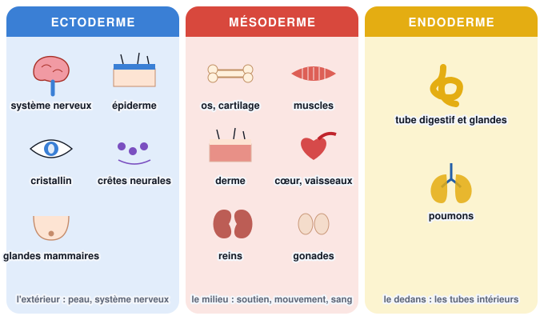

# La 4e semaine : du disque au tube

9 schémas. Pour en afficher un dans le chat : ``.

## 0. Ce qui change en une semaine : l'embryon plat à trois feuillets devient un tube plié, avec sa face ventrale et sa face dorsale.

`https://cdn.jsdelivr.net/gh/alxhe3-lab/schemas-medecine@main/Anatomie/CM6/fig00-484580be.svg`

## 1. Les paires de somites, de la tête à la queue (chiffres de la prof)

`https://cdn.jsdelivr.net/gh/alxhe3-lab/schemas-medecine@main/Anatomie/CM6/fig01-ce562d11.svg`

## 2. L'arbre du somite : qui donne quoi ?

`https://cdn.jsdelivr.net/gh/alxhe3-lab/schemas-medecine@main/Anatomie/CM6/fig02-c8002ac4.svg`

## 3. Les mêmes numéros : comment le nerf trouve sa place

`https://cdn.jsdelivr.net/gh/alxhe3-lab/schemas-medecine@main/Anatomie/CM6/fig03-3e158fa4.svg`

## 4. Trois coupes : la plaque se creuse, se ferme et lâche ses crêtes

`https://cdn.jsdelivr.net/gh/alxhe3-lab/schemas-medecine@main/Anatomie/CM6/fig04-3c981cc5.svg`

## 5. Dérive des crêtes neurales, ou pas ?

`https://cdn.jsdelivr.net/gh/alxhe3-lab/schemas-medecine@main/Anatomie/CM6/fig05-3dafcaaf.svg`

## 6. Une double plicature : dans la longueur et dans la largeur

`https://cdn.jsdelivr.net/gh/alxhe3-lab/schemas-medecine@main/Anatomie/CM6/fig06-457f8966.svg`

## 7. Où se trouve chaque structure sur l'embryon d'un mois ?

`https://cdn.jsdelivr.net/gh/alxhe3-lab/schemas-medecine@main/Anatomie/CM6/fig07-66a1e4b4.svg`

## 8. Que donne chaque feuillet ?

`https://cdn.jsdelivr.net/gh/alxhe3-lab/schemas-medecine@main/Anatomie/CM6/fig08-7c6d6bb1.svg`
