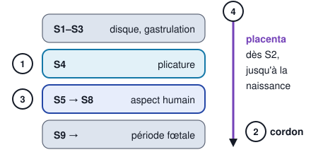
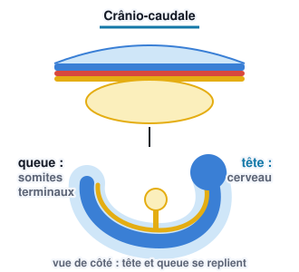
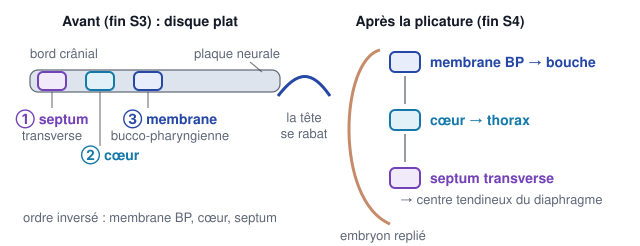
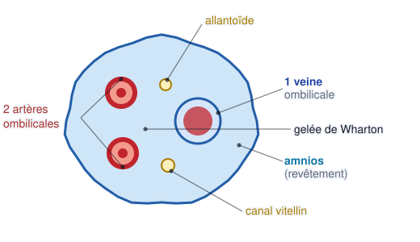
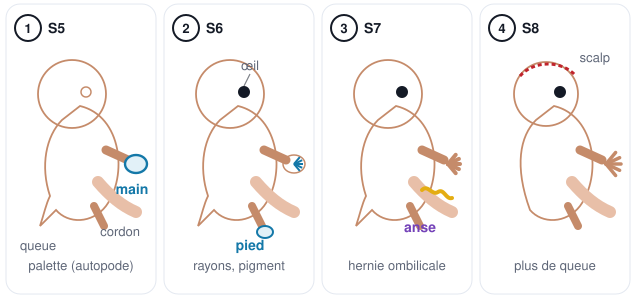
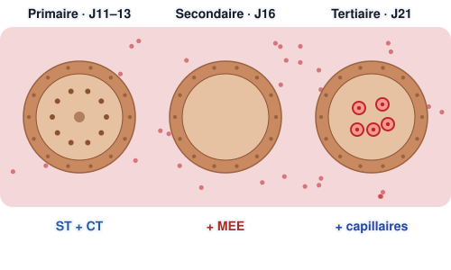
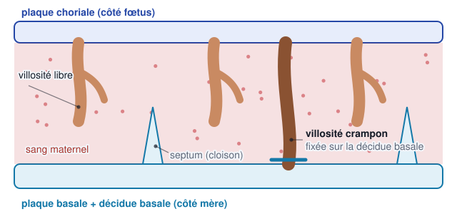
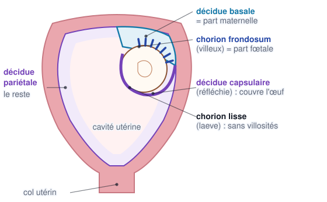

# Des semaines 5 à 8 au placenta

9 schémas. Pour en afficher un dans le chat : ``.

## 0. Où est-on ? La fin de la période embryonnaire, et le placenta qui l'accompagne.

`https://cdn.jsdelivr.net/gh/alxhe3-lab/schemas-medecine@main/Anatomie/CM7/fig00-1aa8baad.svg`

## 1. Les deux plicatures de la 4e semaine

`https://cdn.jsdelivr.net/gh/alxhe3-lab/schemas-medecine@main/Anatomie/CM7/fig01-ea6d2d7b.svg`

## 2. Pourquoi le cœur se retrouve-t-il dans le thorax ?

`https://cdn.jsdelivr.net/gh/alxhe3-lab/schemas-medecine@main/Anatomie/CM7/fig02-22aa1a23.svg`

## 3. Que trouve-t-on dans le cordon ? (coupe transversale)

`https://cdn.jsdelivr.net/gh/alxhe3-lab/schemas-medecine@main/Anatomie/CM7/fig03-2ef8681f.svg`

## 4. Une vignette par semaine : ce qui apparaît

`https://cdn.jsdelivr.net/gh/alxhe3-lab/schemas-medecine@main/Anatomie/CM7/fig04-fc8ff6e8.svg`

## 5. Les trois décidues et les deux chorions

`https://cdn.jsdelivr.net/gh/alxhe3-lab/schemas-medecine@main/Anatomie/CM7/fig05-635372fc.svg`

## 6. Qu'est-ce qu'une villosité tertiaire contient de plus ?

`https://cdn.jsdelivr.net/gh/alxhe3-lab/schemas-medecine@main/Anatomie/CM7/fig06-ea66f579.svg`

## 7. Qu'est-ce qui accroche le placenta à la mère ?

`https://cdn.jsdelivr.net/gh/alxhe3-lab/schemas-medecine@main/Anatomie/CM7/fig07-bc7c7c90.svg`

## 8. Le schéma à avoir en tête pour ces questions

`https://cdn.jsdelivr.net/gh/alxhe3-lab/schemas-medecine@main/Anatomie/CM7/fig08-635372fc.svg`
