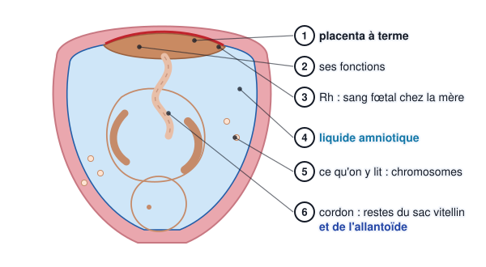
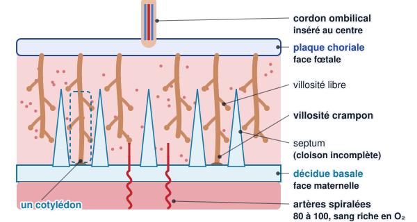
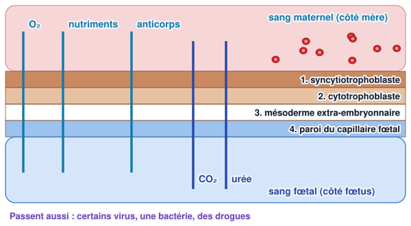
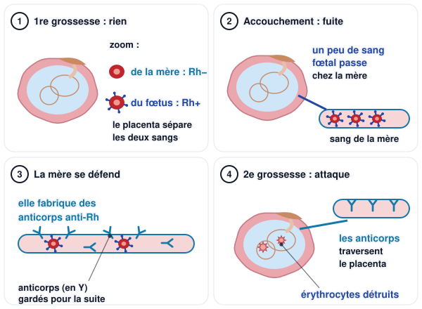
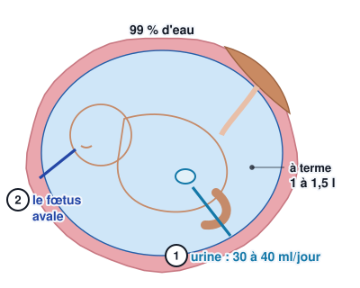
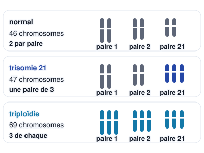
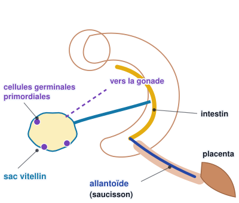
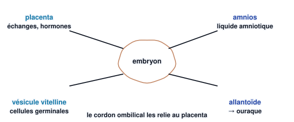

# Placenta, liquide amniotique et sac vitellin

8 schémas. Pour en afficher un dans le chat : ``.

## 0. L'utérus à terme : les numéros sont ceux des parties du cours.

`https://cdn.jsdelivr.net/gh/alxhe3-lab/schemas-medecine@main/Anatomie/CM8/fig00-dd62cf2f.svg`

## 1. Coupe du placenta à terme : qui est fœtal, qui est maternel ?

`https://cdn.jsdelivr.net/gh/alxhe3-lab/schemas-medecine@main/Anatomie/CM8/fig01-e2e91455.svg`

## 2. Que traverse la paroi de la villosité, et dans quel sens ?

`https://cdn.jsdelivr.net/gh/alxhe3-lab/schemas-medecine@main/Anatomie/CM8/fig02-54920531.svg`

## 3. Pourquoi c'est la deuxième grossesse qui est touchée ?

`https://cdn.jsdelivr.net/gh/alxhe3-lab/schemas-medecine@main/Anatomie/CM8/fig03-276745c4.svg`

## 4. Ce qui entre, ce qui sort, et quand le volume devient anormal

`https://cdn.jsdelivr.net/gh/alxhe3-lab/schemas-medecine@main/Anatomie/CM8/fig04-a6017ca5.svg`

## 5. Combien de chromosomes, et comment on le voit sur la main ?

`https://cdn.jsdelivr.net/gh/alxhe3-lab/schemas-medecine@main/Anatomie/CM8/fig05-f28465fb.svg`

## 6. D'où viennent l'ouraque et le diverticule de Meckel ?

`https://cdn.jsdelivr.net/gh/alxhe3-lab/schemas-medecine@main/Anatomie/CM8/fig06-8588b570.svg`

## 7. Le schéma à avoir en tête pour ces questions

`https://cdn.jsdelivr.net/gh/alxhe3-lab/schemas-medecine@main/Anatomie/CM8/fig07-ba2fb271.svg`
