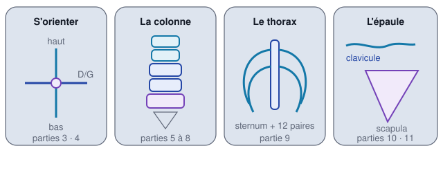
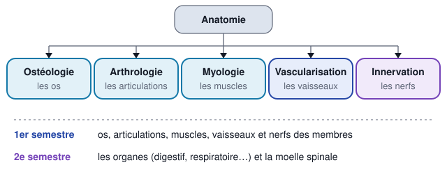
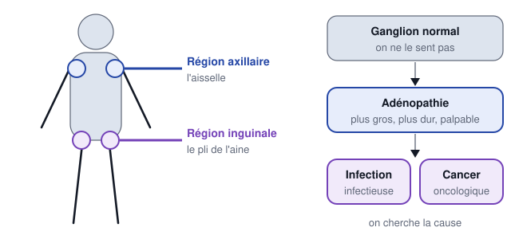
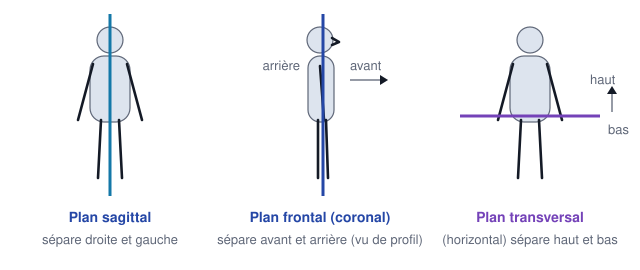
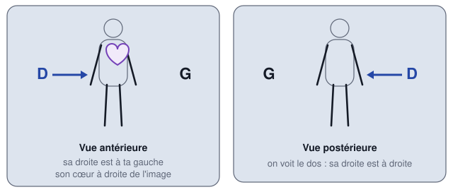
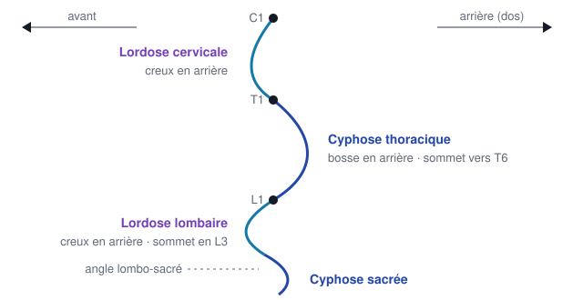
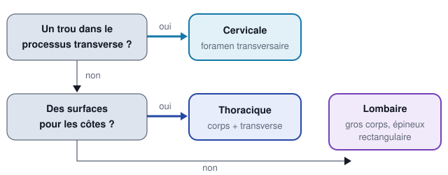
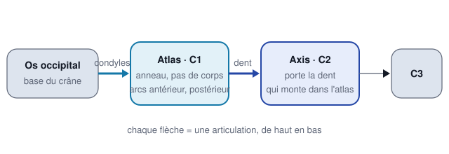
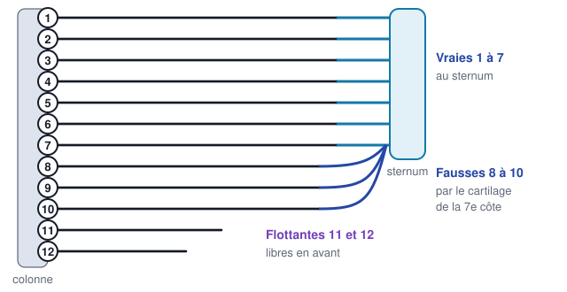
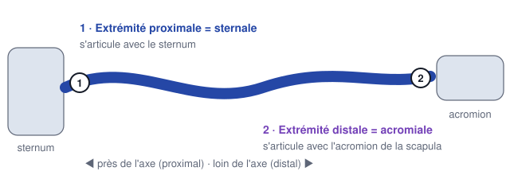

# S'orienter, la colonne, le thorax et l'épaule

10 schémas. Pour en afficher un dans le chat : ``.

## 0. Du plus général (s'orienter) au plus précis : l'axe du corps, puis la ceinture de l'épaule.

`https://cdn.jsdelivr.net/gh/alxhe3-lab/schemas-medecine@main/Anatomie/TP1/fig00-b5769e30.svg`

## 1. Cinq branches, deux semestres

`https://cdn.jsdelivr.net/gh/alxhe3-lab/schemas-medecine@main/Anatomie/TP1/fig01-3f5f80ac.svg`

## 2. Où palper, et que veut dire un ganglion palpable ?

`https://cdn.jsdelivr.net/gh/alxhe3-lab/schemas-medecine@main/Anatomie/TP1/fig02-d9fa5c20.svg`

## 3. Où passe chaque plan ?

`https://cdn.jsdelivr.net/gh/alxhe3-lab/schemas-medecine@main/Anatomie/TP1/fig03-059d3f5d.svg`

## 5. Où est la droite du sujet ?

`https://cdn.jsdelivr.net/gh/alxhe3-lab/schemas-medecine@main/Anatomie/TP1/fig05-3d2344c7.svg`

## 7. Quatre courbures qui alternent

`https://cdn.jsdelivr.net/gh/alxhe3-lab/schemas-medecine@main/Anatomie/TP1/fig07-76aa0fdd.svg`

## 9. La clé d'identification (proposée)

`https://cdn.jsdelivr.net/gh/alxhe3-lab/schemas-medecine@main/Anatomie/TP1/fig09-ea796ac4.svg`

## 13. De la tête à C3

`https://cdn.jsdelivr.net/gh/alxhe3-lab/schemas-medecine@main/Anatomie/TP1/fig13-733f8023.svg`

## 18. En arrière, toutes à la colonne ; en avant, trois cas

`https://cdn.jsdelivr.net/gh/alxhe3-lab/schemas-medecine@main/Anatomie/TP1/fig18-f5e07f5b.svg`

## 20. Ses deux extrémités

`https://cdn.jsdelivr.net/gh/alxhe3-lab/schemas-medecine@main/Anatomie/TP1/fig20-dfda2092.svg`
