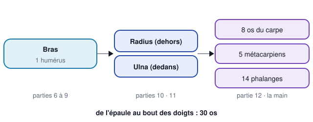
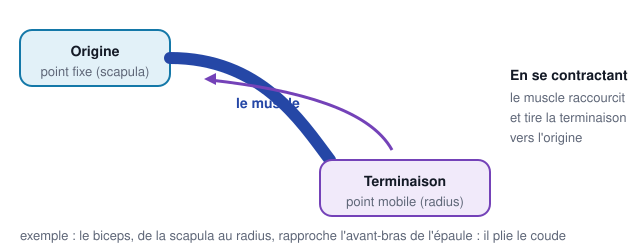
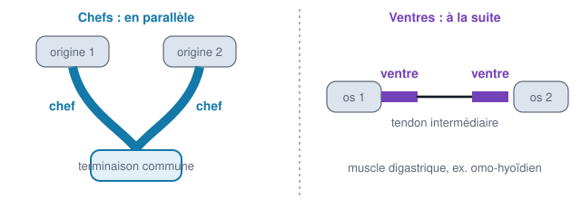
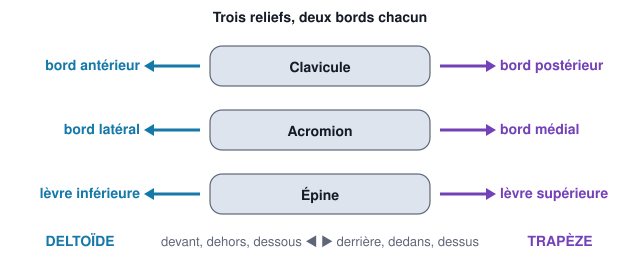
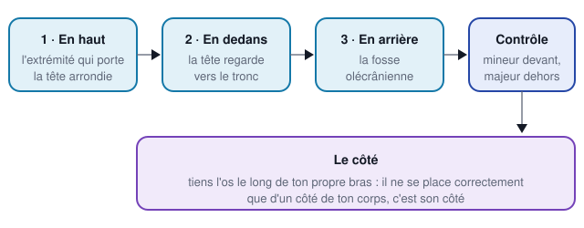
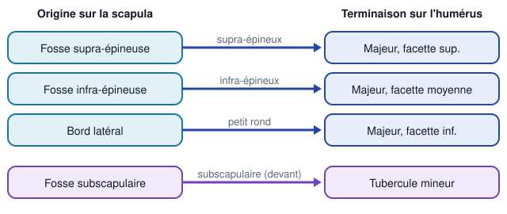
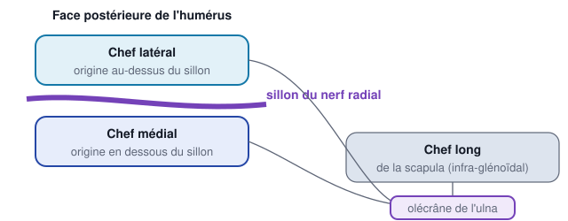
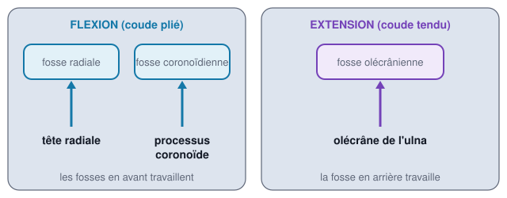
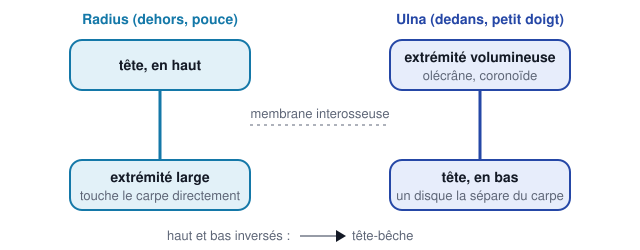
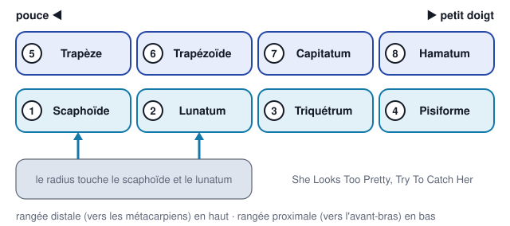

# Le membre supérieur libre : humérus, radius, ulna, main

10 schémas. Pour en afficher un dans le chat : ``.

## 0. Un os au bras, deux à l'avant-bras, vingt-sept à la main.

`https://cdn.jsdelivr.net/gh/alxhe3-lab/schemas-medecine@main/Anatomie/TP2/fig00-dbe1e149.svg`

## 1. Dans quel sens tire un muscle ?

`https://cdn.jsdelivr.net/gh/alxhe3-lab/schemas-medecine@main/Anatomie/TP2/fig01-937f4c9b.svg`

## 2. Deux façons d'assembler des parties charnues

`https://cdn.jsdelivr.net/gh/alxhe3-lab/schemas-medecine@main/Anatomie/TP2/fig02-26e109a4.svg`

## 5. Deltoïde et trapèze : deux muscles en miroir

`https://cdn.jsdelivr.net/gh/alxhe3-lab/schemas-medecine@main/Anatomie/TP2/fig05-94b1e9bb.svg`

## 9. La clé du côté, étape par étape

`https://cdn.jsdelivr.net/gh/alxhe3-lab/schemas-medecine@main/Anatomie/TP2/fig09-593152cd.svg`

## 10. Ce qui part le plus haut se termine le plus haut

`https://cdn.jsdelivr.net/gh/alxhe3-lab/schemas-medecine@main/Anatomie/TP2/fig10-05bffb97.svg`

## 11. Le nerf radial passe entre les chefs du triceps

`https://cdn.jsdelivr.net/gh/alxhe3-lab/schemas-medecine@main/Anatomie/TP2/fig11-32d6e16c.svg`

## 13. Plié ou tendu : quel os entre dans quelle fosse ?

`https://cdn.jsdelivr.net/gh/alxhe3-lab/schemas-medecine@main/Anatomie/TP2/fig13-14d8d978.svg`

## 18. Deux os tête-bêche

`https://cdn.jsdelivr.net/gh/alxhe3-lab/schemas-medecine@main/Anatomie/TP2/fig18-a33a4e0a.svg`

## 19. Chaque os à sa place, dans l'ordre

`https://cdn.jsdelivr.net/gh/alxhe3-lab/schemas-medecine@main/Anatomie/TP2/fig19-935a47c9.svg`
