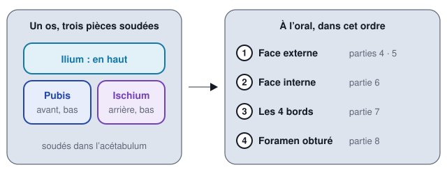
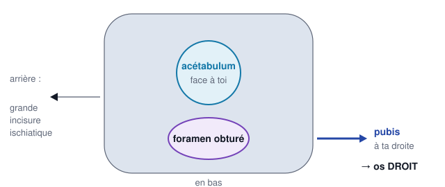
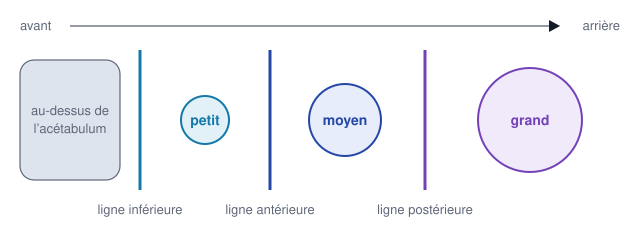
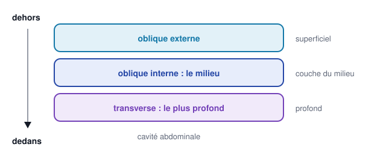
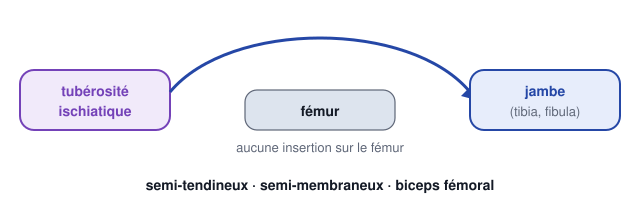
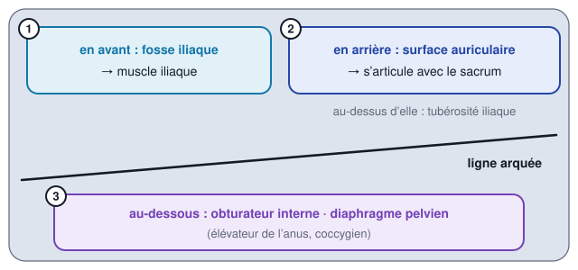
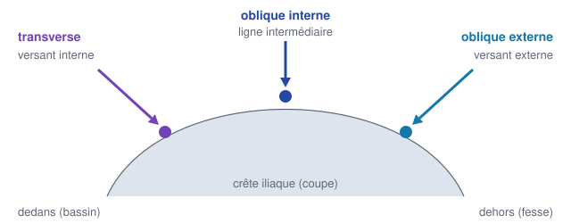
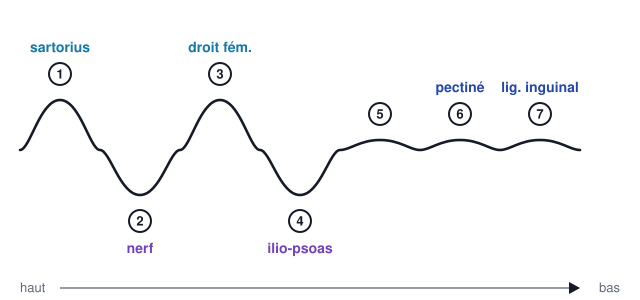
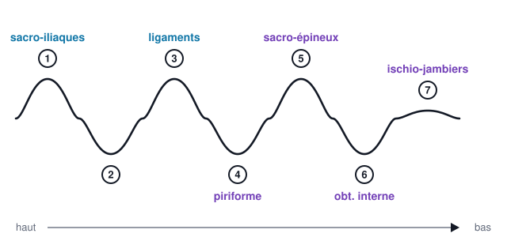
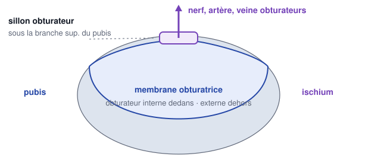

# L'os coxal

10 schémas. Pour en afficher un dans le chat : ``.

## 0. Le fil du cours : découper l'os en trois, puis le décrire face par face, bord par bord.

`https://cdn.jsdelivr.net/gh/alxhe3-lab/schemas-medecine@main/Anatomie/TP3/fig00-41560435.svg`

## 5. Acétabulum face à toi : de quel côté est le pubis ?

`https://cdn.jsdelivr.net/gh/alxhe3-lab/schemas-medecine@main/Anatomie/TP3/fig05-cae4e75b.svg`

## 9. Pourquoi trois lignes ? Elles séparent les trois fessiers

`https://cdn.jsdelivr.net/gh/alxhe3-lab/schemas-medecine@main/Anatomie/TP3/fig09-fa36dad6.svg`

## 11. Les trois muscles larges : qui est où, de dehors en dedans ?

`https://cdn.jsdelivr.net/gh/alxhe3-lab/schemas-medecine@main/Anatomie/TP3/fig11-1ba1a3d4.svg`

## 12. Pourquoi « ischio-jambiers » ? De l'ischium à la jambe

`https://cdn.jsdelivr.net/gh/alxhe3-lab/schemas-medecine@main/Anatomie/TP3/fig12-1bf286f9.svg`

## 14. Ce que la ligne arquée sépare

`https://cdn.jsdelivr.net/gh/alxhe3-lab/schemas-medecine@main/Anatomie/TP3/fig14-9c6a2fe9.svg`

## 15. Pourquoi trois muscles sur trois lignes ? La crête reproduit les couches de la paroi

`https://cdn.jsdelivr.net/gh/alxhe3-lab/schemas-medecine@main/Anatomie/TP3/fig15-42bb1fc9.svg`

## 17. Les sept reliefs du bord antérieur, dans l'ordre (mêmes numéros que la liste)

`https://cdn.jsdelivr.net/gh/alxhe3-lab/schemas-medecine@main/Anatomie/TP3/fig17-ac3c581c.svg`

## 19. Les sept reliefs du bord postérieur, dans l'ordre

`https://cdn.jsdelivr.net/gh/alxhe3-lab/schemas-medecine@main/Anatomie/TP3/fig19-9633256d.svg`

## 20. Fermé partout, sauf en haut

`https://cdn.jsdelivr.net/gh/alxhe3-lab/schemas-medecine@main/Anatomie/TP3/fig20-6d1815b4.svg`
