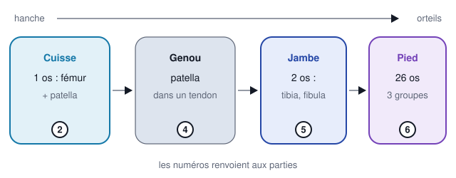
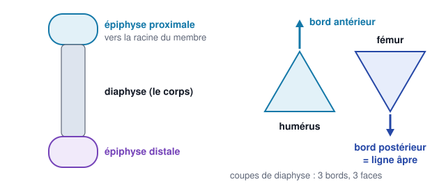
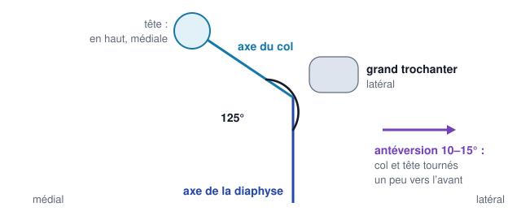
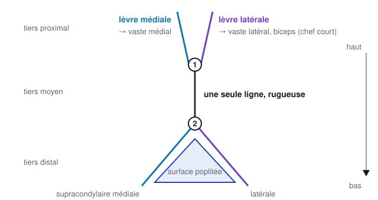
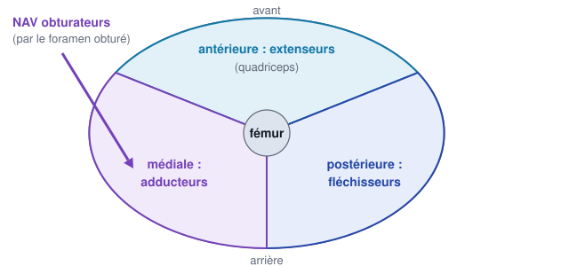
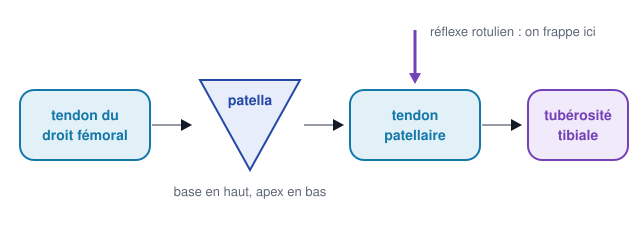
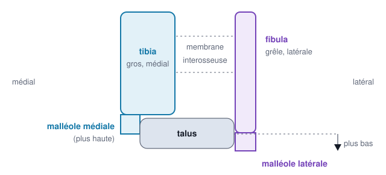
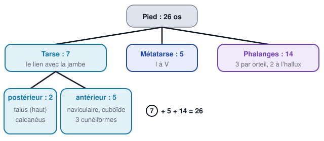
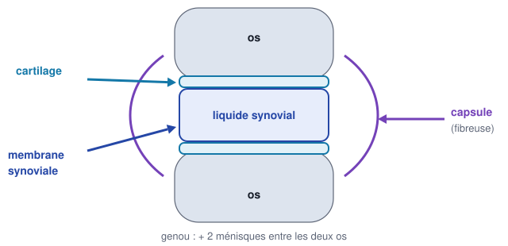

# Le squelette du membre inférieur libre

9 schémas. Pour en afficher un dans le chat : ``.

## 0. Le fil du cours : un os à la cuisse, deux à la jambe, puis le pied, comme au membre supérieur.

`https://cdn.jsdelivr.net/gh/alxhe3-lab/schemas-medecine@main/Anatomie/TP4/fig00-4864e6f8.svg`

## 1. De quoi est fait un os long, et où est son bord saillant ?

`https://cdn.jsdelivr.net/gh/alxhe3-lab/schemas-medecine@main/Anatomie/TP4/fig01-a337c6db.svg`

## 3. Comment le col est-il incliné ?

`https://cdn.jsdelivr.net/gh/alxhe3-lab/schemas-medecine@main/Anatomie/TP4/fig03-d238e84c.svg`

## 4. Comment la ligne âpre change-t-elle de haut en bas ?

`https://cdn.jsdelivr.net/gh/alxhe3-lab/schemas-medecine@main/Anatomie/TP4/fig04-165243b4.svg`

## 5. Qui est où dans la cuisse ?

`https://cdn.jsdelivr.net/gh/alxhe3-lab/schemas-medecine@main/Anatomie/TP4/fig05-75391eb4.svg`

## 7. Dans quel tendon est la patella ?

`https://cdn.jsdelivr.net/gh/alxhe3-lab/schemas-medecine@main/Anatomie/TP4/fig07-91bc23c6.svg`

## 11. Malléole médiale ou latérale : quel os ?

`https://cdn.jsdelivr.net/gh/alxhe3-lab/schemas-medecine@main/Anatomie/TP4/fig11-a52cb8dc.svg`

## 13. Comment sont rangés les os du pied ?

`https://cdn.jsdelivr.net/gh/alxhe3-lab/schemas-medecine@main/Anatomie/TP4/fig13-32aee899.svg`

## 17. De quoi est faite une articulation mobile ?

`https://cdn.jsdelivr.net/gh/alxhe3-lab/schemas-medecine@main/Anatomie/TP4/fig17-acf2191c.svg`
