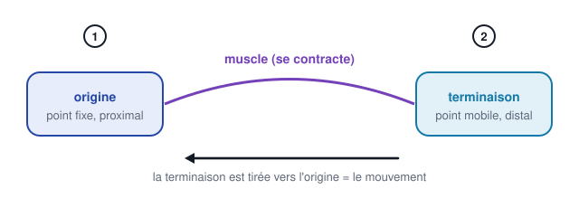
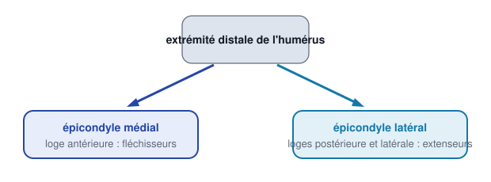

# Muscles de la ceinture scapulaire et du membre supérieur

2 schémas. Pour en afficher un dans le chat : ``.

## 0. La règle de la prof : l'origine tire la terminaison, comme une poulie.

`https://cdn.jsdelivr.net/gh/alxhe3-lab/schemas-medecine@main/Anatomie/TP5/fig00-271ee2b5.svg`

## 1. Quel épicondyle pour quelle loge de l'avant-bras ?

`https://cdn.jsdelivr.net/gh/alxhe3-lab/schemas-medecine@main/Anatomie/TP5/fig01-27ea9581.svg`
