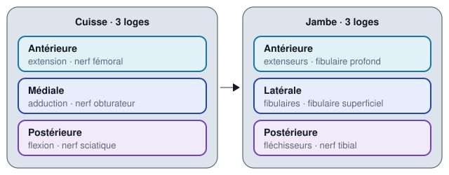
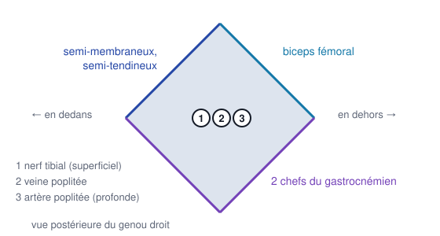

# Les muscles de la cuisse, de la jambe et du pied

2 schémas. Pour en afficher un dans le chat : ``.

## 0. La seule différence entre cuisse et jambe : la cuisse a une loge médiale, la jambe une loge latérale.

`https://cdn.jsdelivr.net/gh/alxhe3-lab/schemas-medecine@main/Anatomie/TP6/fig00-ee959cba.svg`

## 6. La fosse poplitée : un losange derrière le genou

`https://cdn.jsdelivr.net/gh/alxhe3-lab/schemas-medecine@main/Anatomie/TP6/fig06-e21d33f7.svg`
