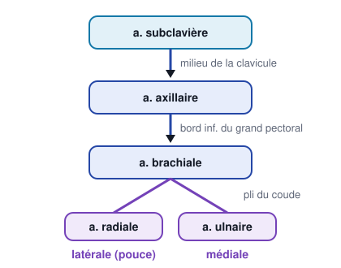
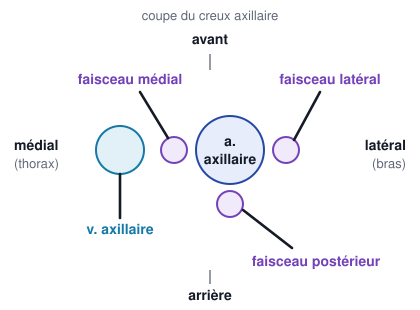
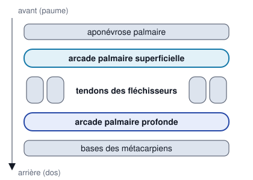
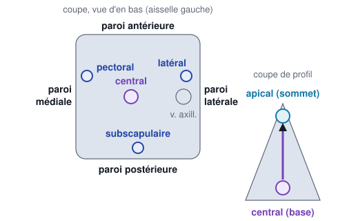
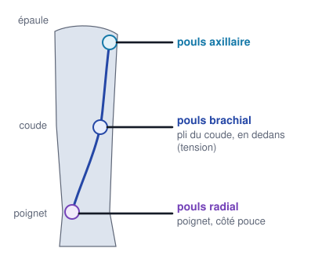

# Vascularisation du membre supérieur

5 schémas. Pour en afficher un dans le chat : ``.

## 1. Où l'artère change-t-elle de nom ?

`https://cdn.jsdelivr.net/gh/alxhe3-lab/schemas-medecine@main/Anatomie/TP7/fig01-eb78a549.svg`

## 3. Pourquoi les faisceaux s'appellent-ils médial, latéral, postérieur ?

`https://cdn.jsdelivr.net/gh/alxhe3-lab/schemas-medecine@main/Anatomie/TP7/fig03-acd236c0.svg`

## 8. Comment les deux arcades se placent-elles par rapport aux tendons ?

`https://cdn.jsdelivr.net/gh/alxhe3-lab/schemas-medecine@main/Anatomie/TP7/fig08-3dc6743e.svg`

## 12. Où se trouve chaque groupe dans le creux axillaire ? (la lymphe remonte vers le sommet)

`https://cdn.jsdelivr.net/gh/alxhe3-lab/schemas-medecine@main/Anatomie/TP7/fig12-1ae4257b.svg`

## 14. Où prend-on le pouls au membre supérieur ?

`https://cdn.jsdelivr.net/gh/alxhe3-lab/schemas-medecine@main/Anatomie/TP7/fig14-63f809f5.svg`
