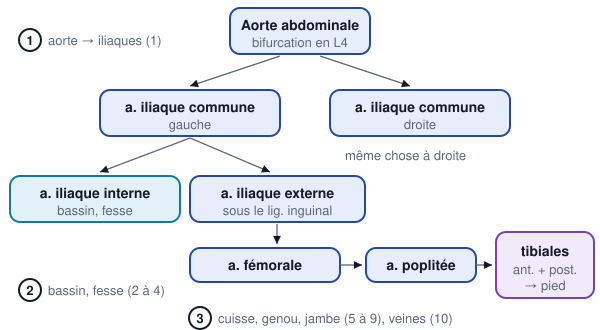
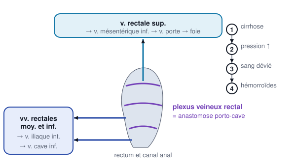
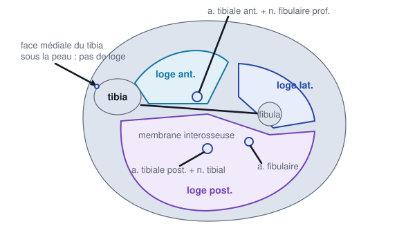

# Vaisseaux du bassin et du membre inférieur

3 schémas. Pour en afficher un dans le chat : ``.

## 0. Une seule artère change de nom en descendant : iliaque externe → fémorale → poplitée → tibiales ; l'iliaque interne reste pour le bassin et la fesse.

`https://cdn.jsdelivr.net/gh/alxhe3-lab/schemas-medecine@main/Anatomie/TP8/fig00-199fa6cd.svg`

## 3. Pourquoi une cirrhose donne-t-elle des hémorroïdes ?

`https://cdn.jsdelivr.net/gh/alxhe3-lab/schemas-medecine@main/Anatomie/TP8/fig03-90756bf0.svg`

## 13. Pourquoi la jambe n'a-t-elle pas de loge médiale ?

`https://cdn.jsdelivr.net/gh/alxhe3-lab/schemas-medecine@main/Anatomie/TP8/fig13-3b8248be.svg`
