# Généralités : les bases de chimie du vivant

15 schémas. Pour en afficher un dans le chat : ``.

## 0. On monte des atomes jusqu'aux grandes molécules du vivant.

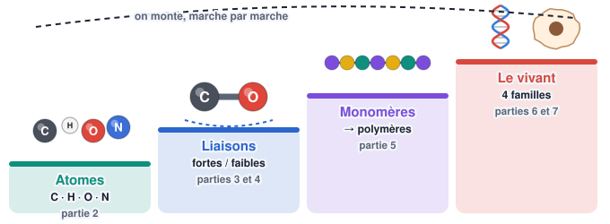

`https://cdn.jsdelivr.net/gh/alxhe3-lab/schemas-medecine@main/Biochimie/CM1/fig00-627f718e.svg`

## 1. Comment une molécule modifiée donne une maladie

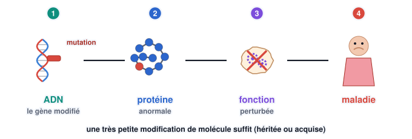

`https://cdn.jsdelivr.net/gh/alxhe3-lab/schemas-medecine@main/Biochimie/CM1/fig01-ff2c0420.svg`

## 2. Que veulent dire les deux nombres du carbone 12 ?

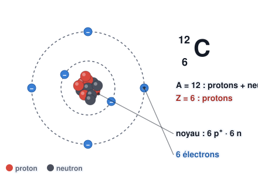

`https://cdn.jsdelivr.net/gh/alxhe3-lab/schemas-medecine@main/Biochimie/CM1/fig02-6bd7b2ab.svg`

## 3. Où l'électronégativité est-elle la plus forte ?

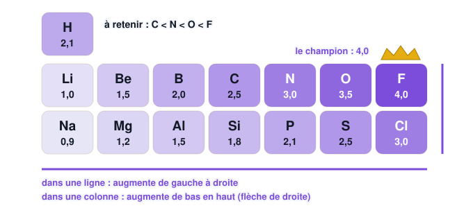

`https://cdn.jsdelivr.net/gh/alxhe3-lab/schemas-medecine@main/Biochimie/CM1/fig03-a0549715.svg`

## 4. Pourquoi H porte-t-il δ+ et Cl δ− ?

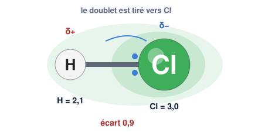

`https://cdn.jsdelivr.net/gh/alxhe3-lab/schemas-medecine@main/Biochimie/CM1/fig04-9936ca02.svg`

## 5. Qui tient la chaîne, qui tient la forme ?

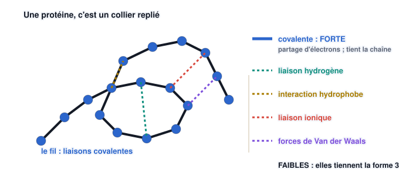

`https://cdn.jsdelivr.net/gh/alxhe3-lab/schemas-medecine@main/Biochimie/CM1/fig05-84a764d8.svg`

## 6. Quelle liaison selon l'écart d'électronégativité ?

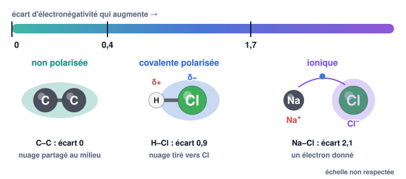

`https://cdn.jsdelivr.net/gh/alxhe3-lab/schemas-medecine@main/Biochimie/CM1/fig06-ee0be72a.svg`

## 7. D'où viennent les deux électrons de la liaison N → H ?

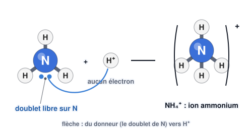

`https://cdn.jsdelivr.net/gh/alxhe3-lab/schemas-medecine@main/Biochimie/CM1/fig07-11698094.svg`

## 8. Où trouve-t-on des liaisons hydrogène ?

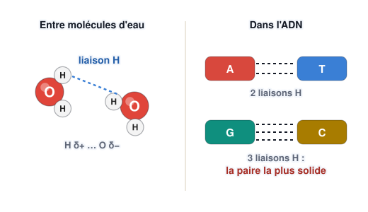

`https://cdn.jsdelivr.net/gh/alxhe3-lab/schemas-medecine@main/Biochimie/CM1/fig08-07b1a819.svg`

## 9. Que signifie chaque flèche ?

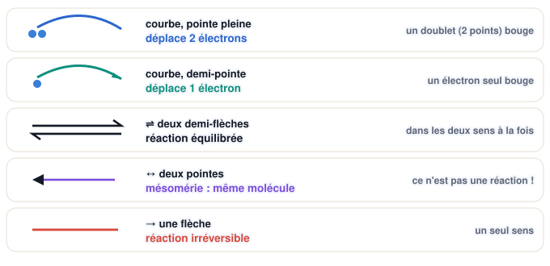

`https://cdn.jsdelivr.net/gh/alxhe3-lab/schemas-medecine@main/Biochimie/CM1/fig09-f40c9a1d.svg`

## 10. Que devient l'eau quand on construit ou qu'on casse ?

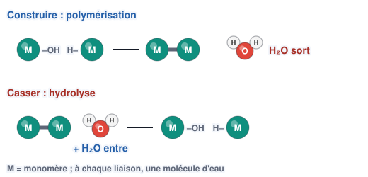

`https://cdn.jsdelivr.net/gh/alxhe3-lab/schemas-medecine@main/Biochimie/CM1/fig10-ab14250a.svg`

## 11. Quelle est la brique de chaque famille ?

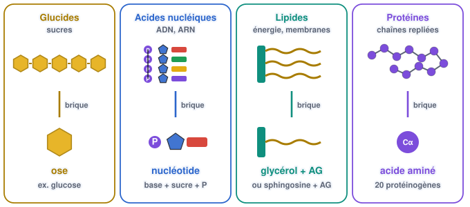

`https://cdn.jsdelivr.net/gh/alxhe3-lab/schemas-medecine@main/Biochimie/CM1/fig11-cc9e88a1.svg`

## 12. Comment les quatre lipides sont-ils construits ?

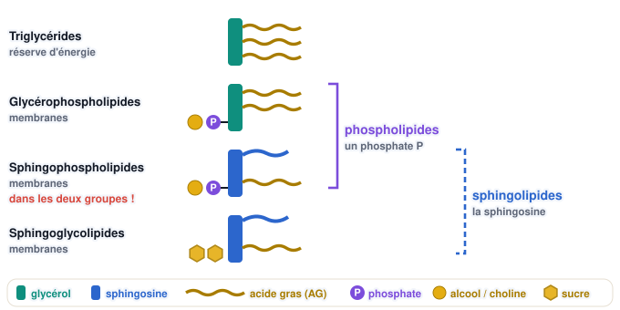

`https://cdn.jsdelivr.net/gh/alxhe3-lab/schemas-medecine@main/Biochimie/CM1/fig12-60d7f98d.svg`

## 13. Comment une chaîne devient-elle une protéine ?

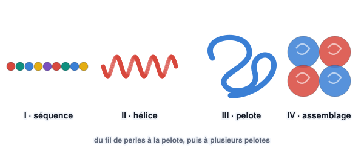

`https://cdn.jsdelivr.net/gh/alxhe3-lab/schemas-medecine@main/Biochimie/CM1/fig13-2beb21e5.svg`

## 14. Que porte le carbone α d'un acide aminé ?

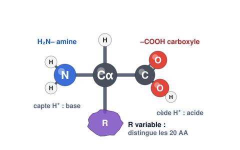

`https://cdn.jsdelivr.net/gh/alxhe3-lab/schemas-medecine@main/Biochimie/CM1/fig14-8396ea52.svg`
