# Peptides et protéines

19 schémas. Pour en afficher un dans le chat : ``.

## 0. De l'acide aminé à la protéine repliée.

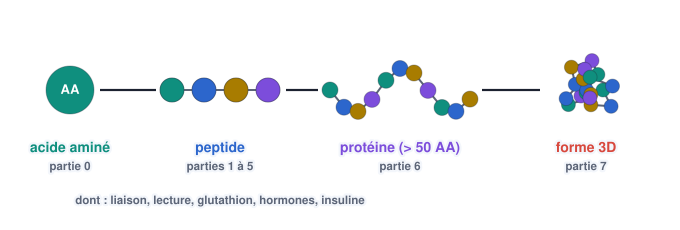

`https://cdn.jsdelivr.net/gh/alxhe3-lab/schemas-medecine@main/Biochimie/CM2/fig00-a43312fb.svg`

## 1. Dans quelle famille range-t-on chaque acide aminé ?

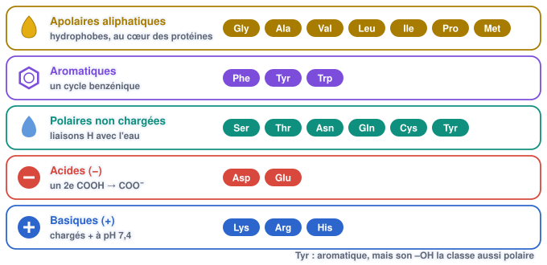

`https://cdn.jsdelivr.net/gh/alxhe3-lab/schemas-medecine@main/Biochimie/CM2/fig01-c4594126.svg`

## 2. Quelle forme porte un groupe, selon que le pH est sous ou au-dessus de son pKa ?

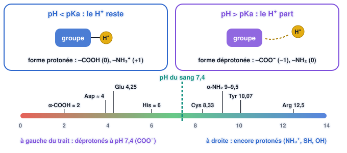

`https://cdn.jsdelivr.net/gh/alxhe3-lab/schemas-medecine@main/Biochimie/CM2/fig02-ee1c9750.svg`

## 3. Comment calculer la charge nette ?

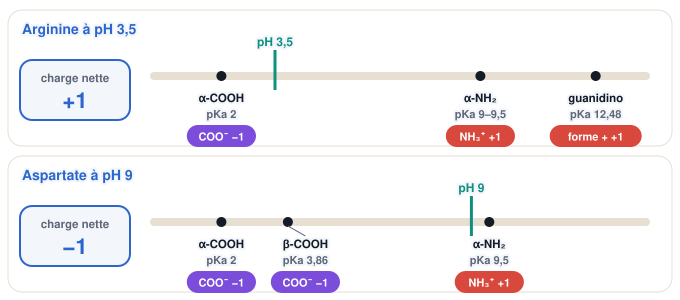

`https://cdn.jsdelivr.net/gh/alxhe3-lab/schemas-medecine@main/Biochimie/CM2/fig03-a6abf21b.svg`

## 4. Qu'est-ce qui part quand deux acides aminés se lient ?

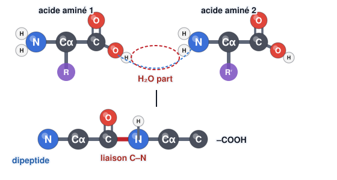

`https://cdn.jsdelivr.net/gh/alxhe3-lab/schemas-medecine@main/Biochimie/CM2/fig04-8afeec8d.svg`

## 5. D'où vient la souplesse d'une chaîne faite de liaisons rigides ?

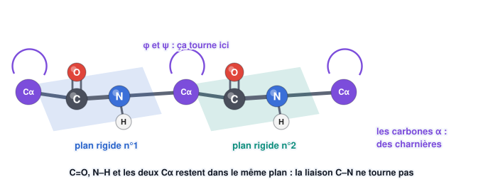

`https://cdn.jsdelivr.net/gh/alxhe3-lab/schemas-medecine@main/Biochimie/CM2/fig05-8ea89eee.svg`

## 6. Cis ou trans : pourquoi la chaîne choisit-elle trans ?

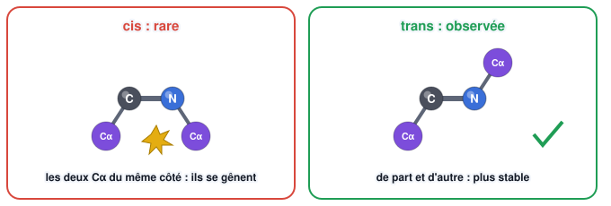

`https://cdn.jsdelivr.net/gh/alxhe3-lab/schemas-medecine@main/Biochimie/CM2/fig06-5ebadc42.svg`

## 7. Par quel bout commence-t-on à lire ?

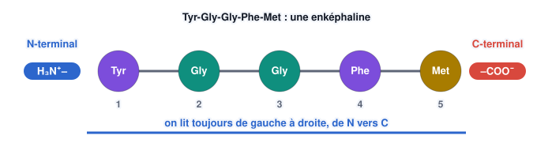

`https://cdn.jsdelivr.net/gh/alxhe3-lab/schemas-medecine@main/Biochimie/CM2/fig07-82d8120c.svg`

## 8. Qu'a de particulier la liaison Glu–Cys du glutathion ?

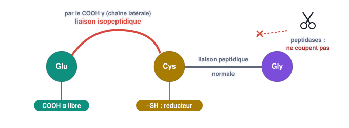

`https://cdn.jsdelivr.net/gh/alxhe3-lab/schemas-medecine@main/Biochimie/CM2/fig08-b6c2ee81.svg`

## 9. Comment l'hypothalamus commande-t-il une glande ?

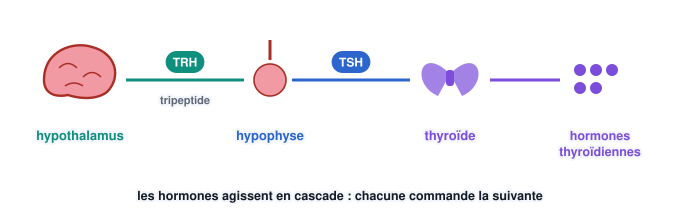

`https://cdn.jsdelivr.net/gh/alxhe3-lab/schemas-medecine@main/Biochimie/CM2/fig09-cf1498c6.svg`

## 10. Ocytocine et vasopressine : qu'est-ce qui les distingue ?

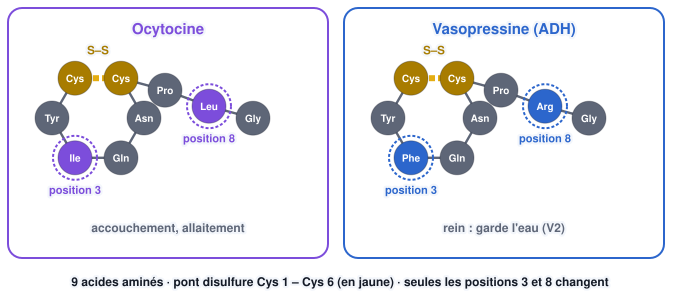

`https://cdn.jsdelivr.net/gh/alxhe3-lab/schemas-medecine@main/Biochimie/CM2/fig10-65b458a0.svg`

## 11. Pourquoi la morphine calme-t-elle la douleur ?

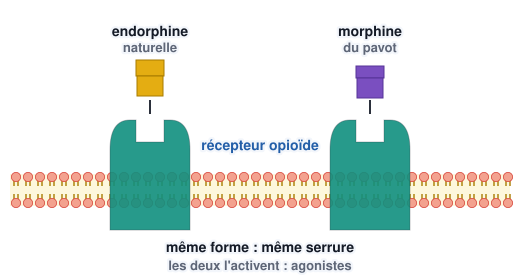

`https://cdn.jsdelivr.net/gh/alxhe3-lab/schemas-medecine@main/Biochimie/CM2/fig11-7882fb5f.svg`

## 12. Comment passe-t-on d'une protéine à l'angiotensine II ?

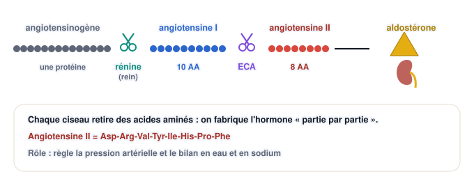

`https://cdn.jsdelivr.net/gh/alxhe3-lab/schemas-medecine@main/Biochimie/CM2/fig12-edd147da.svg`

## 13. Qui baisse, qui augmente la glycémie ?

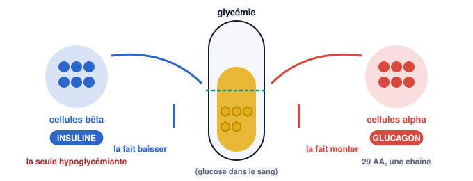

`https://cdn.jsdelivr.net/gh/alxhe3-lab/schemas-medecine@main/Biochimie/CM2/fig13-1c8db356.svg`

## 14. Comment la préproinsuline devient-elle insuline ?

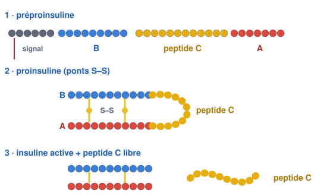

`https://cdn.jsdelivr.net/gh/alxhe3-lab/schemas-medecine@main/Biochimie/CM2/fig14-613fbbe7.svg`

## 15. Le patient s'est-il injecté son insuline ?

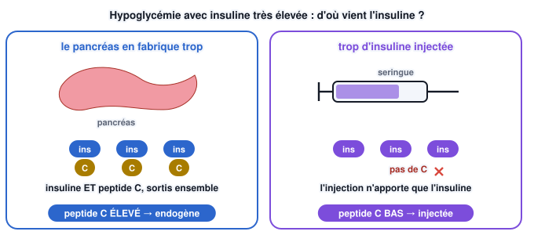

`https://cdn.jsdelivr.net/gh/alxhe3-lab/schemas-medecine@main/Biochimie/CM2/fig15-0bdc1849.svg`

## 16. Fibreuse ou globulaire : à quoi le voit-on ?

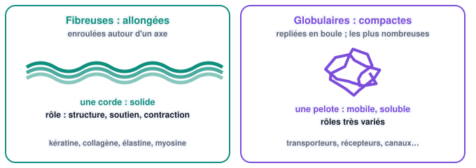

`https://cdn.jsdelivr.net/gh/alxhe3-lab/schemas-medecine@main/Biochimie/CM2/fig16-bbe45914.svg`

## 17. De quoi est faite une hétéroprotéine comme l'hémoglobine ?

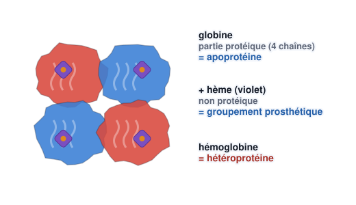

`https://cdn.jsdelivr.net/gh/alxhe3-lab/schemas-medecine@main/Biochimie/CM2/fig17-13ea79f7.svg`

## 18. Quels sont les quatre étages, et qui les a ?

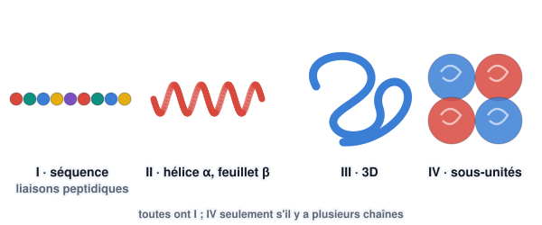

`https://cdn.jsdelivr.net/gh/alxhe3-lab/schemas-medecine@main/Biochimie/CM2/fig18-7c5f8263.svg`
