# Structure des protéines

18 schémas. Pour en afficher un dans le chat : ``.

## 0. De la chaîne à l'assemblage, puis ce qui défait la forme.

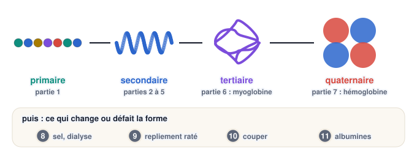

`https://cdn.jsdelivr.net/gh/alxhe3-lab/schemas-medecine@main/Biochimie/CM3/fig00-0cdee3c2.svg`

## 1. Quelle liaison tient quel étage ?

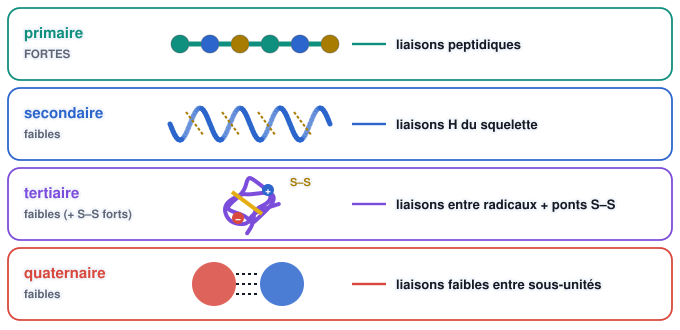

`https://cdn.jsdelivr.net/gh/alxhe3-lab/schemas-medecine@main/Biochimie/CM3/fig01-19d9cdd3.svg`

## 2. Entre quels acides aminés se fait la liaison H ?

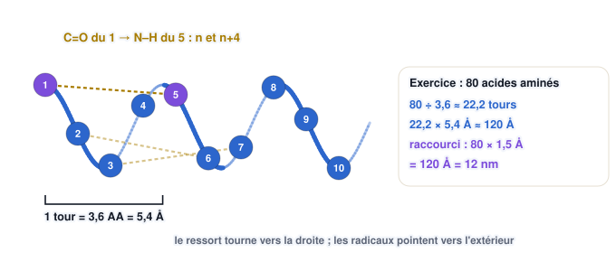

`https://cdn.jsdelivr.net/gh/alxhe3-lab/schemas-medecine@main/Biochimie/CM3/fig02-0309bd5a.svg`

## 3. Parallèle ou antiparallèle : lequel est le plus stable ?

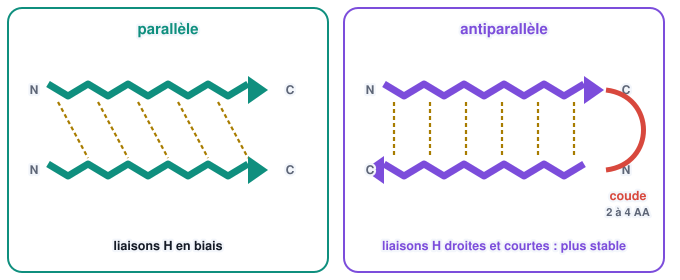

`https://cdn.jsdelivr.net/gh/alxhe3-lab/schemas-medecine@main/Biochimie/CM3/fig03-80083c11.svg`

## 4. Dans quel sens tournent les chaînes, puis le câble ?

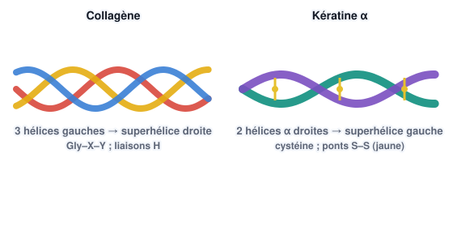

`https://cdn.jsdelivr.net/gh/alxhe3-lab/schemas-medecine@main/Biochimie/CM3/fig04-aa921f57.svg`

## 5. Pourquoi manquer de vitamine C rend-il le collagène fragile ?

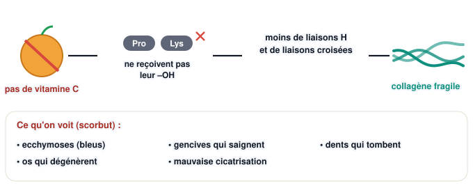

`https://cdn.jsdelivr.net/gh/alxhe3-lab/schemas-medecine@main/Biochimie/CM3/fig05-e0b122f2.svg`

## 6. Où le calcium se loge-t-il dans la main EF ?

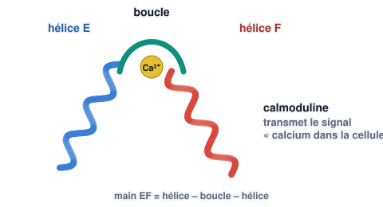

`https://cdn.jsdelivr.net/gh/alxhe3-lab/schemas-medecine@main/Biochimie/CM3/fig06-d5303522.svg`

## 7. Que lie le fer de l'hème, position par position ?

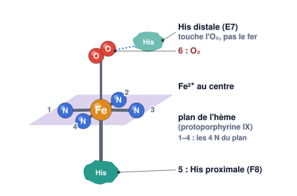

`https://cdn.jsdelivr.net/gh/alxhe3-lab/schemas-medecine@main/Biochimie/CM3/fig07-6739ab19.svg`

## 8. Comment l'hémoglobine est-elle assemblée ?

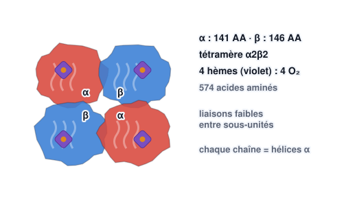

`https://cdn.jsdelivr.net/gh/alxhe3-lab/schemas-medecine@main/Biochimie/CM3/fig08-de50e24b.svg`

## 9. Comment un seul acide aminé déforme-t-il le globule rouge ?

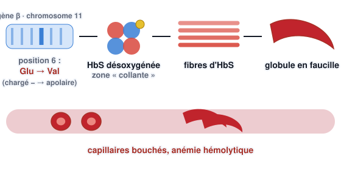

`https://cdn.jsdelivr.net/gh/alxhe3-lab/schemas-medecine@main/Biochimie/CM3/fig09-0b6c5f2e.svg`

## 10. Comment la quantité de sel change-t-elle la solubilité ?

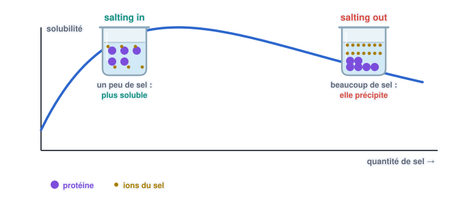

`https://cdn.jsdelivr.net/gh/alxhe3-lab/schemas-medecine@main/Biochimie/CM3/fig10-4104fc02.svg`

## 11. Que laisse passer la dialyse ?

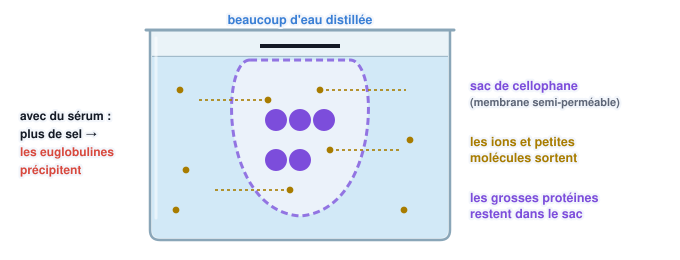

`https://cdn.jsdelivr.net/gh/alxhe3-lab/schemas-medecine@main/Biochimie/CM3/fig11-8258b8a0.svg`

## 12. Que devient un globule rouge (GR) dans chaque solution ?

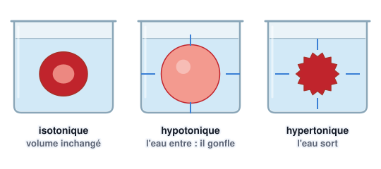

`https://cdn.jsdelivr.net/gh/alxhe3-lab/schemas-medecine@main/Biochimie/CM3/fig12-337adc5d.svg`

## 13. Qu'est-ce qui se défait, et peut-on revenir en arrière ?

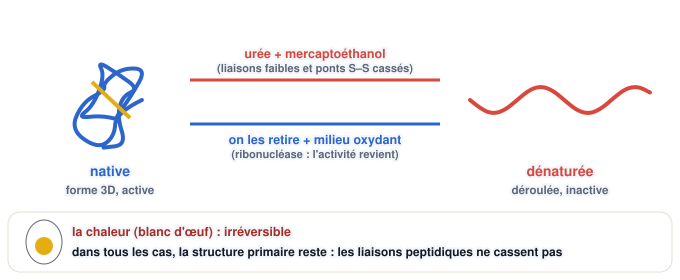

`https://cdn.jsdelivr.net/gh/alxhe3-lab/schemas-medecine@main/Biochimie/CM3/fig13-bc41ecf1.svg`

## 14. Comment un prion se multiplie-t-il sans ADN ?

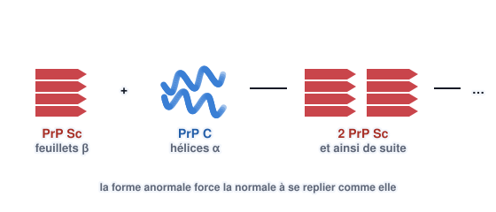

`https://cdn.jsdelivr.net/gh/alxhe3-lab/schemas-medecine@main/Biochimie/CM3/fig14-675e1013.svg`

## 15. Où chaque enzyme coupe-t-elle la séquence ?

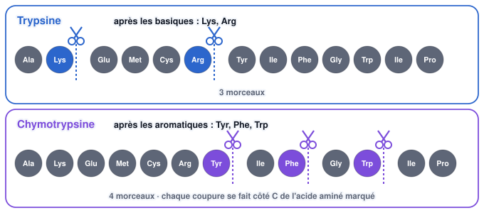

`https://cdn.jsdelivr.net/gh/alxhe3-lab/schemas-medecine@main/Biochimie/CM3/fig15-5885cd0c.svg`

## 16. Comment se séparent les protéines du sérum ?

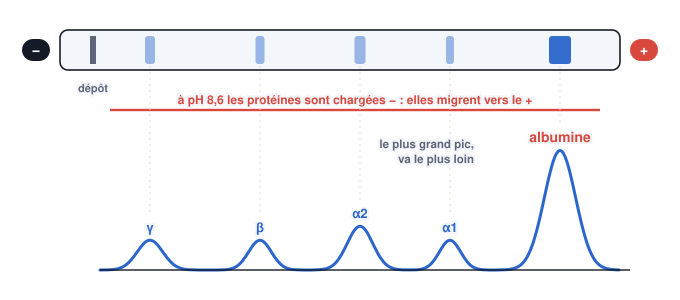

`https://cdn.jsdelivr.net/gh/alxhe3-lab/schemas-medecine@main/Biochimie/CM3/fig16-3584dc13.svg`

## 17. Pourquoi manquer d'albumine fait-il gonfler ?

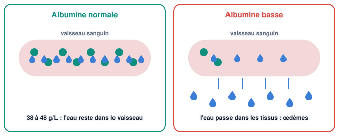

`https://cdn.jsdelivr.net/gh/alxhe3-lab/schemas-medecine@main/Biochimie/CM3/fig17-f1e41045.svg`
