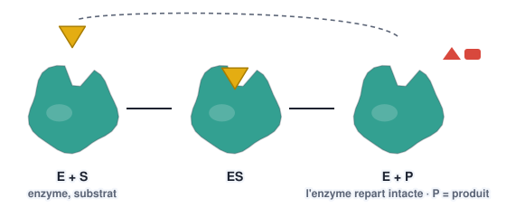
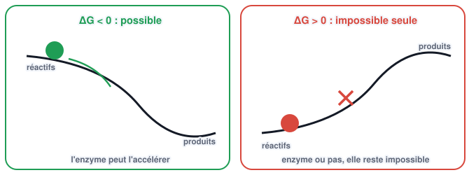
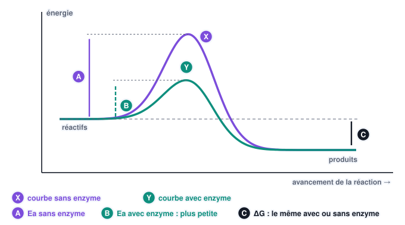
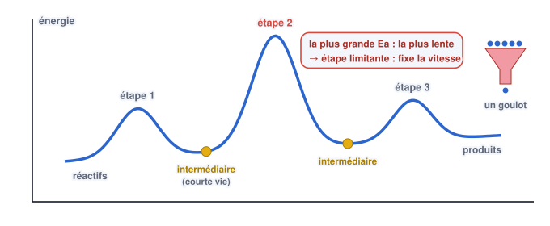
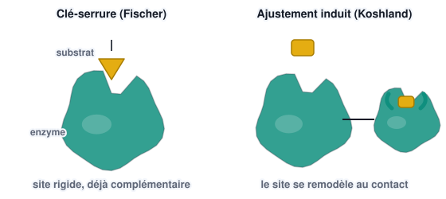
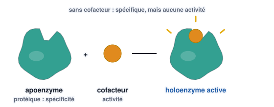
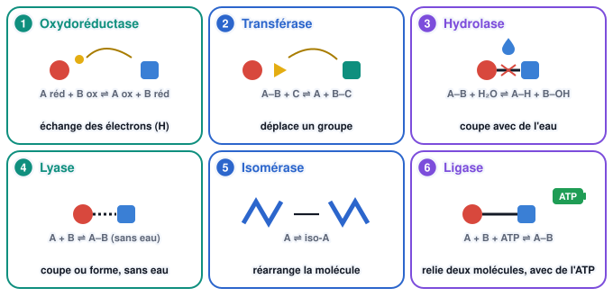
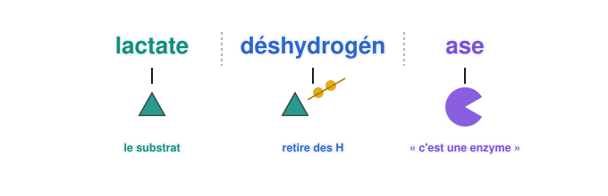

# Les enzymes

8 schémas. Pour en afficher un dans le chat : ``.

## 0. Le cycle d'une enzyme : elle se fixe, transforme, repart intacte.

`https://cdn.jsdelivr.net/gh/alxhe3-lab/schemas-medecine@main/Biochimie/CM4/fig00-885539cd.svg`

## 1. Quelles réactions une enzyme peut-elle accélérer ?

`https://cdn.jsdelivr.net/gh/alxhe3-lab/schemas-medecine@main/Biochimie/CM4/fig01-f6ace538.svg`

## 2. Qu'est-ce que l'enzyme change, et qu'est-ce qu'elle ne change pas ?

`https://cdn.jsdelivr.net/gh/alxhe3-lab/schemas-medecine@main/Biochimie/CM4/fig02-c9bcd5ab.svg`

## 3. Quelle étape fixe la vitesse ?

`https://cdn.jsdelivr.net/gh/alxhe3-lab/schemas-medecine@main/Biochimie/CM4/fig03-d2b6b2f8.svg`

## 4. Le site est-il rigide ou se remodèle-t-il ?

`https://cdn.jsdelivr.net/gh/alxhe3-lab/schemas-medecine@main/Biochimie/CM4/fig04-b31f593b.svg`

## 5. Que perd une enzyme si on lui retire son cofacteur ?

`https://cdn.jsdelivr.net/gh/alxhe3-lab/schemas-medecine@main/Biochimie/CM4/fig05-741391a0.svg`

## 6. Quelle réaction fait chaque classe ?

`https://cdn.jsdelivr.net/gh/alxhe3-lab/schemas-medecine@main/Biochimie/CM4/fig06-8e634bfb.svg`

## 7. Que dit chaque morceau du nom ?

`https://cdn.jsdelivr.net/gh/alxhe3-lab/schemas-medecine@main/Biochimie/CM4/fig07-3b0931d1.svg`
