# Cinétique enzymatique et inhibiteurs

12 schémas. Pour en afficher un dans le chat : ``.

## 0. Le fil du cours : mesurer la vitesse d'une enzyme, voir ce qui la modifie, puis ce qui la bloque.

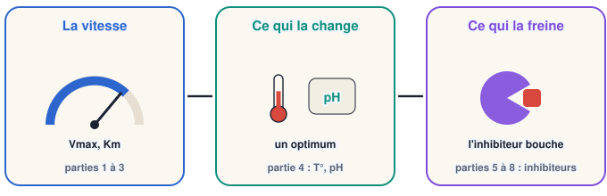

`https://cdn.jsdelivr.net/gh/alxhe3-lab/schemas-medecine@main/Biochimie/CM5/fig00-c0a73e76.svg`

## 1. Que se passe-t-il pendant une réaction enzymatique ?

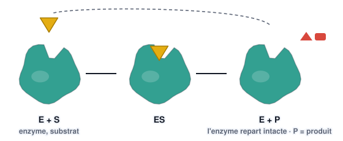

`https://cdn.jsdelivr.net/gh/alxhe3-lab/schemas-medecine@main/Biochimie/CM5/fig01-bd54c34f.svg`

## 2. Que veut dire « 1 UI » et « 1 katal » ?

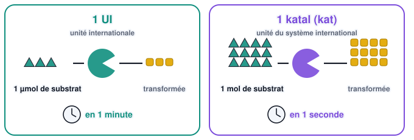

`https://cdn.jsdelivr.net/gh/alxhe3-lab/schemas-medecine@main/Biochimie/CM5/fig02-d9183b1c.svg`

## 3. Pourquoi la courbe finit-elle en plateau ?

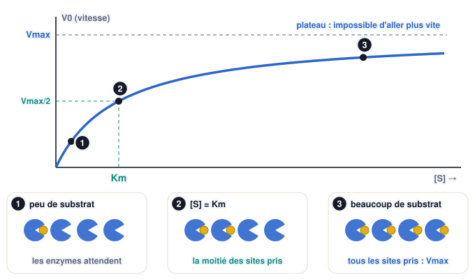

`https://cdn.jsdelivr.net/gh/alxhe3-lab/schemas-medecine@main/Biochimie/CM5/fig03-4c53c842.svg`

## 4. Où lire Km et Vmax sur la droite ?

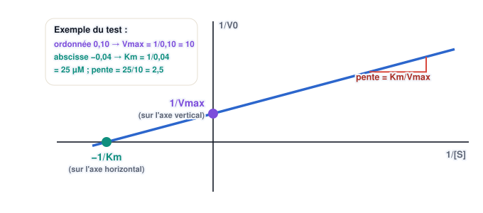

`https://cdn.jsdelivr.net/gh/alxhe3-lab/schemas-medecine@main/Biochimie/CM5/fig04-2b737c7c.svg`

## 5. Pourquoi chaque enzyme a-t-elle un pH optimal différent ?

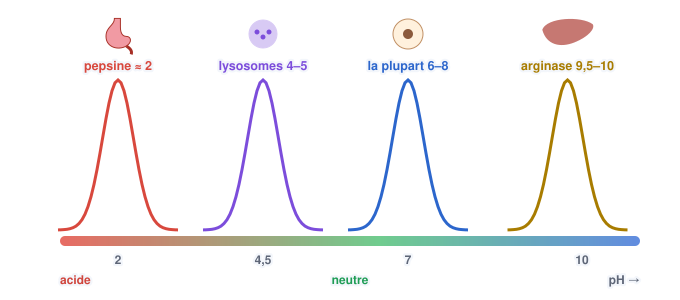

`https://cdn.jsdelivr.net/gh/alxhe3-lab/schemas-medecine@main/Biochimie/CM5/fig05-67d502b3.svg`

## 6. Où se fixe l'inhibiteur ?

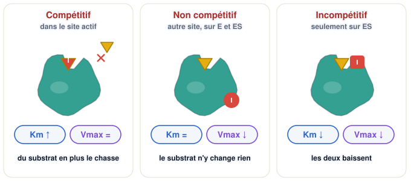

`https://cdn.jsdelivr.net/gh/alxhe3-lab/schemas-medecine@main/Biochimie/CM5/fig06-6fe7819e.svg`

## 7. Comment ces deux médicaments trompent-ils l'enzyme ?

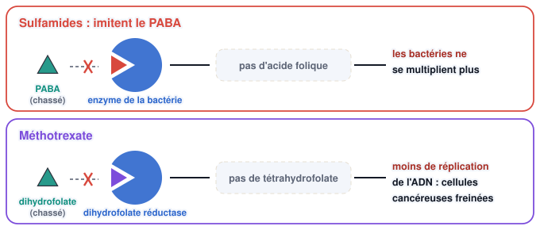

`https://cdn.jsdelivr.net/gh/alxhe3-lab/schemas-medecine@main/Biochimie/CM5/fig07-2ae75077.svg`

## 8. Comment l'éthanol protège-t-il d'une intoxication au méthanol ?

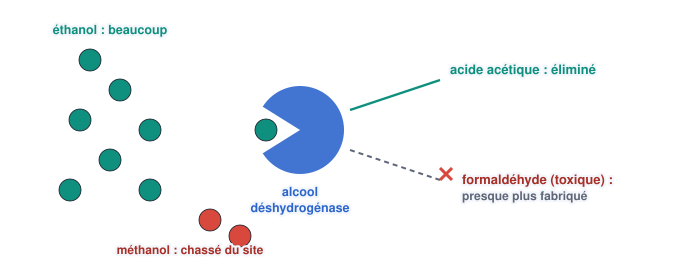

`https://cdn.jsdelivr.net/gh/alxhe3-lab/schemas-medecine@main/Biochimie/CM5/fig08-e895f784.svg`

## 9. Pourquoi le sarin tue-t-il par asphyxie ?

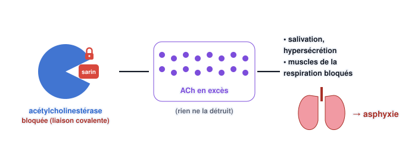

`https://cdn.jsdelivr.net/gh/alxhe3-lab/schemas-medecine@main/Biochimie/CM5/fig09-53235c2b.svg`

## 10. Pourquoi parle-t-on de substrat « suicide » ?

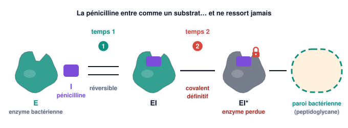

`https://cdn.jsdelivr.net/gh/alxhe3-lab/schemas-medecine@main/Biochimie/CM5/fig10-3c252d85.svg`

## 11. Hyperbole ou sigmoïde : comment reconnaître une enzyme allostérique ?

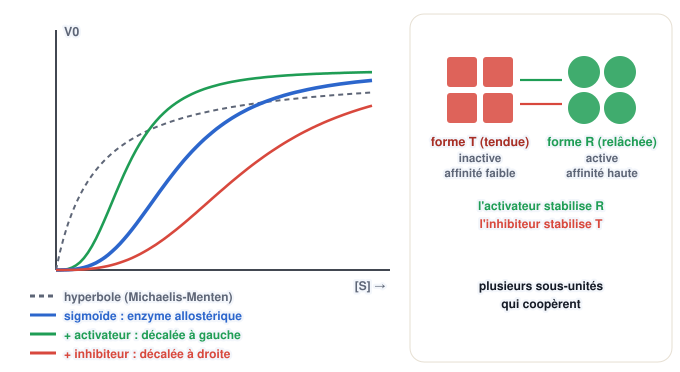

`https://cdn.jsdelivr.net/gh/alxhe3-lab/schemas-medecine@main/Biochimie/CM5/fig11-1a82c59d.svg`
