# Glycolyse et début de la néoglucogenèse

14 schémas. Pour en afficher un dans le chat : ``.

## 0. Le fil du cours : le glucose a trois destins. On étudie la glycolyse, puis la voie inverse pour refaire du glucose.

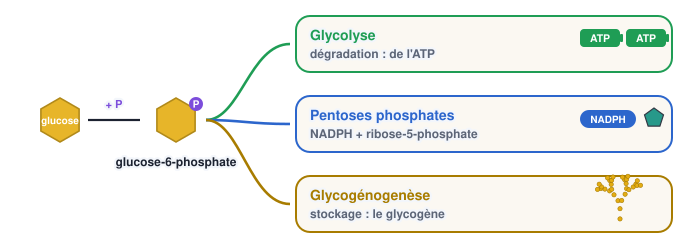

`https://cdn.jsdelivr.net/gh/alxhe3-lab/schemas-medecine@main/Biochimie/CM6/fig00-61218a5f.svg`

## 1. Quelle liaison relie les glucoses, et à quoi ça sert ?

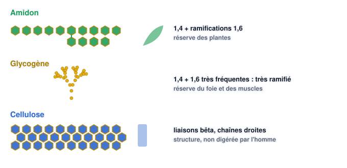

`https://cdn.jsdelivr.net/gh/alxhe3-lab/schemas-medecine@main/Biochimie/CM6/fig01-a2ab78b6.svg`

## 2. Où va le glucose-6-phosphate ?

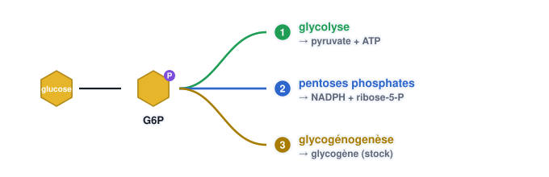

`https://cdn.jsdelivr.net/gh/alxhe3-lab/schemas-medecine@main/Biochimie/CM6/fig02-9ad54072.svg`

## 3. Pourquoi le glucose ne ressort-il pas ?

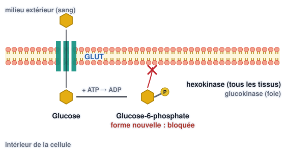

`https://cdn.jsdelivr.net/gh/alxhe3-lab/schemas-medecine@main/Biochimie/CM6/fig03-7f9a91fb.svg`

## 4. Pourquoi ces trois tissus dépendent-ils du glucose ?

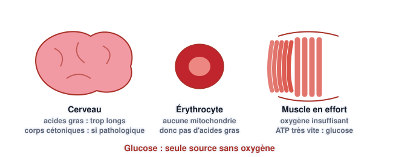

`https://cdn.jsdelivr.net/gh/alxhe3-lab/schemas-medecine@main/Biochimie/CM6/fig04-aa7bae64.svg`

## 5. Comment un glucose donne deux GA3P ?

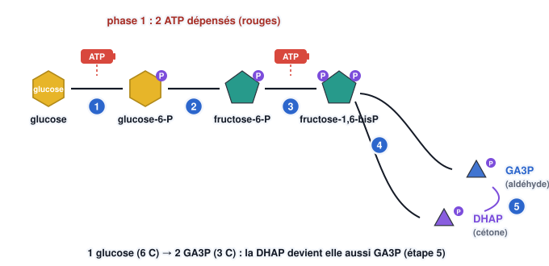

`https://cdn.jsdelivr.net/gh/alxhe3-lab/schemas-medecine@main/Biochimie/CM6/fig05-ec4f7995.svg`

## 6. Où l'ATP et le NADH sont-ils fabriqués ?

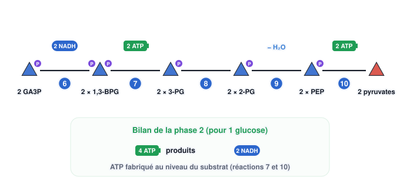

`https://cdn.jsdelivr.net/gh/alxhe3-lab/schemas-medecine@main/Biochimie/CM6/fig06-ef6be6ea.svg`

## 7. Dans quelles réactions l'ATP est-il fabriqué au niveau du substrat ?

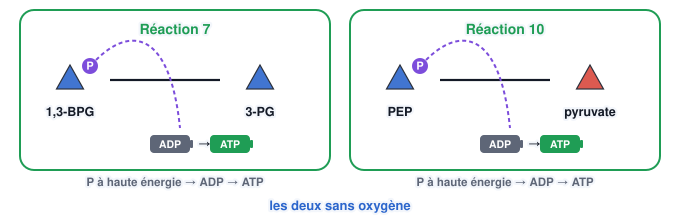

`https://cdn.jsdelivr.net/gh/alxhe3-lab/schemas-medecine@main/Biochimie/CM6/fig07-165ddc61.svg`

## 8. Que devient le pyruvate selon l'oxygène disponible ?

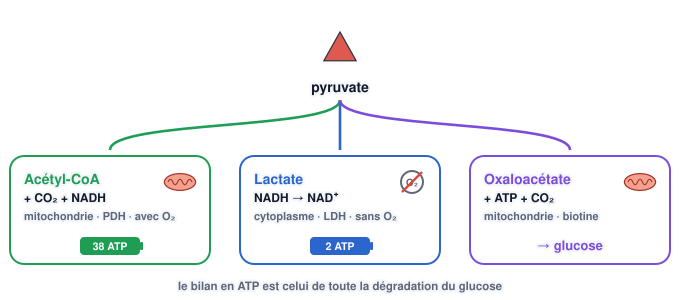

`https://cdn.jsdelivr.net/gh/alxhe3-lab/schemas-medecine@main/Biochimie/CM6/fig08-4fc9523d.svg`

## 9. Comment le glucagon freine-t-il la glycolyse du foie ?

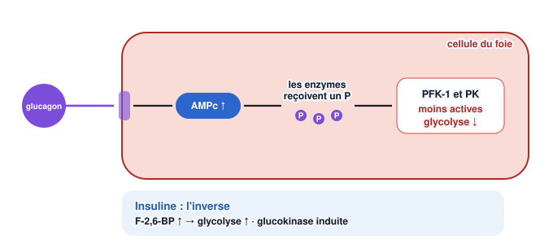

`https://cdn.jsdelivr.net/gh/alxhe3-lab/schemas-medecine@main/Biochimie/CM6/fig09-46948313.svg`

## 10. Quelles étapes de la glycolyse sont contournées, et par quoi ?

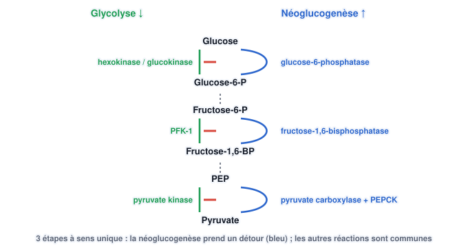

`https://cdn.jsdelivr.net/gh/alxhe3-lab/schemas-medecine@main/Biochimie/CM6/fig10-fbbe5615.svg`

## 11. Comment le lactate du muscle redevient-il du glucose ?

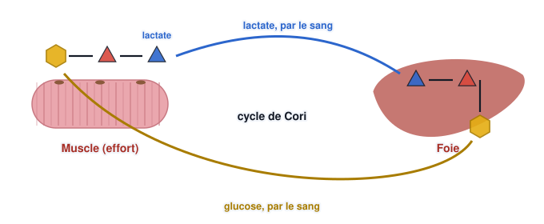

`https://cdn.jsdelivr.net/gh/alxhe3-lab/schemas-medecine@main/Biochimie/CM6/fig11-72ff03c1.svg`

## 12. Quel signal fait basculer le foie d'une voie à l'autre ?

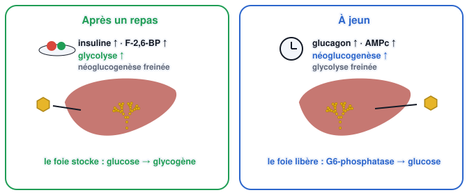

`https://cdn.jsdelivr.net/gh/alxhe3-lab/schemas-medecine@main/Biochimie/CM6/fig12-847da446.svg`

## 13. Sur quoi portent les 25 questions de cette partie ?

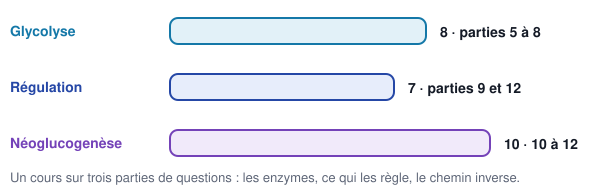

`https://cdn.jsdelivr.net/gh/alxhe3-lab/schemas-medecine@main/Biochimie/CM6/fig13-84d34523.svg`
