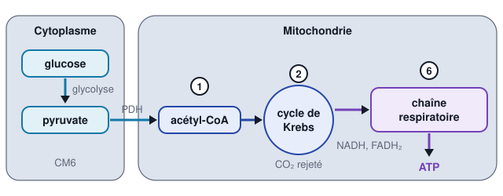
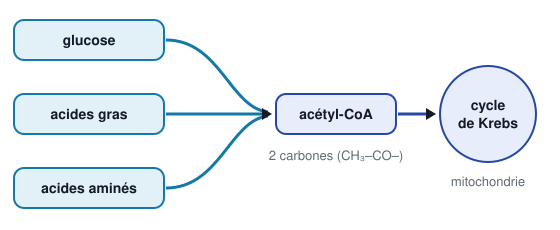
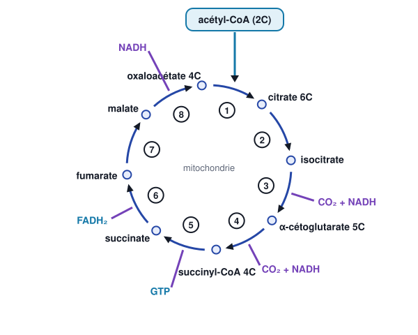
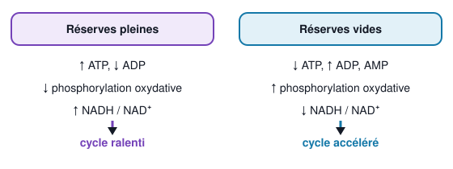
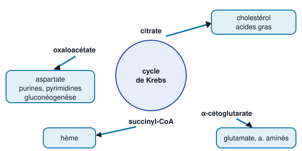
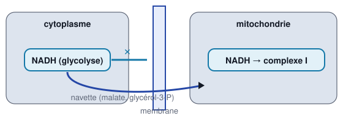
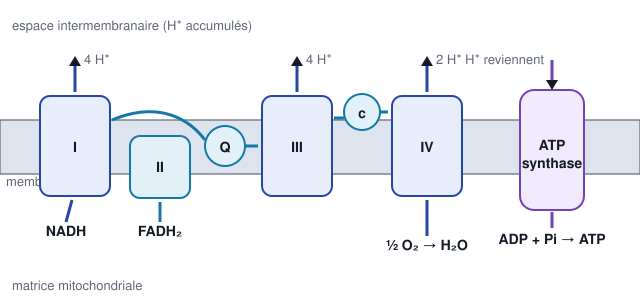
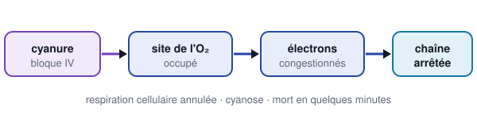
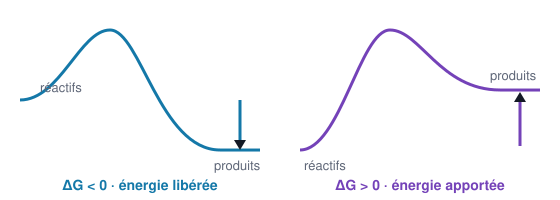
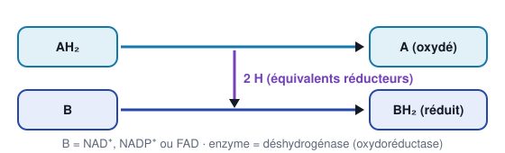

# Cycle de Krebs, chaîne respiratoire et énergétique

11 schémas. Pour en afficher un dans le chat : ``.

## 0. Le fil du cours : l'acétyl-CoA entre dans le cycle (1–2), le cycle remplit NADH et FADH₂, la chaîne respiratoire en fait de l'ATP (6).

`https://cdn.jsdelivr.net/gh/alxhe3-lab/schemas-medecine@main/Biochimie/CM7/fig00-8c06b3f0.svg`

## 1. Pourquoi l'acétyl-CoA est-il un « donneur universel » ?

`https://cdn.jsdelivr.net/gh/alxhe3-lab/schemas-medecine@main/Biochimie/CM7/fig01-fd5e77e8.svg`

## 2. Où sortent les CO₂, les NADH, le FADH₂ et le GTP ?

`https://cdn.jsdelivr.net/gh/alxhe3-lab/schemas-medecine@main/Biochimie/CM7/fig02-693c4aef.svg`

## 3. Réserves pleines ou vides : le cycle suit la demande d'énergie

`https://cdn.jsdelivr.net/gh/alxhe3-lab/schemas-medecine@main/Biochimie/CM7/fig03-3f09548c.svg`

## 4. Quel intermédiaire sert à fabriquer quoi ?

`https://cdn.jsdelivr.net/gh/alxhe3-lab/schemas-medecine@main/Biochimie/CM7/fig04-c75338ec.svg`

## 5. Pourquoi le NADH du cytoplasme a besoin d'une navette

`https://cdn.jsdelivr.net/gh/alxhe3-lab/schemas-medecine@main/Biochimie/CM7/fig05-74fb83a6.svg`

## 6. Le trajet des électrons et des protons

`https://cdn.jsdelivr.net/gh/alxhe3-lab/schemas-medecine@main/Biochimie/CM7/fig06-466e89d7.svg`

## 7. Cyanure : du blocage du complexe IV à la mort

`https://cdn.jsdelivr.net/gh/alxhe3-lab/schemas-medecine@main/Biochimie/CM7/fig07-6b8e5014.svg`

## 8. Exergonique ou endergonique : où sont les produits ?

`https://cdn.jsdelivr.net/gh/alxhe3-lab/schemas-medecine@main/Biochimie/CM7/fig08-a7734029.svg`

## 9. AH₂ + B → A + BH₂ : qui est oxydé, qui est réduit ?

`https://cdn.jsdelivr.net/gh/alxhe3-lab/schemas-medecine@main/Biochimie/CM7/fig09-2c051ed1.svg`

## 10. Les 4 thèmes qui reviennent

`https://cdn.jsdelivr.net/gh/alxhe3-lab/schemas-medecine@main/Biochimie/CM7/fig10-42083fd3.svg`
