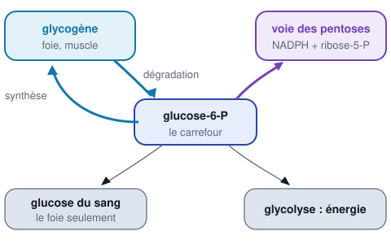
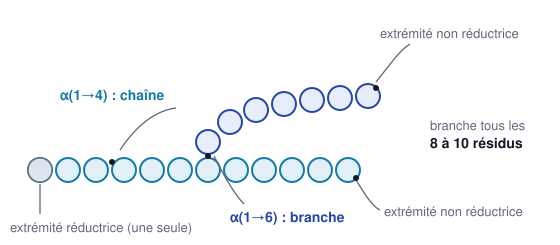
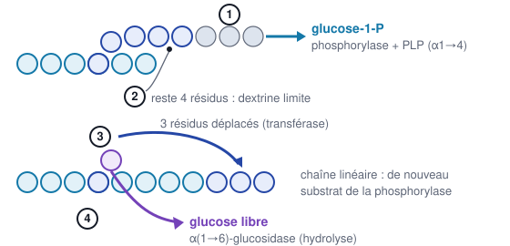
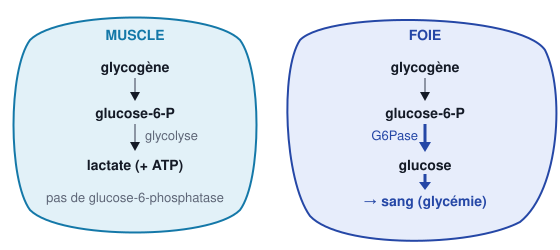
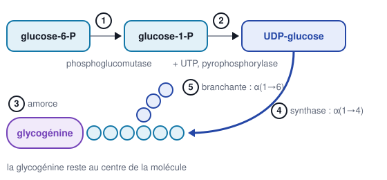
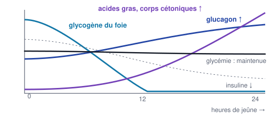
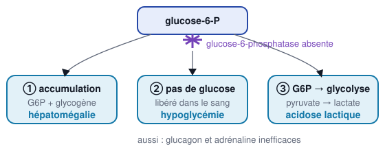
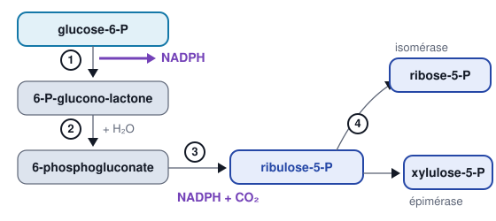
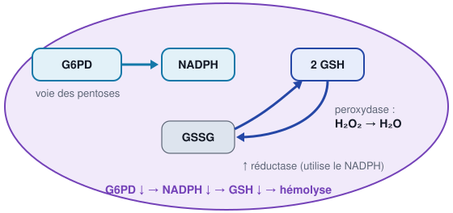
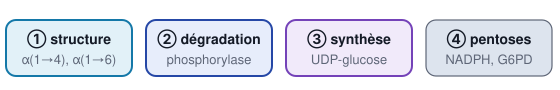

# Glycogène et voie des pentoses phosphates

10 schémas. Pour en afficher un dans le chat : ``.

## 0. Le glucose-6-phosphate est au centre : il se stocke en glycogène, en ressort, ou part dans la voie des pentoses.

`https://cdn.jsdelivr.net/gh/alxhe3-lab/schemas-medecine@main/Biochimie/CM8/fig00-49bba824.svg`

## 1. Où sont les liaisons et les extrémités ?

`https://cdn.jsdelivr.net/gh/alxhe3-lab/schemas-medecine@main/Biochimie/CM8/fig01-6c6ce139.svg`

## 2. Les mêmes numéros : qui coupe quoi ?

`https://cdn.jsdelivr.net/gh/alxhe3-lab/schemas-medecine@main/Biochimie/CM8/fig02-d0237e73.svg`

## 3. Pourquoi le foie libère du glucose et pas le muscle ?

`https://cdn.jsdelivr.net/gh/alxhe3-lab/schemas-medecine@main/Biochimie/CM8/fig03-a826efe3.svg`

## 4. Les 5 étapes, des mêmes numéros

`https://cdn.jsdelivr.net/gh/alxhe3-lab/schemas-medecine@main/Biochimie/CM8/fig04-f32d7f11.svg`

## 5. Jeûne de 24 h : qui monte, qui baisse ?

`https://cdn.jsdelivr.net/gh/alxhe3-lab/schemas-medecine@main/Biochimie/CM8/fig05-bb20364d.svg`

## 6. Une enzyme manque : trois conséquences

`https://cdn.jsdelivr.net/gh/alxhe3-lab/schemas-medecine@main/Biochimie/CM8/fig06-9e5a3895.svg`

## 7. Phase oxydative : où sortent les 2 NADPH et le CO₂ ?

`https://cdn.jsdelivr.net/gh/alxhe3-lab/schemas-medecine@main/Biochimie/CM8/fig07-60854317.svg`

## 8. Globule rouge : à quoi sert le NADPH ?

`https://cdn.jsdelivr.net/gh/alxhe3-lab/schemas-medecine@main/Biochimie/CM8/fig08-2ce4a1c3.svg`

## 9. Les 4 thèmes qui reviennent

`https://cdn.jsdelivr.net/gh/alxhe3-lab/schemas-medecine@main/Biochimie/CM8/fig09-c8bd52d6.svg`
