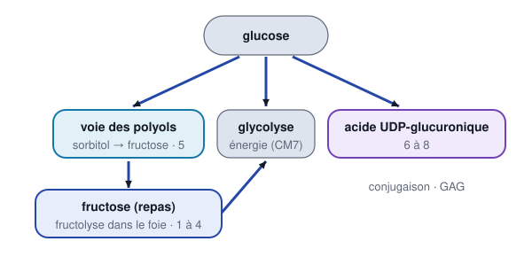
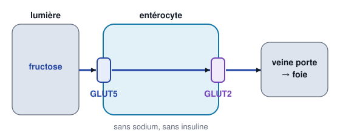
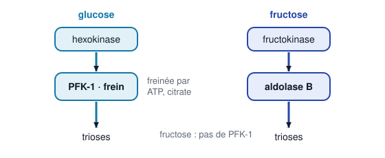
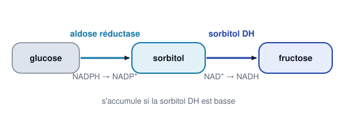
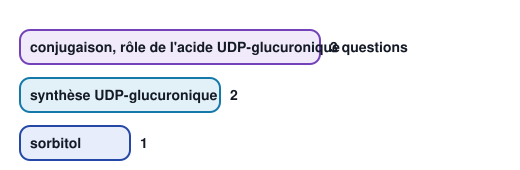

# Fructose, polyols et acide glucuronique

5 schémas. Pour en afficher un dans le chat : ``.

## 0. Le fructose rejoint la glycolyse par un raccourci ; le glucose peut aussi partir vers les polyols ou vers l'acide UDP-glucuronique.

`https://cdn.jsdelivr.net/gh/alxhe3-lab/schemas-medecine@main/Biochimie/CM9/fig00-f5f896e2.svg`

## 1. Le fructose entre par GLUT5, sort par GLUT2

`https://cdn.jsdelivr.net/gh/alxhe3-lab/schemas-medecine@main/Biochimie/CM9/fig01-61a32b33.svg`

## 5. Le fructose passe à côté du frein

`https://cdn.jsdelivr.net/gh/alxhe3-lab/schemas-medecine@main/Biochimie/CM9/fig05-6d812fe1.svg`

## 7. Glucose → sorbitol → fructose

`https://cdn.jsdelivr.net/gh/alxhe3-lab/schemas-medecine@main/Biochimie/CM9/fig07-ab867a47.svg`

## 13. Ce qui est interrogé sur ce chapitre

`https://cdn.jsdelivr.net/gh/alxhe3-lab/schemas-medecine@main/Biochimie/CM9/fig13-6c41dc5e.svg`
