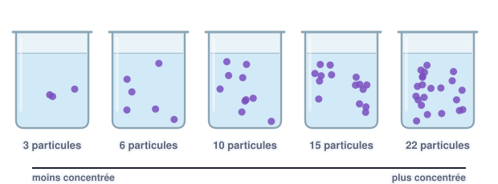
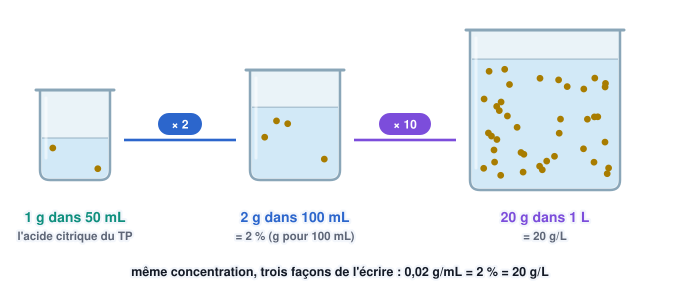
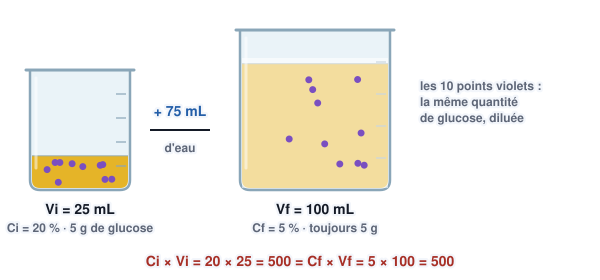
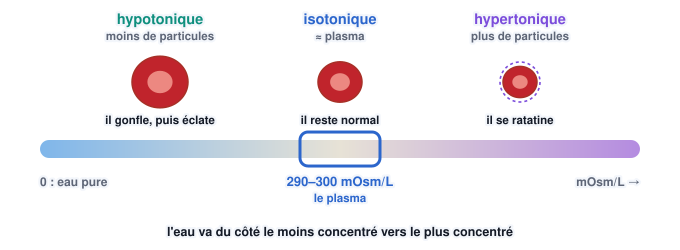
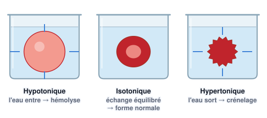
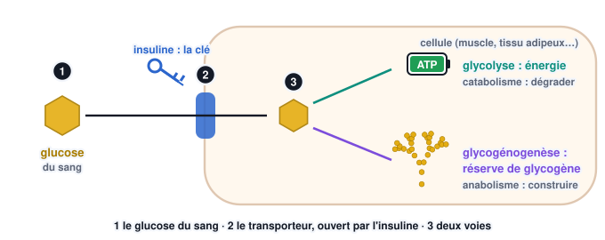
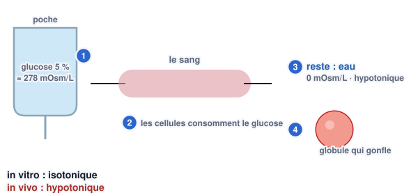
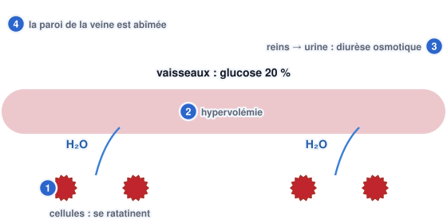
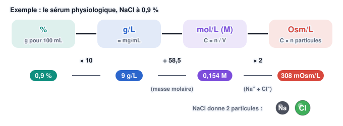

# Concentrations, osmolarité et perfusion

9 schémas. Pour en afficher un dans le chat : ``.

## 0. Même volume, plus de particules : plus concentrée.

`https://cdn.jsdelivr.net/gh/alxhe3-lab/schemas-medecine@main/Biochimie/TP1/fig00-d24778b7.svg`

## 1. Comment lire « 1 g dans 50 mL » en % et en g/L ?

`https://cdn.jsdelivr.net/gh/alxhe3-lab/schemas-medecine@main/Biochimie/TP1/fig01-1f46ee84.svg`

## 3. Pourquoi Ci × Vi = Cf × Vf ? La quantité de soluté ne bouge pas

`https://cdn.jsdelivr.net/gh/alxhe3-lab/schemas-medecine@main/Biochimie/TP1/fig03-412fafc7.svg`

## 5. Où se place une solution par rapport au plasma ?

`https://cdn.jsdelivr.net/gh/alxhe3-lab/schemas-medecine@main/Biochimie/TP1/fig05-06874621.svg`

## 6. Que devient un globule rouge selon la solution ?

`https://cdn.jsdelivr.net/gh/alxhe3-lab/schemas-medecine@main/Biochimie/TP1/fig06-f138664a.svg`

## 8. Que devient le glucose qui entre dans la cellule ?

`https://cdn.jsdelivr.net/gh/alxhe3-lab/schemas-medecine@main/Biochimie/TP1/fig08-bcba121b.svg`

## 9. Pourquoi la poche isotonique devient-elle de l'eau pure ?

`https://cdn.jsdelivr.net/gh/alxhe3-lab/schemas-medecine@main/Biochimie/TP1/fig09-b0f17d13.svg`

## 10. Où va l'eau quand on perfuse du glucose à 20 % ?

`https://cdn.jsdelivr.net/gh/alxhe3-lab/schemas-medecine@main/Biochimie/TP1/fig10-4c87afef.svg`

## 11. Comment passer d'une écriture de la concentration à l'autre ?

`https://cdn.jsdelivr.net/gh/alxhe3-lab/schemas-medecine@main/Biochimie/TP1/fig11-0d7c9aa9.svg`
