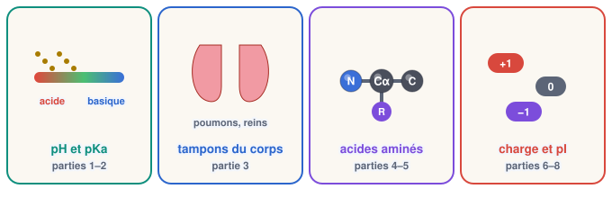
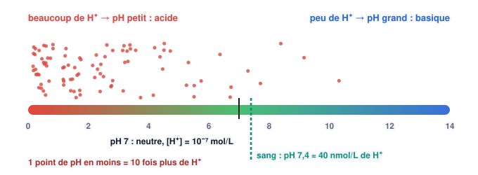
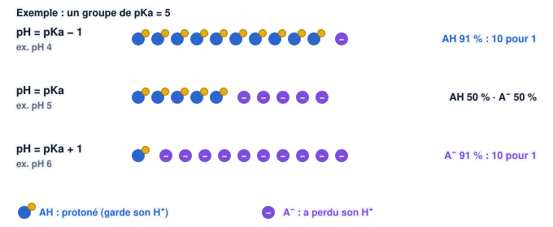
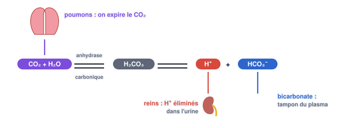
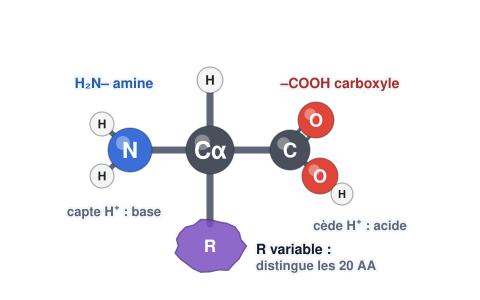
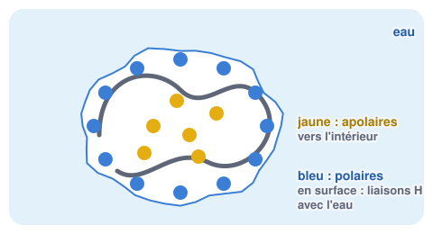
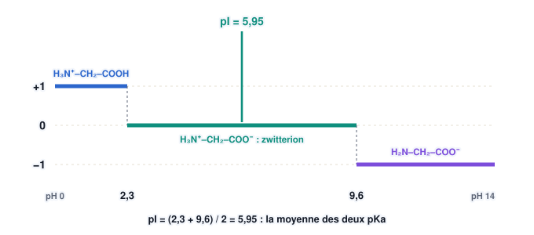
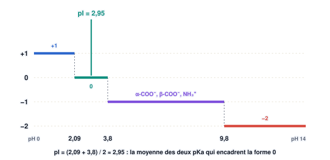
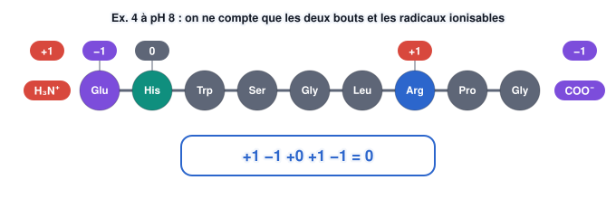

# Le pH et la charge des acides aminés

9 schémas. Pour en afficher un dans le chat : ``.

## 0. Le fil du TP : le pH, les tampons, les acides aminés, puis leur charge.

`https://cdn.jsdelivr.net/gh/alxhe3-lab/schemas-medecine@main/Biochimie/TP3/fig00-9b2cff92.svg`

## 1. Pourquoi « beaucoup de protons = petit pH » ?

`https://cdn.jsdelivr.net/gh/alxhe3-lab/schemas-medecine@main/Biochimie/TP3/fig01-06e1d306.svg`

## 2. Quelle forme domine quand le pH s'éloigne du pKa ?

`https://cdn.jsdelivr.net/gh/alxhe3-lab/schemas-medecine@main/Biochimie/TP3/fig02-9be31c01.svg`

## 3. Où partent le CO₂ et les H⁺ ?

`https://cdn.jsdelivr.net/gh/alxhe3-lab/schemas-medecine@main/Biochimie/TP3/fig03-c03a24db.svg`

## 4. Que porte le carbone alpha ?

`https://cdn.jsdelivr.net/gh/alxhe3-lab/schemas-medecine@main/Biochimie/TP3/fig04-8396ea52.svg`

## 5. Où se placent les radicaux dans une protéine ?

`https://cdn.jsdelivr.net/gh/alxhe3-lab/schemas-medecine@main/Biochimie/TP3/fig05-6dd40569.svg`

## 6. Comment la charge de la glycine change-t-elle avec le pH ?

`https://cdn.jsdelivr.net/gh/alxhe3-lab/schemas-medecine@main/Biochimie/TP3/fig06-63eb726a.svg`

## 7. Pourquoi le pI de l'acide aspartique est-il si bas ?

`https://cdn.jsdelivr.net/gh/alxhe3-lab/schemas-medecine@main/Biochimie/TP3/fig07-9c87b0a9.svg`

## 8. Comment compter la charge d'un peptide ?

`https://cdn.jsdelivr.net/gh/alxhe3-lab/schemas-medecine@main/Biochimie/TP3/fig08-d333b288.svg`
