# Ioniser les acides aminés, puis prélever le sang

11 schémas. Pour en afficher un dans le chat : ``.

## 0. Le chemin d'un échantillon de sang, du patient au résultat.

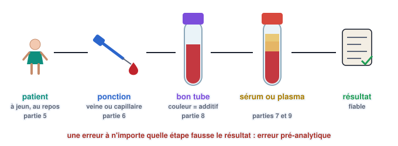

`https://cdn.jsdelivr.net/gh/alxhe3-lab/schemas-medecine@main/Biochimie/TP4/fig00-520ca79c.svg`

## 1. Quelle famille selon le radical ?

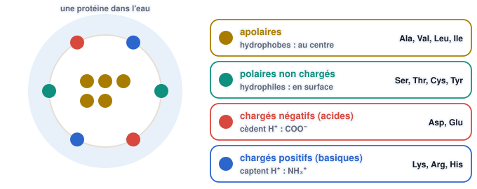

`https://cdn.jsdelivr.net/gh/alxhe3-lab/schemas-medecine@main/Biochimie/TP4/fig01-57175d83.svg`

## 2. Glu-His-Leu-Arg-Pro-Gly : pourquoi +3 à pH 1 et 0 à pH 7 ?

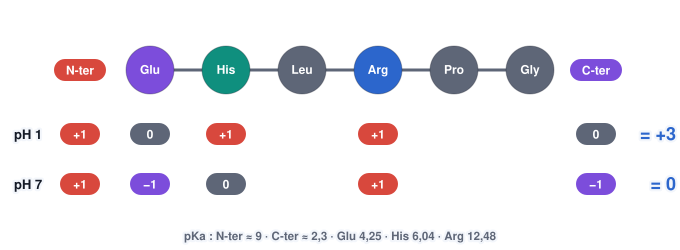

`https://cdn.jsdelivr.net/gh/alxhe3-lab/schemas-medecine@main/Biochimie/TP4/fig02-2ba89b8b.svg`

## 3. Qu'est-ce qui dépend de la qualité du prélèvement ?

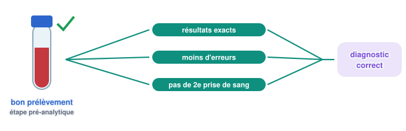

`https://cdn.jsdelivr.net/gh/alxhe3-lab/schemas-medecine@main/Biochimie/TP4/fig03-003615ad.svg`

## 4. Dans quel ordre le sang se sépare-t-il ?

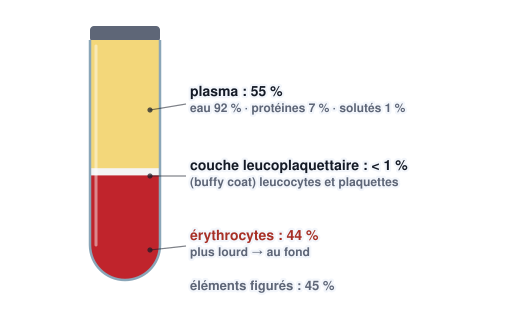

`https://cdn.jsdelivr.net/gh/alxhe3-lab/schemas-medecine@main/Biochimie/TP4/fig04-602b098d.svg`

## 5. Combien d'heures de jeûne avant la prise de sang ?

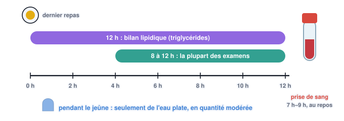

`https://cdn.jsdelivr.net/gh/alxhe3-lab/schemas-medecine@main/Biochimie/TP4/fig05-cadc9e75.svg`

## 6. Les mêmes numéros sur le bras

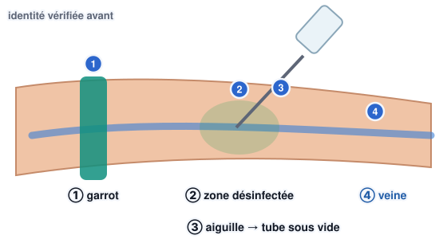

`https://cdn.jsdelivr.net/gh/alxhe3-lab/schemas-medecine@main/Biochimie/TP4/fig06-6f1097b2.svg`

## 7. Pourquoi un caillot dans un tube et pas dans l'autre ?

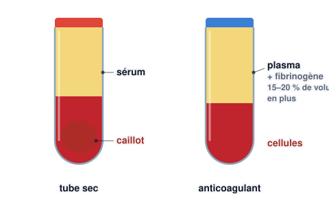

`https://cdn.jsdelivr.net/gh/alxhe3-lab/schemas-medecine@main/Biochimie/TP4/fig07-a658b750.svg`

## 8. Quel bouchon pour quel examen ?

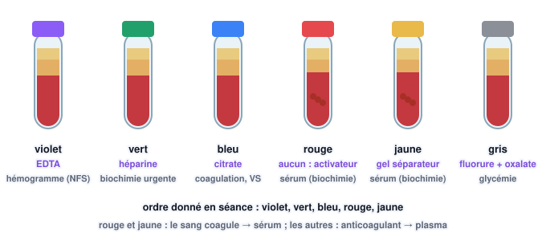

`https://cdn.jsdelivr.net/gh/alxhe3-lab/schemas-medecine@main/Biochimie/TP4/fig08-11936d7b.svg`

## 9. Comment agissent les anticoagulants ?

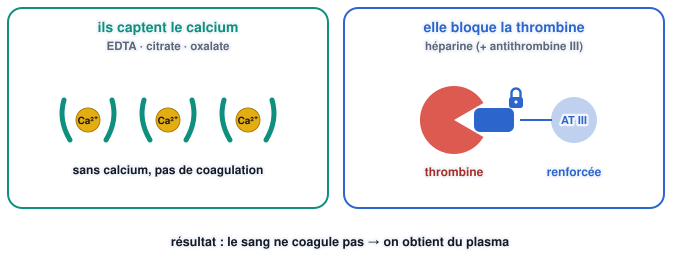

`https://cdn.jsdelivr.net/gh/alxhe3-lab/schemas-medecine@main/Biochimie/TP4/fig09-22f5d240.svg`

## 10. Quel sérum, quelle cause ?

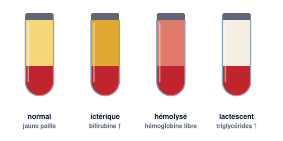

`https://cdn.jsdelivr.net/gh/alxhe3-lab/schemas-medecine@main/Biochimie/TP4/fig10-ccb70f2c.svg`
