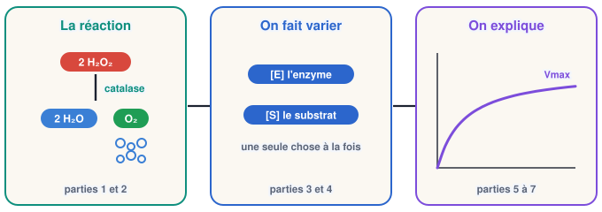
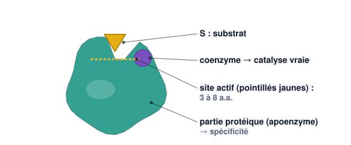
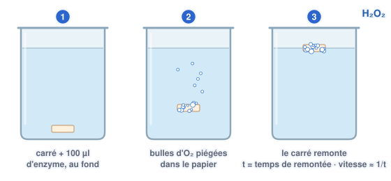
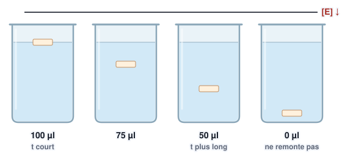
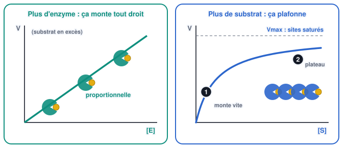
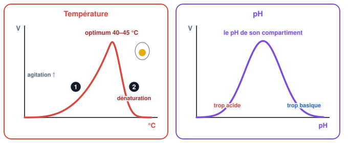
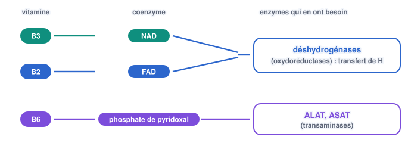
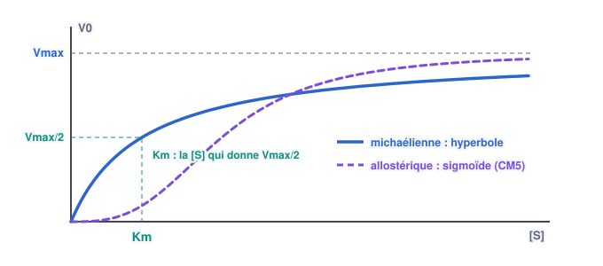

# La catalase et les facteurs de l'activité enzymatique

8 schémas. Pour en afficher un dans le chat : ``.

## 0. Le fil du TP : une réaction simple, deux expériences, puis les règles qui expliquent les résultats.

`https://cdn.jsdelivr.net/gh/alxhe3-lab/schemas-medecine@main/Biochimie/TP5/fig00-a4e9ef47.svg`

## 1. Qui reconnaît, qui catalyse ?

`https://cdn.jsdelivr.net/gh/alxhe3-lab/schemas-medecine@main/Biochimie/TP5/fig01-bd61b635.svg`

## 2. Pourquoi le carré de papier remonte-t-il ?

`https://cdn.jsdelivr.net/gh/alxhe3-lab/schemas-medecine@main/Biochimie/TP5/fig02-d3f606a9.svg`

## 3. Moins d'enzyme, remontée plus lente

`https://cdn.jsdelivr.net/gh/alxhe3-lab/schemas-medecine@main/Biochimie/TP5/fig03-d115d66a.svg`

## 4. Droite pour l'enzyme, plateau pour le substrat

`https://cdn.jsdelivr.net/gh/alxhe3-lab/schemas-medecine@main/Biochimie/TP5/fig04-af7394b9.svg`

## 5. Deux courbes en cloche : un optimum, puis la chute

`https://cdn.jsdelivr.net/gh/alxhe3-lab/schemas-medecine@main/Biochimie/TP5/fig05-411e78ff.svg`

## 6. Quelle vitamine pour quelle enzyme ?

`https://cdn.jsdelivr.net/gh/alxhe3-lab/schemas-medecine@main/Biochimie/TP5/fig06-5d1dba78.svg`

## 7. Où lire Vmax, Vmax/2 et Km ?

`https://cdn.jsdelivr.net/gh/alxhe3-lab/schemas-medecine@main/Biochimie/TP5/fig07-80cfc02b.svg`
