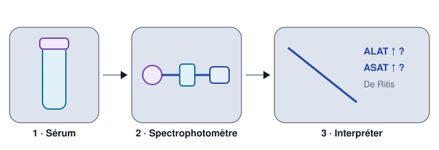
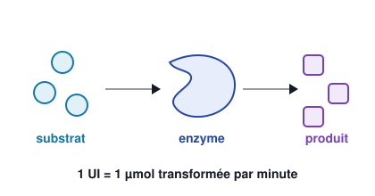
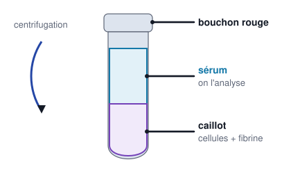
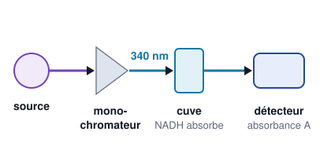
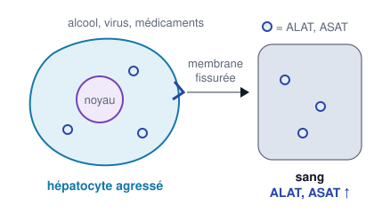
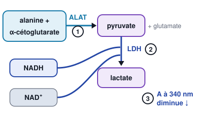
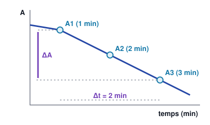
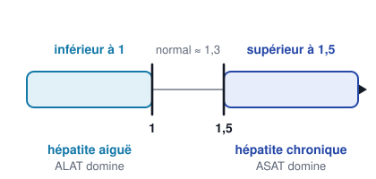

# Dosage des transaminases (ALAT, ASAT)

8 schémas. Pour en afficher un dans le chat : ``.

## 0. Du tube au diagnostic : sérum, mesure de l'activité, interprétation.

`https://cdn.jsdelivr.net/gh/alxhe3-lab/schemas-medecine@main/Biochimie/TP7/fig00-dc2ec285.svg`

## 1. Que compte-t-on quand on dose une enzyme ?

`https://cdn.jsdelivr.net/gh/alxhe3-lab/schemas-medecine@main/Biochimie/TP7/fig01-184e5749.svg`

## 2. Que contient le tube après centrifugation ?

`https://cdn.jsdelivr.net/gh/alxhe3-lab/schemas-medecine@main/Biochimie/TP7/fig02-e1799cf2.svg`

## 3. Par où passe la lumière dans le spectrophotomètre ?

`https://cdn.jsdelivr.net/gh/alxhe3-lab/schemas-medecine@main/Biochimie/TP7/fig03-423f7e9f.svg`

## 4. Comment les transaminases arrivent-elles dans le sang ?

`https://cdn.jsdelivr.net/gh/alxhe3-lab/schemas-medecine@main/Biochimie/TP7/fig04-77f54699.svg`

## 5. Pourquoi l'absorbance baisse-t-elle quand l'ALAT travaille ?

`https://cdn.jsdelivr.net/gh/alxhe3-lab/schemas-medecine@main/Biochimie/TP7/fig05-eb0665ba.svg`

## 6. Où lit-on ΔA et Δt ?

`https://cdn.jsdelivr.net/gh/alxhe3-lab/schemas-medecine@main/Biochimie/TP7/fig06-46a1aea3.svg`

## 7. Que dit la valeur du rapport ASAT / ALAT ?

`https://cdn.jsdelivr.net/gh/alxhe3-lab/schemas-medecine@main/Biochimie/TP7/fig07-3da5e54e.svg`
