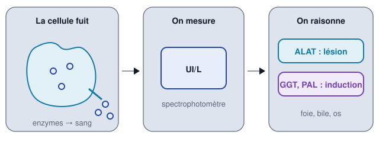
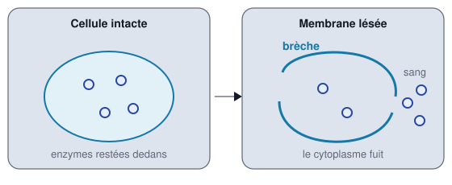
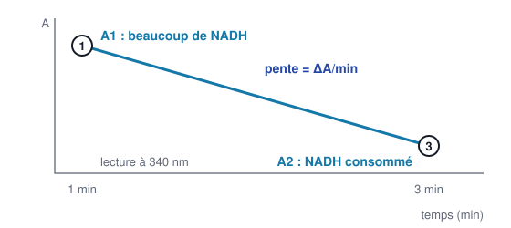
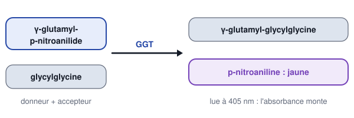
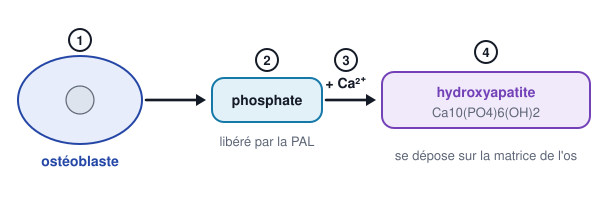

# Les enzymes du sérum : ALAT, GGT et phosphatase alcaline

5 schémas. Pour en afficher un dans le chat : ``.

## 0. Le fil du TP : une enzyme sort de sa cellule, on mesure son activité, puis on en déduit l'organe en cause.

`https://cdn.jsdelivr.net/gh/alxhe3-lab/schemas-medecine@main/Biochimie/TP8/fig00-9cc29279.svg`

## 1. Comment une enzyme de la cellule arrive-t-elle dans le sang ?

`https://cdn.jsdelivr.net/gh/alxhe3-lab/schemas-medecine@main/Biochimie/TP8/fig01-d5a14dac.svg`

## 4. Que lit-on sur l'appareil pour l'ALAT ?

`https://cdn.jsdelivr.net/gh/alxhe3-lab/schemas-medecine@main/Biochimie/TP8/fig04-fc0b7e88.svg`

## 6. Que mesure-t-on dans le dosage de la GGT ?

`https://cdn.jsdelivr.net/gh/alxhe3-lab/schemas-medecine@main/Biochimie/TP8/fig06-75c839e4.svg`

## 7. Comment la PAL aide-t-elle l'os à se minéraliser ?

`https://cdn.jsdelivr.net/gh/alxhe3-lab/schemas-medecine@main/Biochimie/TP8/fig07-99f2c010.svg`
