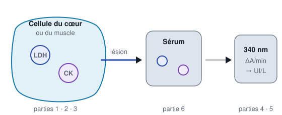
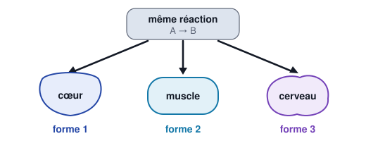
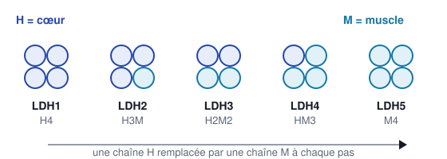
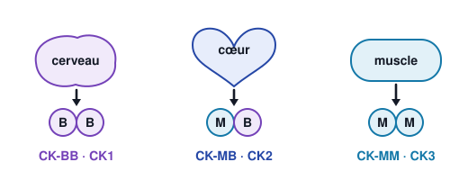
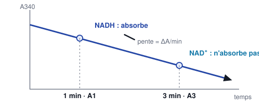
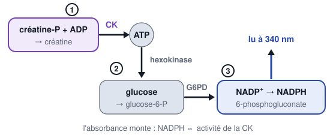
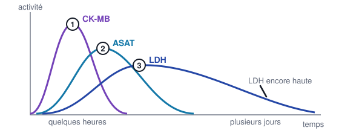

# Dosage de la LDH et de la créatine kinase

7 schémas. Pour en afficher un dans le chat : ``.

## 0. Le fil du cours : la LDH et la CK sortent des cellules lésées, on les dose dans le sérum, et le résultat dit quel organe souffre.

`https://cdn.jsdelivr.net/gh/alxhe3-lab/schemas-medecine@main/Biochimie/TP9/fig00-2494ed18.svg`

## 1. Une même réaction, une forme par tissu : comment l'isoenzyme montre l'organe

`https://cdn.jsdelivr.net/gh/alxhe3-lab/schemas-medecine@main/Biochimie/TP9/fig01-e679c325.svg`

## 2. Les 5 isoenzymes de la LDH : de 4 chaînes H à 4 chaînes M

`https://cdn.jsdelivr.net/gh/alxhe3-lab/schemas-medecine@main/Biochimie/TP9/fig02-b1a6d034.svg`

## 3. CK : deux chaînes, trois combinaisons, trois organes

`https://cdn.jsdelivr.net/gh/alxhe3-lab/schemas-medecine@main/Biochimie/TP9/fig03-6b159263.svg`

## 4. Dosage de la LDH : pourquoi l'absorbance baisse-t-elle ?

`https://cdn.jsdelivr.net/gh/alxhe3-lab/schemas-medecine@main/Biochimie/TP9/fig04-44d50ad7.svg`

## 5. Comment l'ATP fait par la CK devient-il du NADPH mesurable ?

`https://cdn.jsdelivr.net/gh/alxhe3-lab/schemas-medecine@main/Biochimie/TP9/fig05-e857dcad.svg`

## 6. Après un infarctus : CK-MB d'abord, puis ASAT, puis LDH qui dure

`https://cdn.jsdelivr.net/gh/alxhe3-lab/schemas-medecine@main/Biochimie/TP9/fig06-9273bbc6.svg`
