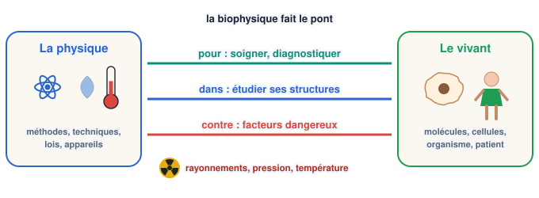
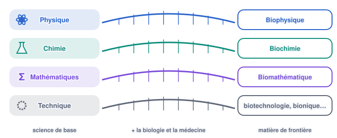
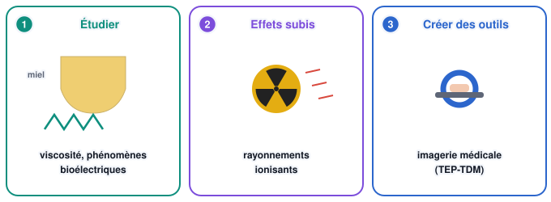
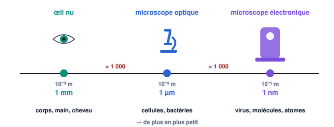
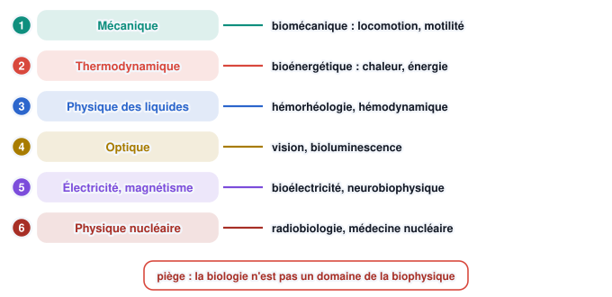
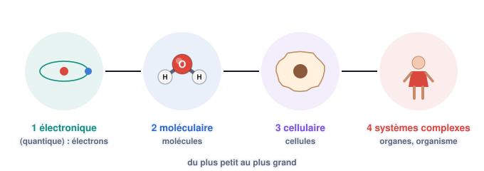
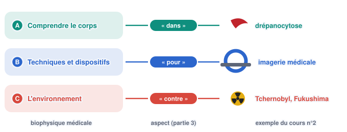
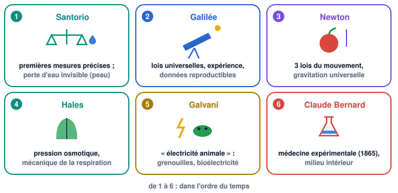

# La biophysique, science de frontière

8 schémas. Pour en afficher un dans le chat : ``.

## 0. La physique au service du vivant, pour l'étudier, et ce qui le menace.

`https://cdn.jsdelivr.net/gh/alxhe3-lab/schemas-medecine@main/Biophysique/CM1/fig00-ad15c03d.svg`

## 1. Quel « pont » chaque science fait-elle vers le vivant ?

`https://cdn.jsdelivr.net/gh/alxhe3-lab/schemas-medecine@main/Biophysique/CM1/fig01-f145c5d1.svg`

## 2. Que fait la biophysique ?

`https://cdn.jsdelivr.net/gh/alxhe3-lab/schemas-medecine@main/Biophysique/CM1/fig02-181c29f3.svg`

## 3. Quel instrument pour voir quoi ?

`https://cdn.jsdelivr.net/gh/alxhe3-lab/schemas-medecine@main/Biophysique/CM1/fig03-39d453f0.svg`

## 4. Quelle branche de la physique pour quel domaine ?

`https://cdn.jsdelivr.net/gh/alxhe3-lab/schemas-medecine@main/Biophysique/CM1/fig04-78d05de9.svg`

## 5. Du plus petit au plus grand : quels niveaux ?

`https://cdn.jsdelivr.net/gh/alxhe3-lab/schemas-medecine@main/Biophysique/CM1/fig05-30c83577.svg`

## 6. Comment A, B, C rejoignent-ils « dans, pour, contre » ?

`https://cdn.jsdelivr.net/gh/alxhe3-lab/schemas-medecine@main/Biophysique/CM1/fig06-59f642f8.svg`

## 7. Qui a fait quoi, et dans quel ordre ?

`https://cdn.jsdelivr.net/gh/alxhe3-lab/schemas-medecine@main/Biophysique/CM1/fig07-6f67a890.svg`
