# Drépanocytose, Tchernobyl et imagerie

12 schémas. Pour en afficher un dans le chat : ``.

## 0. Un exemple par objectif de la biophysique médicale.

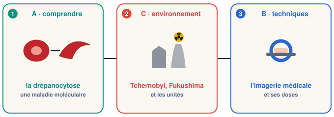

`https://cdn.jsdelivr.net/gh/alxhe3-lab/schemas-medecine@main/Biophysique/CM2/fig00-9477d0c1.svg`

## 1. Quelle méthode pour quel niveau ?

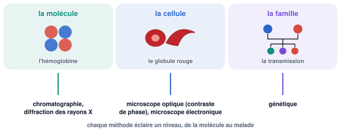

`https://cdn.jsdelivr.net/gh/alxhe3-lab/schemas-medecine@main/Biophysique/CM2/fig01-04654562.svg`

## 2. Que change la mutation, et qu'en résulte-t-il ?

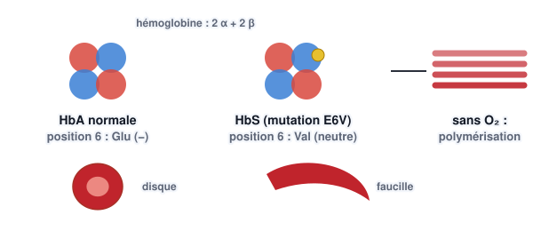

`https://cdn.jsdelivr.net/gh/alxhe3-lab/schemas-medecine@main/Biophysique/CM2/fig02-0c92ea16.svg`

## 3. Pourquoi tant d'organes sont-ils touchés ?

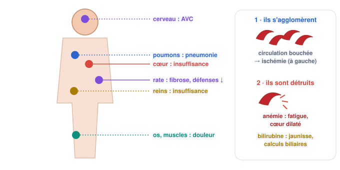

`https://cdn.jsdelivr.net/gh/alxhe3-lab/schemas-medecine@main/Biophysique/CM2/fig03-ded809d9.svg`

## 4. Deux parents porteurs : quel risque pour l'enfant ?

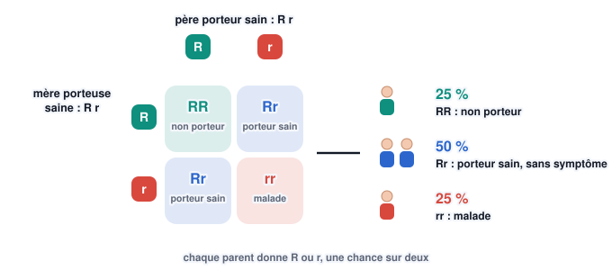

`https://cdn.jsdelivr.net/gh/alxhe3-lab/schemas-medecine@main/Biophysique/CM2/fig04-eb87d47f.svg`

## 5. Lequel a rejeté le plus ?

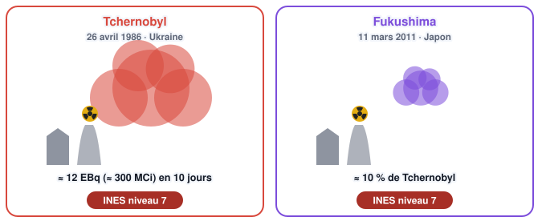

`https://cdn.jsdelivr.net/gh/alxhe3-lab/schemas-medecine@main/Biophysique/CM2/fig05-df880022.svg`

## 6. Que reste-t-il après chaque période ?

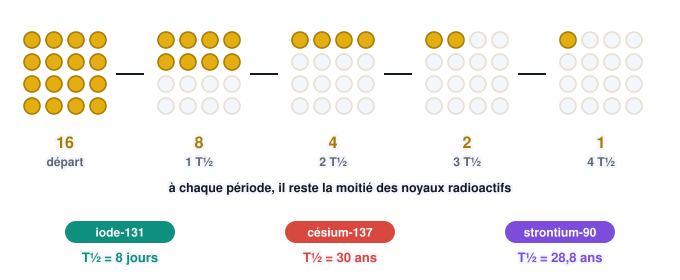

`https://cdn.jsdelivr.net/gh/alxhe3-lab/schemas-medecine@main/Biophysique/CM2/fig06-9be8f9dd.svg`

## 7. Du dépistage au cancer : combien d'enfants à chaque étape ?

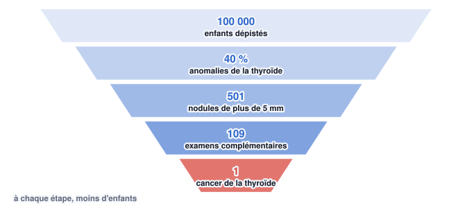

`https://cdn.jsdelivr.net/gh/alxhe3-lab/schemas-medecine@main/Biophysique/CM2/fig07-22430c07.svg`

## 8. Que mesure chaque unité ?

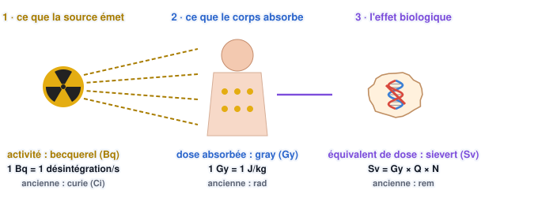

`https://cdn.jsdelivr.net/gh/alxhe3-lab/schemas-medecine@main/Biophysique/CM2/fig08-f4c161a9.svg`

## 9. Du patient à l'image : quelles étapes ?

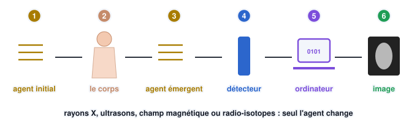

`https://cdn.jsdelivr.net/gh/alxhe3-lab/schemas-medecine@main/Biophysique/CM2/fig09-e2832c3e.svg`

## 10. Quel agent envoie-t-on, quel agent détecte-t-on ?

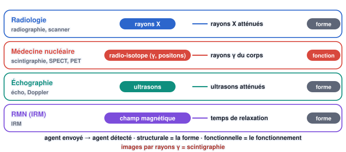

`https://cdn.jsdelivr.net/gh/alxhe3-lab/schemas-medecine@main/Biophysique/CM2/fig10-9ce07f57.svg`

## 11. Quelle scintigraphie irradie le plus ?

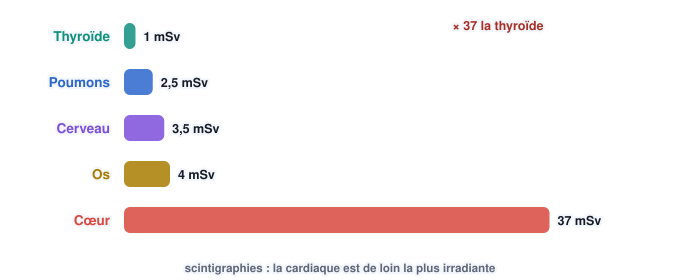

`https://cdn.jsdelivr.net/gh/alxhe3-lab/schemas-medecine@main/Biophysique/CM2/fig11-59b84258.svg`
