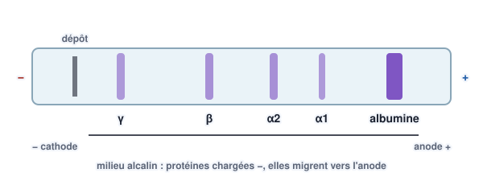
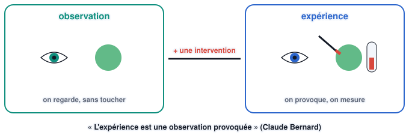
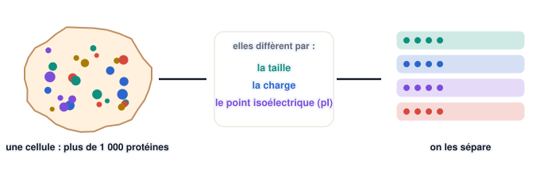
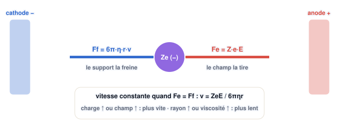
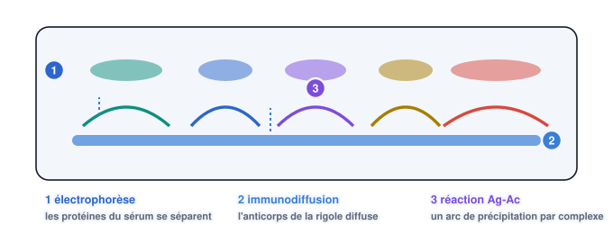
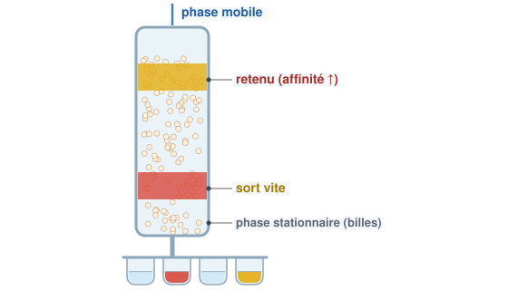

# Méthodes d'étude : l'électrophorèse

6 schémas. Pour en afficher un dans le chat : ``.

## 0. Schéma simplifié : le sérum se sépare en 5 fractions.

`https://cdn.jsdelivr.net/gh/alxhe3-lab/schemas-medecine@main/Biophysique/CM4/fig00-51005dbd.svg`

## 1. Qu'ajoute l'expérience à l'observation ?

`https://cdn.jsdelivr.net/gh/alxhe3-lab/schemas-medecine@main/Biophysique/CM4/fig01-3a15c81a.svg`

## 2. Pourquoi séparer les protéines ?

`https://cdn.jsdelivr.net/gh/alxhe3-lab/schemas-medecine@main/Biophysique/CM4/fig02-d095e13c.svg`

## 3. Quelles forces s'exercent sur la protéine qui migre ?

`https://cdn.jsdelivr.net/gh/alxhe3-lab/schemas-medecine@main/Biophysique/CM4/fig03-24840829.svg`

## 6. Les mêmes numéros sur la plaque

`https://cdn.jsdelivr.net/gh/alxhe3-lab/schemas-medecine@main/Biophysique/CM4/fig06-e4013a33.svg`

## 7. Pourquoi les composants sortent-ils à des moments différents ?

`https://cdn.jsdelivr.net/gh/alxhe3-lab/schemas-medecine@main/Biophysique/CM4/fig07-4536d183.svg`
