# Chromatographie, centrifugation, lyophilisation

11 schémas. Pour en afficher un dans le chat : ``.

## 0. Le fil de la séance : séparer par l'affinité (chromatographie), par la masse (centrifugation), puis sécher par le froid (lyophilisation).

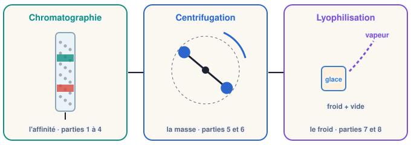

`https://cdn.jsdelivr.net/gh/alxhe3-lab/schemas-medecine@main/Biophysique/CM5/fig00-a7451497.svg`

## 1. Pourquoi les composants sortent-ils à des moments différents ?

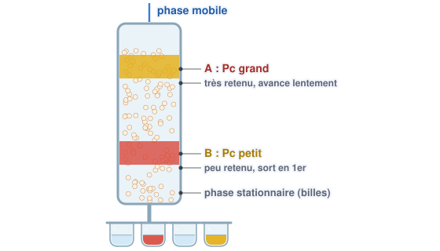

`https://cdn.jsdelivr.net/gh/alxhe3-lab/schemas-medecine@main/Biophysique/CM5/fig01-9f66f48d.svg`

## 2. Surface ou charge : qu'est-ce qui retient la molécule ?

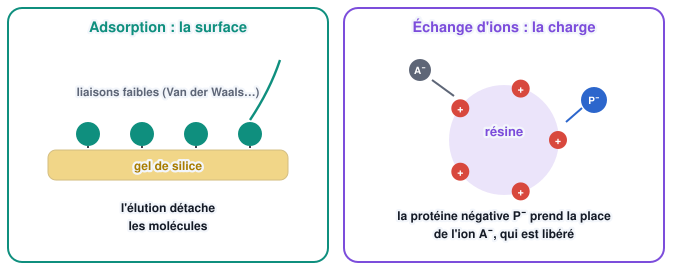

`https://cdn.jsdelivr.net/gh/alxhe3-lab/schemas-medecine@main/Biophysique/CM5/fig02-685bf577.svg`

## 3. Seul l'anticorps qui reconnaît l'antigène reste dans la colonne

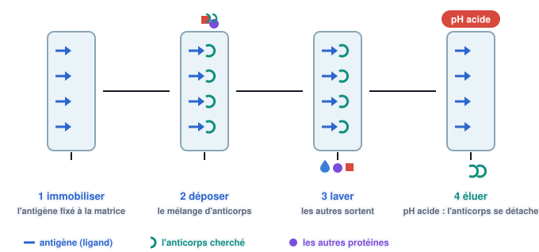

`https://cdn.jsdelivr.net/gh/alxhe3-lab/schemas-medecine@main/Biophysique/CM5/fig03-d9ad47e0.svg`

## 4. Pourquoi les grosses molécules sortent-elles avant les petites ?

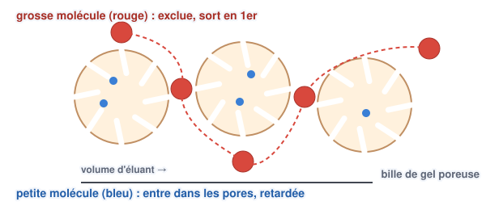

`https://cdn.jsdelivr.net/gh/alxhe3-lab/schemas-medecine@main/Biophysique/CM5/fig04-83859612.svg`

## 5. Estimer une masse moléculaire : plus la protéine est lourde, plus Ve/V0 est petit

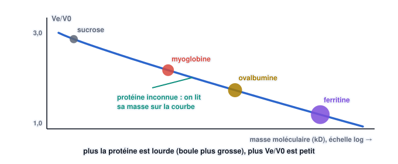

`https://cdn.jsdelivr.net/gh/alxhe3-lab/schemas-medecine@main/Biophysique/CM5/fig05-65958f7b.svg`

## 6. Dans le tube qui tourne, quelles forces agissent sur la particule ?

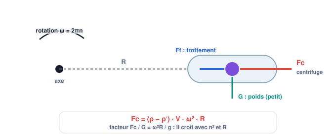

`https://cdn.jsdelivr.net/gh/alxhe3-lab/schemas-medecine@main/Biophysique/CM5/fig06-31be2650.svg`

## 7. Plus on tourne vite et longtemps, plus ce qui se dépose est petit

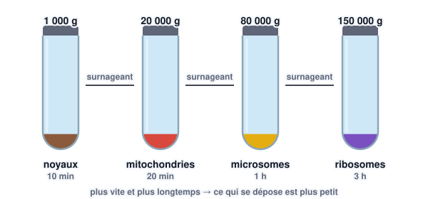

`https://cdn.jsdelivr.net/gh/alxhe3-lab/schemas-medecine@main/Biophysique/CM5/fig07-24a6664a.svg`

## 8. Pourquoi baisser la pression ? Sous le point triple, la glace devient directement vapeur

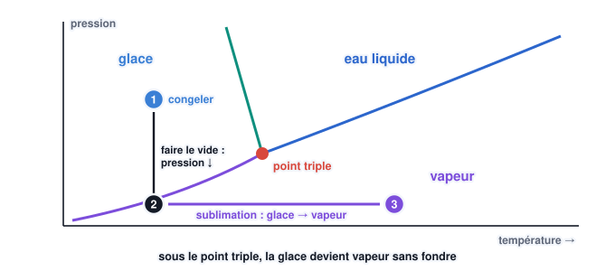

`https://cdn.jsdelivr.net/gh/alxhe3-lab/schemas-medecine@main/Biophysique/CM5/fig08-3ff6917c.svg`

## 9. Pourquoi le sang complet ne se lyophilise-t-il pas encore ?

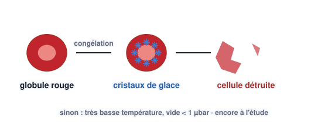

`https://cdn.jsdelivr.net/gh/alxhe3-lab/schemas-medecine@main/Biophysique/CM5/fig09-e05cfb45.svg`

## 10. Où est le détecteur ? Dans l'axe (turbidimétrie) ou de côté (néphélométrie)

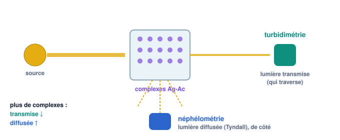

`https://cdn.jsdelivr.net/gh/alxhe3-lab/schemas-medecine@main/Biophysique/CM5/fig10-bf8fd1e0.svg`
