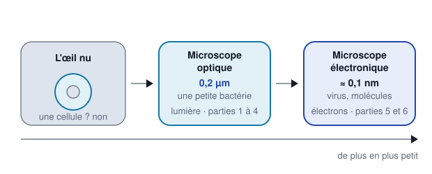
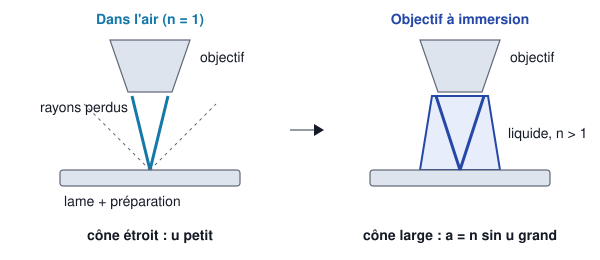
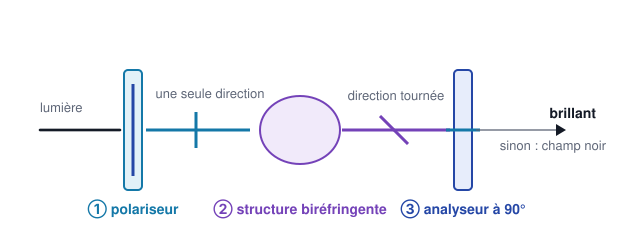

# Les microscopes : optiques et électroniques

3 schémas. Pour en afficher un dans le chat : ``.

## 0. Le fil du cours : on passe de la lumière aux électrons pour voir de plus petits détails.

`https://cdn.jsdelivr.net/gh/alxhe3-lab/schemas-medecine@main/Biophysique/CM8/fig00-25bf2de9.svg`

## 3. Pourquoi l'objectif à immersion voit-il plus fin ?

`https://cdn.jsdelivr.net/gh/alxhe3-lab/schemas-medecine@main/Biophysique/CM8/fig03-21bd3a6f.svg`

## 4. Polariseur et analyseur croisés : pourquoi un fond noir ?

`https://cdn.jsdelivr.net/gh/alxhe3-lab/schemas-medecine@main/Biophysique/CM8/fig04-b4051227.svg`
