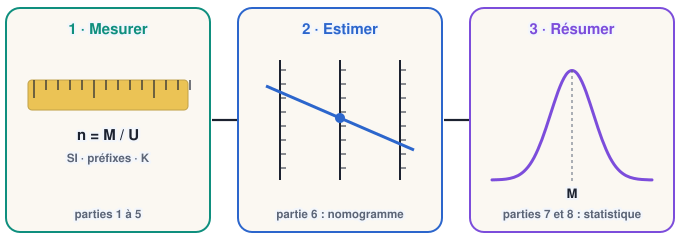
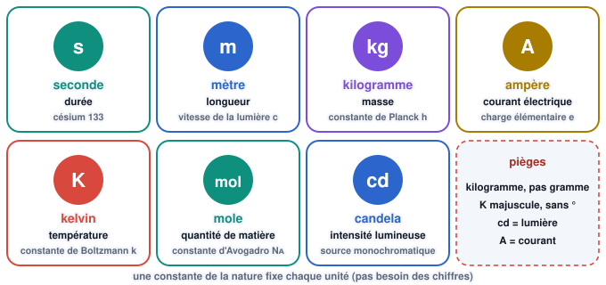
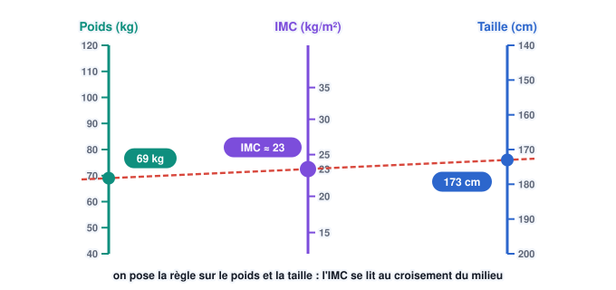
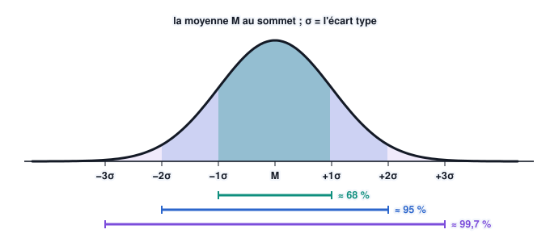
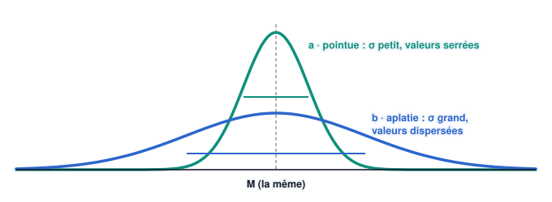

# Mesurer, convertir, résumer

5 schémas. Pour en afficher un dans le chat : ``.

## 0. Mesurer, estimer, résumer : le fil du TP.

`https://cdn.jsdelivr.net/gh/alxhe3-lab/schemas-medecine@main/Biophysique/TP1/fig00-6f57beff.svg`

## 1. Les 7 unités de base, d'un coup d'œil

`https://cdn.jsdelivr.net/gh/alxhe3-lab/schemas-medecine@main/Biophysique/TP1/fig01-d065b29c.svg`

## 2. On relie le poids et la taille avec une règle : l'IMC se lit là où la droite coupe l'échelle du milieu

`https://cdn.jsdelivr.net/gh/alxhe3-lab/schemas-medecine@main/Biophysique/TP1/fig02-92e2fd4d.svg`

## 3. La part des valeurs autour de la moyenne

`https://cdn.jsdelivr.net/gh/alxhe3-lab/schemas-medecine@main/Biophysique/TP1/fig03-029e7b8f.svg`

## 4. Même moyenne, deux dispersions

`https://cdn.jsdelivr.net/gh/alxhe3-lab/schemas-medecine@main/Biophysique/TP1/fig04-63e34578.svg`
