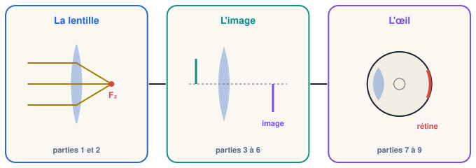
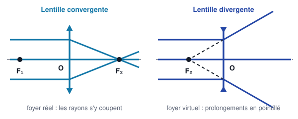
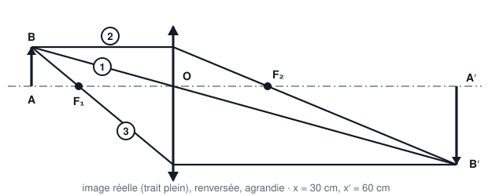
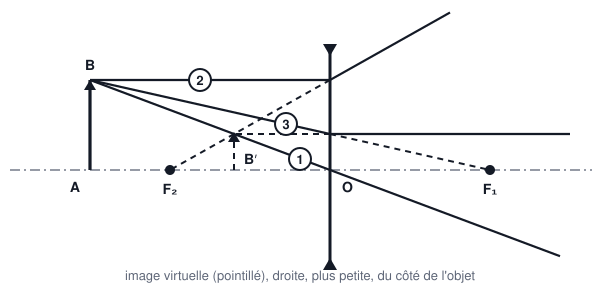
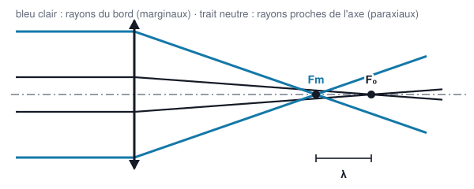
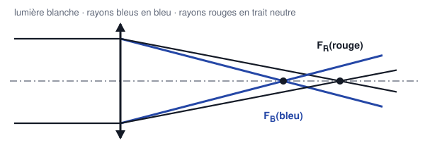
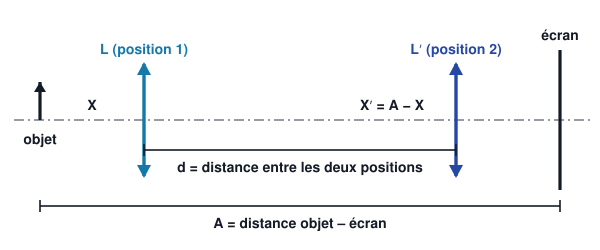
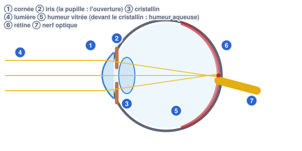
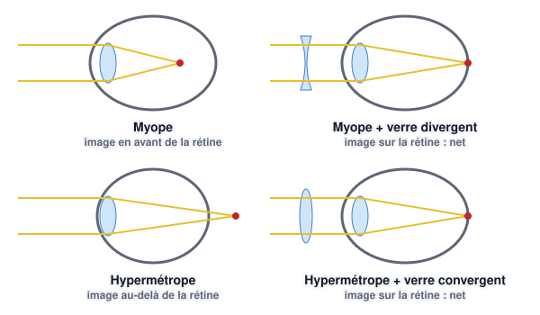

# Optique : les lentilles et l'œil

9 schémas. Pour en afficher un dans le chat : ``.

## 0. Le fil du TP : la lentille, l'image, puis l'œil.

`https://cdn.jsdelivr.net/gh/alxhe3-lab/schemas-medecine@main/Biophysique/TP2/fig00-80b91007.svg`

## 1. Le foyer d'une lentille convergente (réel) et d'une lentille divergente (virtuel)

`https://cdn.jsdelivr.net/gh/alxhe3-lab/schemas-medecine@main/Biophysique/TP2/fig01-65db7896.svg`

## 2. Lentille convergente : les mêmes numéros sur le schéma

`https://cdn.jsdelivr.net/gh/alxhe3-lab/schemas-medecine@main/Biophysique/TP2/fig02-d30ba27d.svg`

## 3. Lentille divergente : rayons 1, 2, 3 et image virtuelle

`https://cdn.jsdelivr.net/gh/alxhe3-lab/schemas-medecine@main/Biophysique/TP2/fig03-f58b3d1a.svg`

## 4. Aberration sphérique : les rayons du bord convergent plus tôt

`https://cdn.jsdelivr.net/gh/alxhe3-lab/schemas-medecine@main/Biophysique/TP2/fig04-78f59b3f.svg`

## 5. Aberration chromatique : un foyer par couleur

`https://cdn.jsdelivr.net/gh/alxhe3-lab/schemas-medecine@main/Biophysique/TP2/fig05-567291ee.svg`

## 6. Les deux positions nettes de la lentille

`https://cdn.jsdelivr.net/gh/alxhe3-lab/schemas-medecine@main/Biophysique/TP2/fig06-8e2e07da.svg`

## 7. L'œil vu de côté, lumière de gauche à droite

`https://cdn.jsdelivr.net/gh/alxhe3-lab/schemas-medecine@main/Biophysique/TP2/fig07-91d6fade.svg`

## 8. Myope et hypermétrope, sans puis avec verre correcteur

`https://cdn.jsdelivr.net/gh/alxhe3-lab/schemas-medecine@main/Biophysique/TP2/fig08-3d797540.svg`
