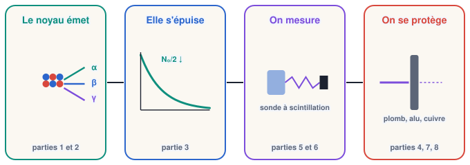
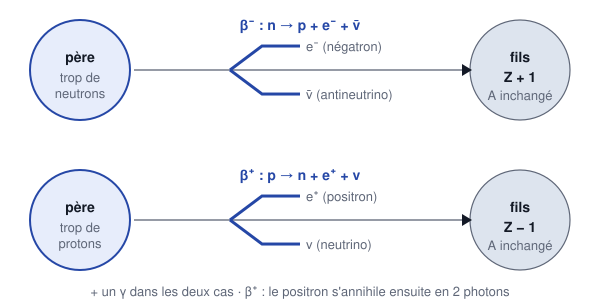
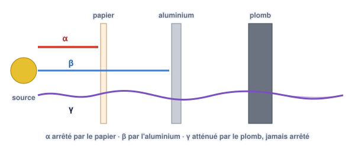
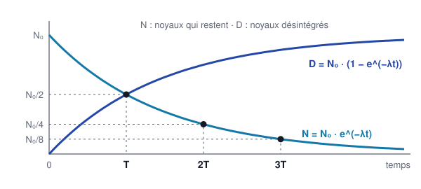
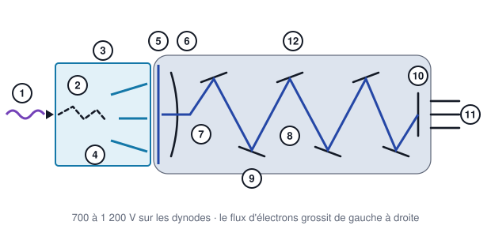
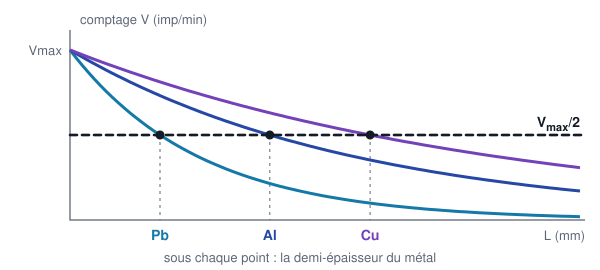

# Radiométrie et dosimétrie

6 schémas. Pour en afficher un dans le chat : ``.

## 0. Le fil du TP, en quatre étapes.

`https://cdn.jsdelivr.net/gh/alxhe3-lab/schemas-medecine@main/Biophysique/TP3/fig00-edce916e.svg`

## 1. β⁻ et β⁺ : le schéma à savoir refaire

`https://cdn.jsdelivr.net/gh/alxhe3-lab/schemas-medecine@main/Biophysique/TP3/fig01-1b1edc36.svg`

## 2. Ce qui arrête chaque rayonnement

`https://cdn.jsdelivr.net/gh/alxhe3-lab/schemas-medecine@main/Biophysique/TP3/fig02-12ee1627.svg`

## 3. N descend, D monte

`https://cdn.jsdelivr.net/gh/alxhe3-lab/schemas-medecine@main/Biophysique/TP3/fig03-28be8d53.svg`

## 4. Le schéma à savoir dessiner (numéros = frise ci-dessous)

`https://cdn.jsdelivr.net/gh/alxhe3-lab/schemas-medecine@main/Biophysique/TP3/fig04-733a5a25.svg`

## 5. Trouver la demi-épaisseur sur le graphique

`https://cdn.jsdelivr.net/gh/alxhe3-lab/schemas-medecine@main/Biophysique/TP3/fig05-3f355005.svg`
