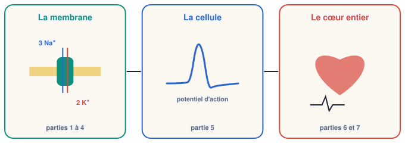
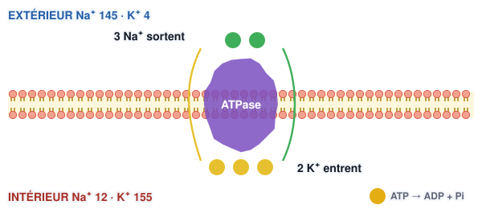
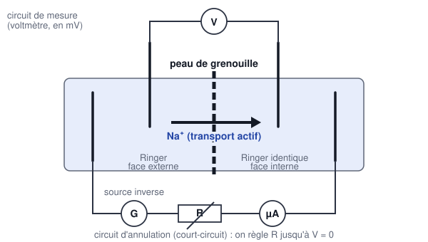
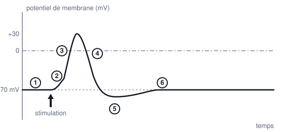
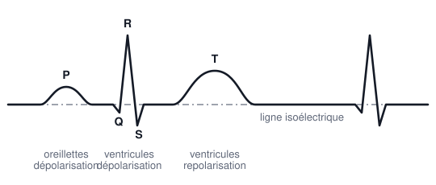
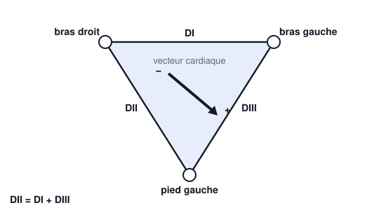

# Transport actif et biopotentiels

6 schémas. Pour en afficher un dans le chat : ``.

## 0. De la membrane au cœur entier.

`https://cdn.jsdelivr.net/gh/alxhe3-lab/schemas-medecine@main/Biophysique/TP4/fig00-deb8c8b1.svg`

## 1. La pompe Na⁺/K⁺

`https://cdn.jsdelivr.net/gh/alxhe3-lab/schemas-medecine@main/Biophysique/TP4/fig01-6566e191.svg`

## 2. Montage d'Ussing et Zerah

`https://cdn.jsdelivr.net/gh/alxhe3-lab/schemas-medecine@main/Biophysique/TP4/fig02-df73ccce.svg`

## 3. Le potentiel d'action d'un neurone

`https://cdn.jsdelivr.net/gh/alxhe3-lab/schemas-medecine@main/Biophysique/TP4/fig03-0ccb4c06.svg`

## 4. ECG normal

`https://cdn.jsdelivr.net/gh/alxhe3-lab/schemas-medecine@main/Biophysique/TP4/fig04-b404eea7.svg`

## 5. Triangle d'Einthoven

`https://cdn.jsdelivr.net/gh/alxhe3-lab/schemas-medecine@main/Biophysique/TP4/fig05-b8eb13f9.svg`
