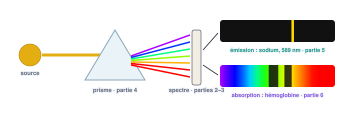
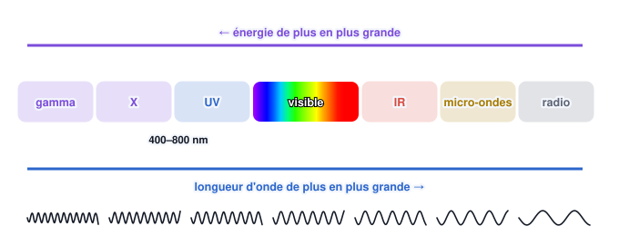
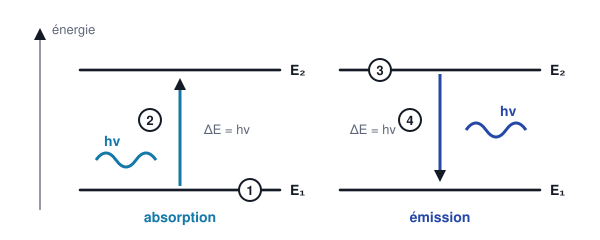
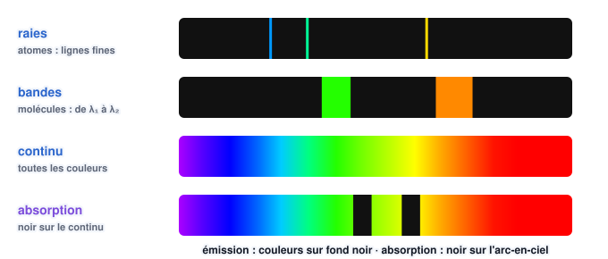
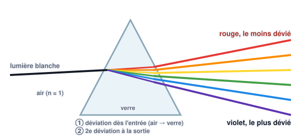
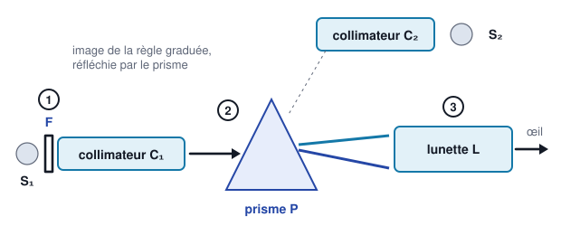
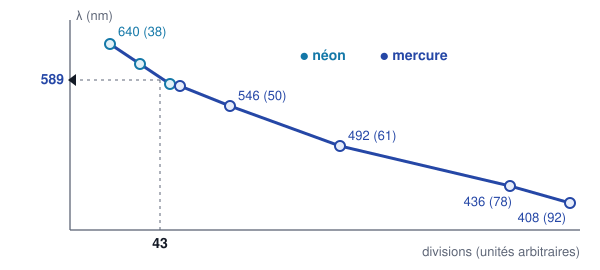
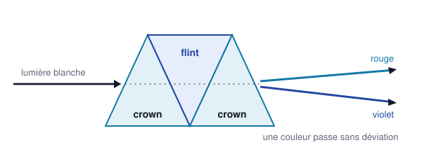
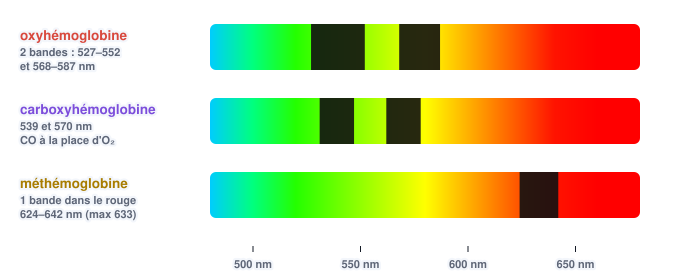

# L'analyse spectrale

9 schémas. Pour en afficher un dans le chat : ``.

## 0. Le fil du TP : la lumière traverse un prisme, on lit le spectre, et ses raies ou ses bandes disent ce qu'il y a dans l'échantillon.

`https://cdn.jsdelivr.net/gh/alxhe3-lab/schemas-medecine@main/Biophysique/TP5/fig00-52fdf75b.svg`

## 1. Plus la longueur d'onde est courte, plus l'onde porte d'énergie

`https://cdn.jsdelivr.net/gh/alxhe3-lab/schemas-medecine@main/Biophysique/TP5/fig01-14c257d9.svg`

## 2. Les mêmes numéros sur les niveaux d'énergie

`https://cdn.jsdelivr.net/gh/alxhe3-lab/schemas-medecine@main/Biophysique/TP5/fig02-5236b035.svg`

## 3. À quoi ressemblent les trois formes, et une absorption ?

`https://cdn.jsdelivr.net/gh/alxhe3-lab/schemas-medecine@main/Biophysique/TP5/fig03-0f24443f.svg`

## 4. Le bon schéma : quelle couleur est la plus déviée ?

`https://cdn.jsdelivr.net/gh/alxhe3-lab/schemas-medecine@main/Biophysique/TP5/fig04-177f26b5.svg`

## 5. Le trajet de la lumière dans le spectroscope à trois bras

`https://cdn.jsdelivr.net/gh/alxhe3-lab/schemas-medecine@main/Biophysique/TP5/fig05-0ee6e9e3.svg`

## 6. Lire la courbe d'étalonnage : 43 divisions → 589 nm, le sodium

`https://cdn.jsdelivr.net/gh/alxhe3-lab/schemas-medecine@main/Biophysique/TP5/fig06-844c6c0a.svg`

## 7. Prisme d'Amici : la lumière ressort presque droite, mais étalée en couleurs

`https://cdn.jsdelivr.net/gh/alxhe3-lab/schemas-medecine@main/Biophysique/TP5/fig07-c9b2884b.svg`

## 8. Où tombent les bandes noires de chaque dérivé ?

`https://cdn.jsdelivr.net/gh/alxhe3-lab/schemas-medecine@main/Biophysique/TP5/fig08-7e6222b6.svg`
