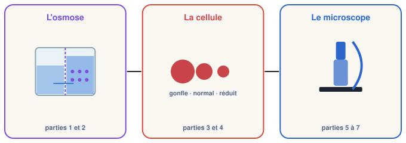
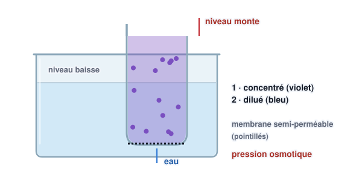
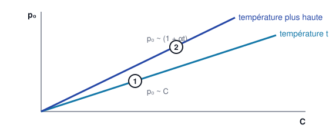
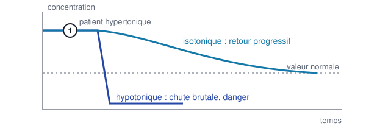
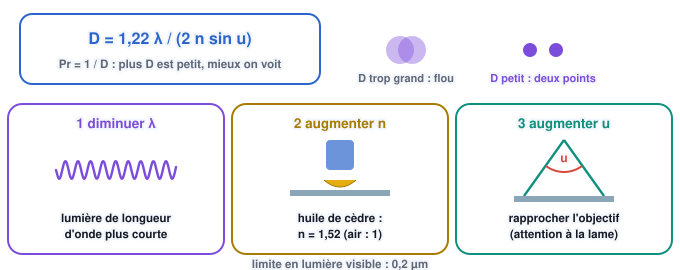
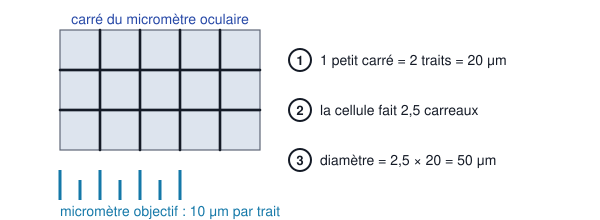

# L'osmose et le microscope optique

6 schémas. Pour en afficher un dans le chat : ``.

## 0. Le fil du cours : l'eau passe la membrane, la cellule change de volume, et le microscope permet de le voir et de le mesurer.

`https://cdn.jsdelivr.net/gh/alxhe3-lab/schemas-medecine@main/Biophysique/TP6/fig00-48b299ec.svg`

## 1. Pourquoi le niveau monte du côté le plus concentré ?

`https://cdn.jsdelivr.net/gh/alxhe3-lab/schemas-medecine@main/Biophysique/TP6/fig01-3ed9d414.svg`

## 2. Lois 1 et 2 : plus de soluté ou plus chaud, plus de pression

`https://cdn.jsdelivr.net/gh/alxhe3-lab/schemas-medecine@main/Biophysique/TP6/fig02-75902afc.svg`

## 4. Pourquoi pas de l'eau dans la veine d'un patient déshydraté ?

`https://cdn.jsdelivr.net/gh/alxhe3-lab/schemas-medecine@main/Biophysique/TP6/fig04-77a24928.svg`

## 7. Comment diminuer D, donc augmenter la résolution ?

`https://cdn.jsdelivr.net/gh/alxhe3-lab/schemas-medecine@main/Biophysique/TP6/fig07-bd678856.svg`

## 8. La méthode des deux micromètres : étalonner, puis compter

`https://cdn.jsdelivr.net/gh/alxhe3-lab/schemas-medecine@main/Biophysique/TP6/fig08-f59e95d9.svg`
