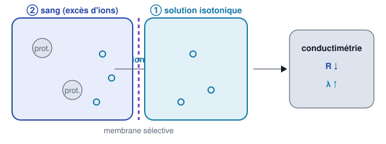
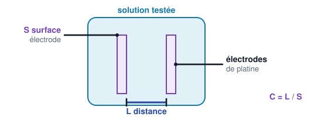
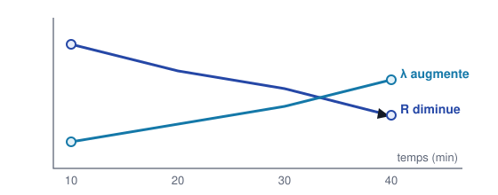

# La dialyse et sa mesure par conductimétrie

3 schémas. Pour en afficher un dans le chat : ``.

## 0. Les ions passent du compartiment ② au ①, et la solution ① conduit de mieux en mieux.

`https://cdn.jsdelivr.net/gh/alxhe3-lab/schemas-medecine@main/Biophysique/TP7/fig00-da2903f8.svg`

## 4. D'où vient la constante C ?

`https://cdn.jsdelivr.net/gh/alxhe3-lab/schemas-medecine@main/Biophysique/TP7/fig04-23bfd27f.svg`

## 5. Pourquoi les deux courbes se croisent-elles ?

`https://cdn.jsdelivr.net/gh/alxhe3-lab/schemas-medecine@main/Biophysique/TP7/fig05-2515d7fe.svg`
