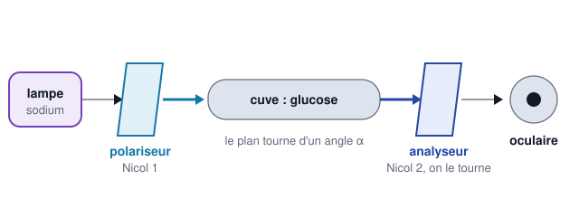
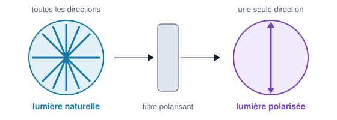
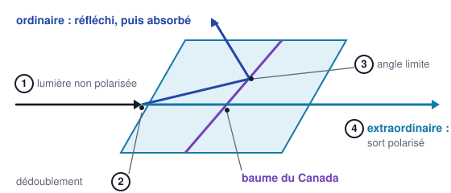
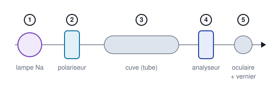
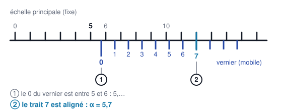

# La polarimétrie

6 schémas. Pour en afficher un dans le chat : ``.

## 0. Le chemin de la lumière : lampe, polariseur, cuve, analyseur, œil.

`https://cdn.jsdelivr.net/gh/alxhe3-lab/schemas-medecine@main/Biophysique/TP8/fig00-009aacbe.svg`

## 1. Avant et après le filtre : dans combien de directions la lumière vibre-t-elle ?

`https://cdn.jsdelivr.net/gh/alxhe3-lab/schemas-medecine@main/Biophysique/TP8/fig01-f181ed71.svg`

## 2. Lequel des deux rayons sort du prisme ?

`https://cdn.jsdelivr.net/gh/alxhe3-lab/schemas-medecine@main/Biophysique/TP8/fig02-4ad37d70.svg`

## 3. Les pièces du polarimètre, dans l'ordre

`https://cdn.jsdelivr.net/gh/alxhe3-lab/schemas-medecine@main/Biophysique/TP8/fig03-2629ccf0.svg`

## 4. Comment lire l'angle sur le vernier ?

`https://cdn.jsdelivr.net/gh/alxhe3-lab/schemas-medecine@main/Biophysique/TP8/fig04-297fc697.svg`

## 5. Que voit-on sur un préparat de pomme de terre ?

`https://cdn.jsdelivr.net/gh/alxhe3-lab/schemas-medecine@main/Biophysique/TP8/fig05-e4a189b5.svg`
