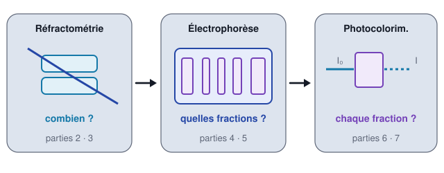
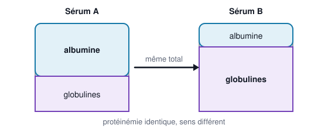
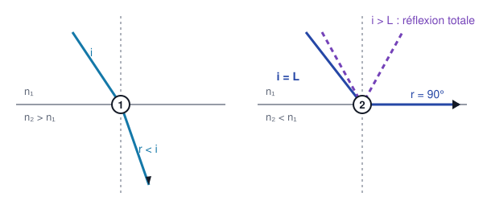
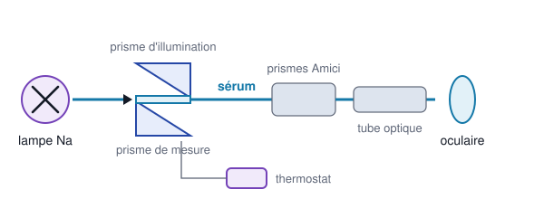
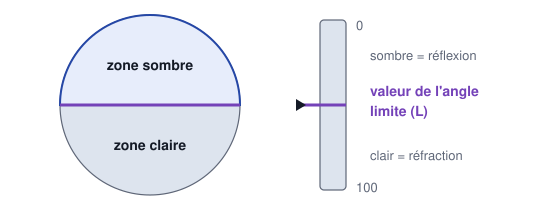
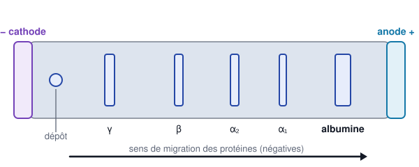
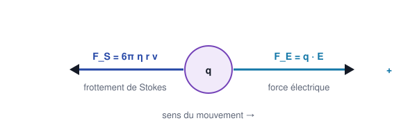
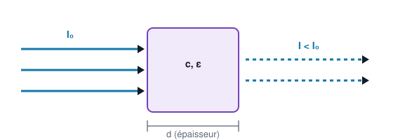
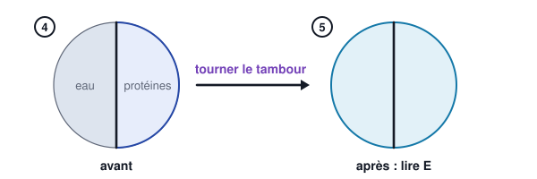
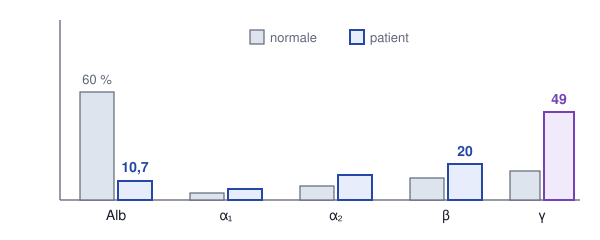

# Les protéines du sang

10 schémas. Pour en afficher un dans le chat : ``.

## 0. Le fil du TP : quantité totale, puis séparation, puis dosage de chaque fraction.

`https://cdn.jsdelivr.net/gh/alxhe3-lab/schemas-medecine@main/Biophysique/TP9/fig00-70b467e9.svg`

## 1. Pourquoi le total ne suffit-il pas ?

`https://cdn.jsdelivr.net/gh/alxhe3-lab/schemas-medecine@main/Biophysique/TP9/fig01-96be3dcc.svg`

## 2. Quand l'angle d'incidence devient-il « limite » ?

`https://cdn.jsdelivr.net/gh/alxhe3-lab/schemas-medecine@main/Biophysique/TP9/fig02-bc5decc3.svg`

## 3. Le trajet de la lumière dans le réfractomètre

`https://cdn.jsdelivr.net/gh/alxhe3-lab/schemas-medecine@main/Biophysique/TP9/fig03-39f83d4a.svg`

## 4. Où lire l'angle limite dans l'oculaire ?

`https://cdn.jsdelivr.net/gh/alxhe3-lab/schemas-medecine@main/Biophysique/TP9/fig04-dbfeb916.svg`

## 5. Où poser la goutte, et dans quel ordre arrivent les fractions ?

`https://cdn.jsdelivr.net/gh/alxhe3-lab/schemas-medecine@main/Biophysique/TP9/fig05-21cd18de.svg`

## 6. Deux forces opposées sur une protéine

`https://cdn.jsdelivr.net/gh/alxhe3-lab/schemas-medecine@main/Biophysique/TP9/fig06-9c63ef08.svg`

## 7. Ce qui entre, ce qui sort

`https://cdn.jsdelivr.net/gh/alxhe3-lab/schemas-medecine@main/Biophysique/TP9/fig07-c8fb0b75.svg`

## 8. Égaliser les deux demi-cercles, puis lire E

`https://cdn.jsdelivr.net/gh/alxhe3-lab/schemas-medecine@main/Biophysique/TP9/fig08-b0c98356.svg`

## 9. Le patient comparé à la normale

`https://cdn.jsdelivr.net/gh/alxhe3-lab/schemas-medecine@main/Biophysique/TP9/fig09-d6ccbbe9.svg`
