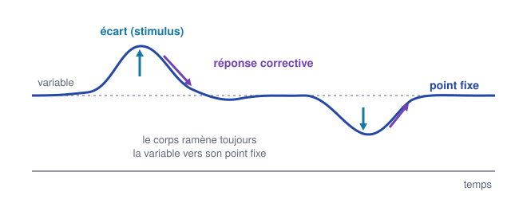
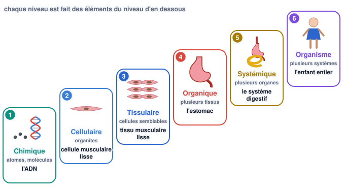
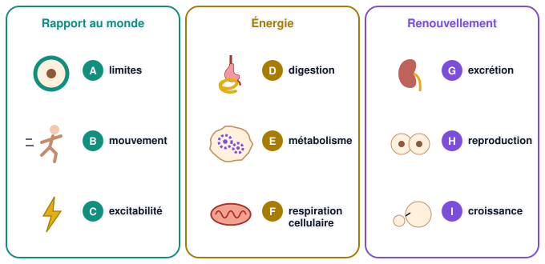
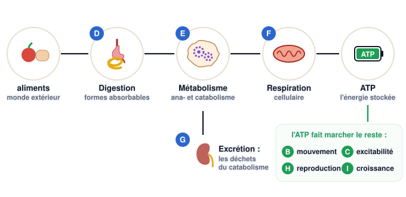
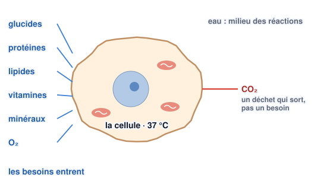
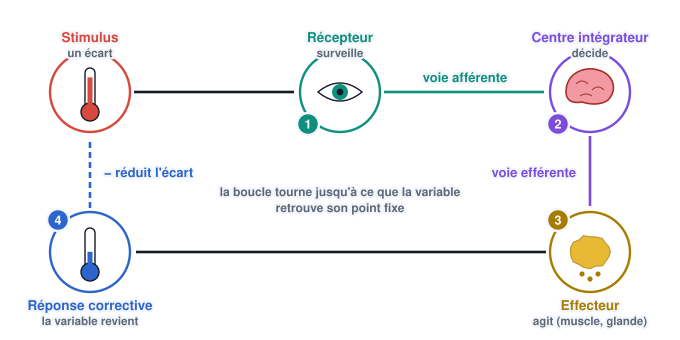
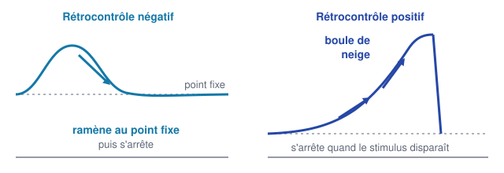
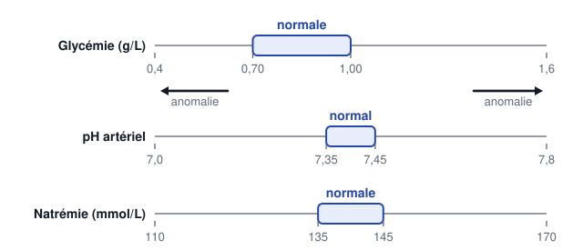
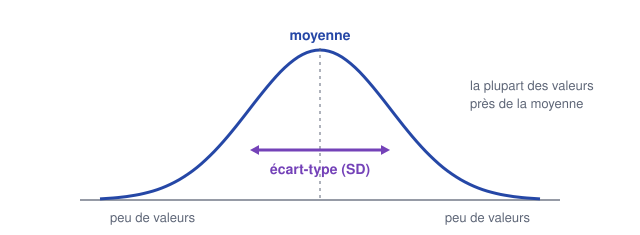

# Le vivant et l'homéostasie

9 schémas. Pour en afficher un dans le chat : ``.

## 0. L'homéostasie en une image : la variable s'écarte de son point fixe, le corps la ramène.

`https://cdn.jsdelivr.net/gh/alxhe3-lab/schemas-medecine@main/Physiologie/CM1/fig00-c70fb46e.svg`

## 1. Comment passe-t-on de l'atome à l'organisme ?

`https://cdn.jsdelivr.net/gh/alxhe3-lab/schemas-medecine@main/Physiologie/CM1/fig01-e28d7a81.svg`

## 2. Quelles sont les neuf fonctions du vivant ?

`https://cdn.jsdelivr.net/gh/alxhe3-lab/schemas-medecine@main/Physiologie/CM1/fig02-b389fae8.svg`

## 3. Comment les fonctions d'énergie s'enchaînent-elles ?

`https://cdn.jsdelivr.net/gh/alxhe3-lab/schemas-medecine@main/Physiologie/CM1/fig03-4167ba69.svg`

## 4. Qu'est-ce qui est un besoin, et qu'est-ce qui est un déchet ?

`https://cdn.jsdelivr.net/gh/alxhe3-lab/schemas-medecine@main/Physiologie/CM1/fig04-1eab2c30.svg`

## 5. Qui fait quoi pour ramener la variable au point fixe ?

`https://cdn.jsdelivr.net/gh/alxhe3-lab/schemas-medecine@main/Physiologie/CM1/fig05-b1fa94b5.svg`

## 6. Que devient la variable dans chaque cas ?

`https://cdn.jsdelivr.net/gh/alxhe3-lab/schemas-medecine@main/Physiologie/CM1/fig06-7ae7cc11.svg`

## 7. Où commence l'anomalie ?

`https://cdn.jsdelivr.net/gh/alxhe3-lab/schemas-medecine@main/Physiologie/CM1/fig07-450c4d25.svg`

## 8. Pourquoi une seule mesure ne suffit-elle jamais ?

`https://cdn.jsdelivr.net/gh/alxhe3-lab/schemas-medecine@main/Physiologie/CM1/fig08-ec32494f.svg`
