# Potentiels membranaires, canaux et pompes

12 schémas. Pour en afficher un dans le chat : ``.

## 0. Le signal nerveux en une courbe : un stimulus, Na⁺ entre, K⁺ sort, puis retour au repos.

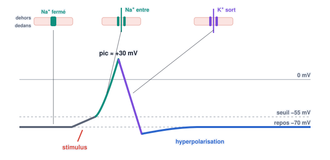

`https://cdn.jsdelivr.net/gh/alxhe3-lab/schemas-medecine@main/Physiologie/CM2/fig00-6ba08680.svg`

## 1. Dans quel équilibre est une cellule ?

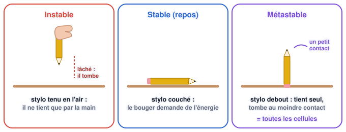

`https://cdn.jsdelivr.net/gh/alxhe3-lab/schemas-medecine@main/Physiologie/CM2/fig01-b1e1c8e5.svg`

## 2. Pourquoi les têtes sont-elles dehors et les queues au milieu ?

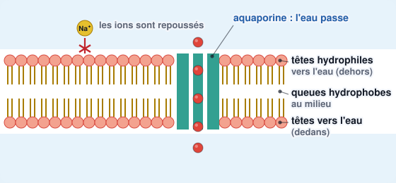

`https://cdn.jsdelivr.net/gh/alxhe3-lab/schemas-medecine@main/Physiologie/CM2/fig02-db2e31b9.svg`

## 3. Où va l'eau, et pourquoi s'arrête-t-elle ?

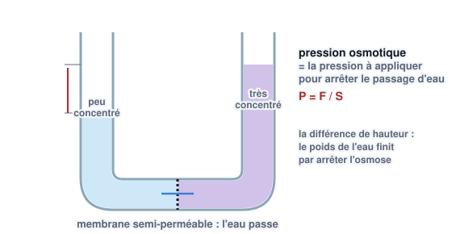

`https://cdn.jsdelivr.net/gh/alxhe3-lab/schemas-medecine@main/Physiologie/CM2/fig03-1ffffc68.svg`

## 4. Que devient un globule rouge dans chaque milieu ?

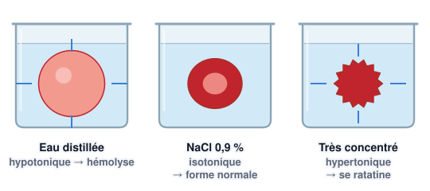

`https://cdn.jsdelivr.net/gh/alxhe3-lab/schemas-medecine@main/Physiologie/CM2/fig04-d5df5c4a.svg`

## 5. Qui fait passer quoi, et à quel prix ?

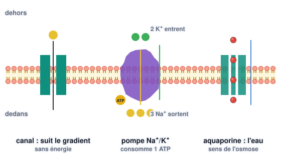

`https://cdn.jsdelivr.net/gh/alxhe3-lab/schemas-medecine@main/Physiologie/CM2/fig05-fbfc98f8.svg`

## 6. Où se place le potentiel de repos, et pourquoi ?

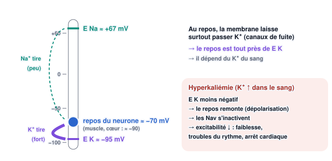

`https://cdn.jsdelivr.net/gh/alxhe3-lab/schemas-medecine@main/Physiologie/CM2/fig06-efb14055.svg`

## 7. Que font les deux portes du canal Na⁺ ?

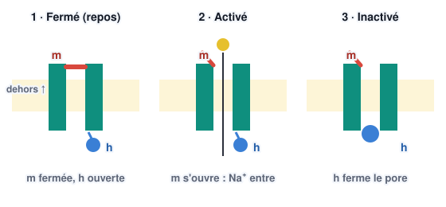

`https://cdn.jsdelivr.net/gh/alxhe3-lab/schemas-medecine@main/Physiologie/CM2/fig07-0ddd76ae.svg`

## 8. Que se passe-t-il à chaque phase ?

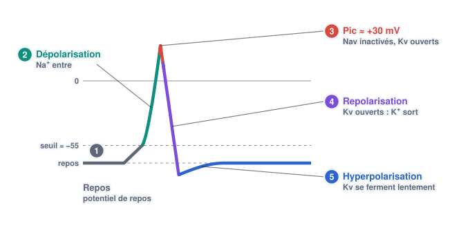

`https://cdn.jsdelivr.net/gh/alxhe3-lab/schemas-medecine@main/Physiologie/CM2/fig08-c370685f.svg`

## 9. Que veut dire « tout ou rien » ?

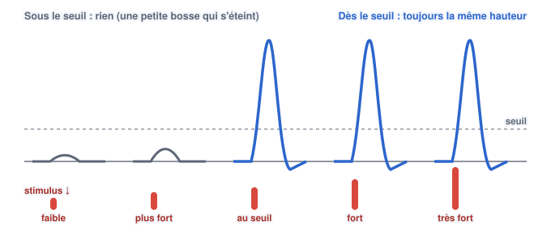

`https://cdn.jsdelivr.net/gh/alxhe3-lab/schemas-medecine@main/Physiologie/CM2/fig09-df78126e.svg`

## 10. Pourquoi la myéline rend-elle l'influx plus rapide ?

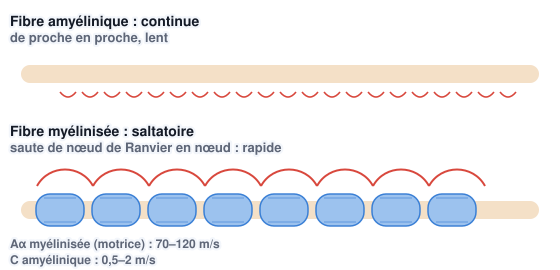

`https://cdn.jsdelivr.net/gh/alxhe3-lab/schemas-medecine@main/Physiologie/CM2/fig10-6b4830c4.svg`

## 11. Comment l'anesthésie locale coupe-t-elle la douleur ?

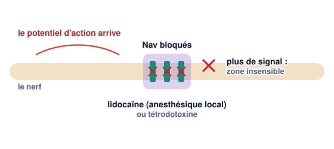

`https://cdn.jsdelivr.net/gh/alxhe3-lab/schemas-medecine@main/Physiologie/CM2/fig11-1f2168b2.svg`
