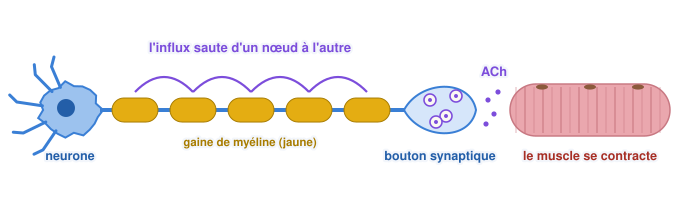
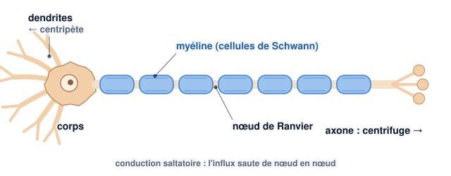
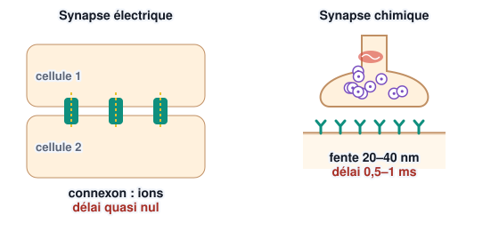
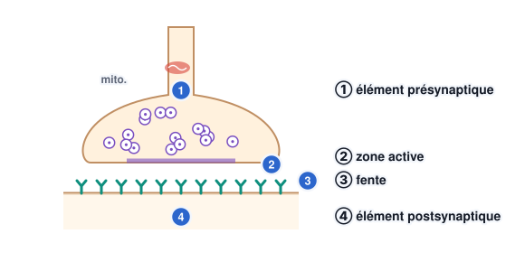
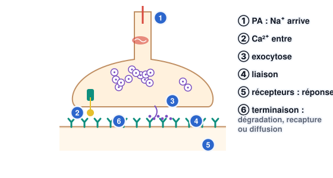
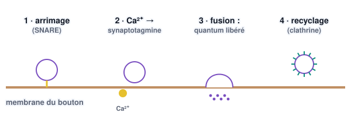
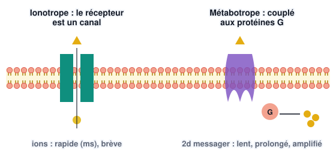
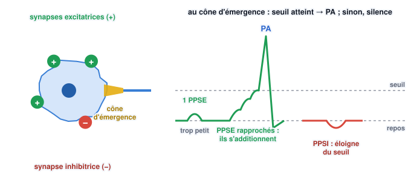
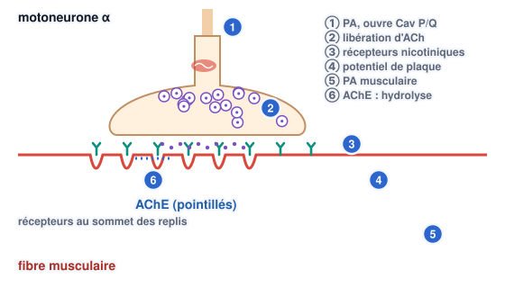
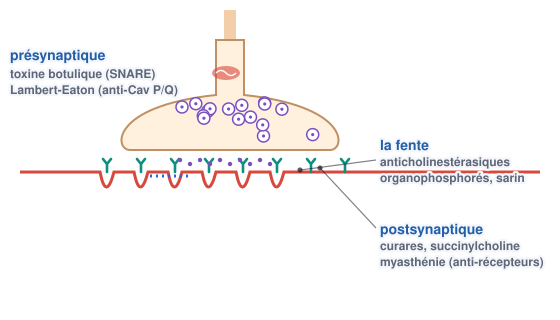

# Synapse et transmission neuromusculaire

10 schémas. Pour en afficher un dans le chat : ``.

## 0. Le fil du cours : l'influx saute le long de l'axone, le bouton libère son messager, le muscle répond.

`https://cdn.jsdelivr.net/gh/alxhe3-lab/schemas-medecine@main/Physiologie/CM3/fig00-176931c2.svg`

## 1. Comment l'influx va-t-il vite le long de l'axone ?

`https://cdn.jsdelivr.net/gh/alxhe3-lab/schemas-medecine@main/Physiologie/CM3/fig01-ad12dcde.svg`

## 2. Les cellules se touchent-elles ?

`https://cdn.jsdelivr.net/gh/alxhe3-lab/schemas-medecine@main/Physiologie/CM3/fig02-35856509.svg`

## 3. Où sont les quatre zones ?

`https://cdn.jsdelivr.net/gh/alxhe3-lab/schemas-medecine@main/Physiologie/CM3/fig03-dc604c80.svg`

## 4. Où se passe chaque étape ?

`https://cdn.jsdelivr.net/gh/alxhe3-lab/schemas-medecine@main/Physiologie/CM3/fig04-3a8f9c3b.svg`

## 5. Que fait le calcium à la vésicule ?

`https://cdn.jsdelivr.net/gh/alxhe3-lab/schemas-medecine@main/Physiologie/CM3/fig05-cc9a425e.svg`

## 6. Que fait le récepteur une fois le ligand fixé ?

`https://cdn.jsdelivr.net/gh/alxhe3-lab/schemas-medecine@main/Physiologie/CM3/fig06-501060e0.svg`

## 7. Comment des petits potentiels deviennent-ils un potentiel d'action ?

`https://cdn.jsdelivr.net/gh/alxhe3-lab/schemas-medecine@main/Physiologie/CM3/fig07-fdf75c75.svg`

## 8. Que se passe-t-il, dans l'ordre, à la plaque motrice ?

`https://cdn.jsdelivr.net/gh/alxhe3-lab/schemas-medecine@main/Physiologie/CM3/fig08-a109b7aa.svg`

## 9. À quel endroit de la jonction chacun agit-il ?

`https://cdn.jsdelivr.net/gh/alxhe3-lab/schemas-medecine@main/Physiologie/CM3/fig09-c9743029.svg`
