# La cellule musculaire striée et sa contraction

12 schémas. Pour en afficher un dans le chat : ``.

## 0. On descend du muscle jusqu'au sarcomère, puis on remonte vers la force.

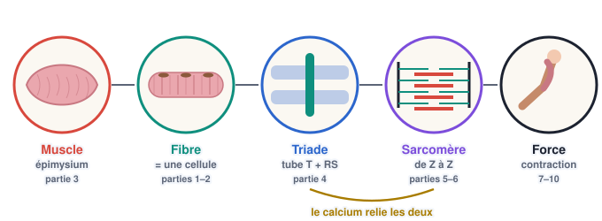

`https://cdn.jsdelivr.net/gh/alxhe3-lab/schemas-medecine@main/Physiologie/CM4/fig00-208a2d0d.svg`

## 1. Qu'est-ce qui sépare les trois types ?

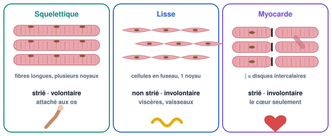

`https://cdn.jsdelivr.net/gh/alxhe3-lab/schemas-medecine@main/Physiologie/CM4/fig01-b162d4a0.svg`

## 2. Comment des myoblastes deviennent une seule fibre ?

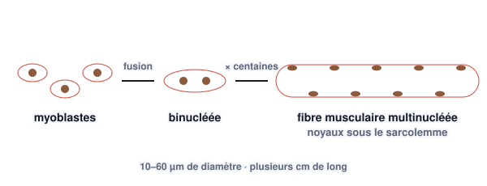

`https://cdn.jsdelivr.net/gh/alxhe3-lab/schemas-medecine@main/Physiologie/CM4/fig02-69260ff2.svg`

## 3. Quelle gaine entoure quoi ?

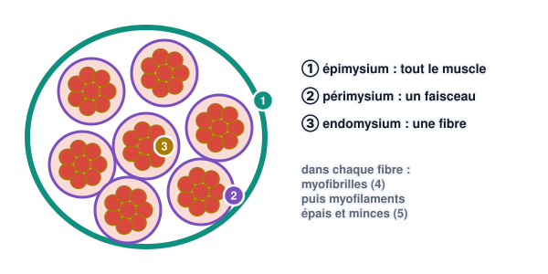

`https://cdn.jsdelivr.net/gh/alxhe3-lab/schemas-medecine@main/Physiologie/CM4/fig03-97c329be.svg`

## 4. Qu'est-ce qu'une triade ?

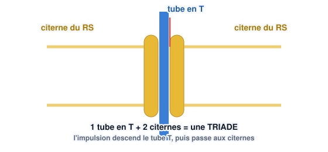

`https://cdn.jsdelivr.net/gh/alxhe3-lab/schemas-medecine@main/Physiologie/CM4/fig04-46256f99.svg`

## 5. Où sont l'actine et la myosine dans un sarcomère ?

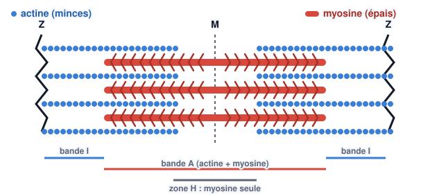

`https://cdn.jsdelivr.net/gh/alxhe3-lab/schemas-medecine@main/Physiologie/CM4/fig05-880d878b.svg`

## 6. Pourquoi la myosine ne peut-elle pas s'accrocher au repos ?

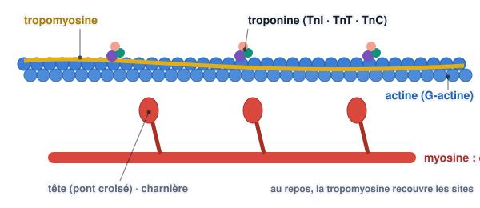

`https://cdn.jsdelivr.net/gh/alxhe3-lab/schemas-medecine@main/Physiologie/CM4/fig06-f640c51b.svg`

## 7. Les mêmes numéros sur le trajet du signal

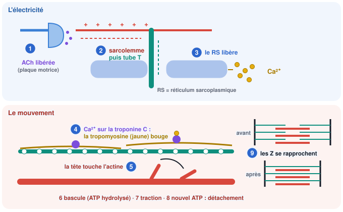

`https://cdn.jsdelivr.net/gh/alxhe3-lab/schemas-medecine@main/Physiologie/CM4/fig07-d8ae3e7e.svg`

## 8. Que se passe-t-il après une seule stimulation ?

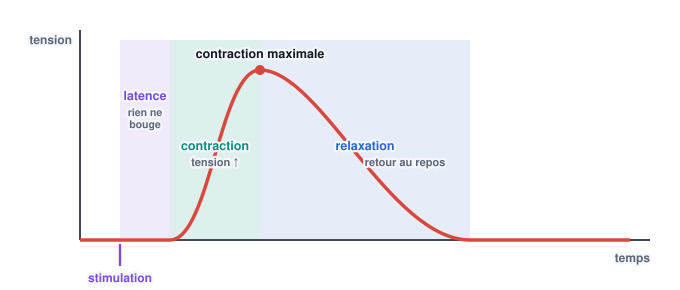

`https://cdn.jsdelivr.net/gh/alxhe3-lab/schemas-medecine@main/Physiologie/CM4/fig08-0c548acc.svg`

## 9. Pourquoi l'œil fait-il des mouvements fins ?

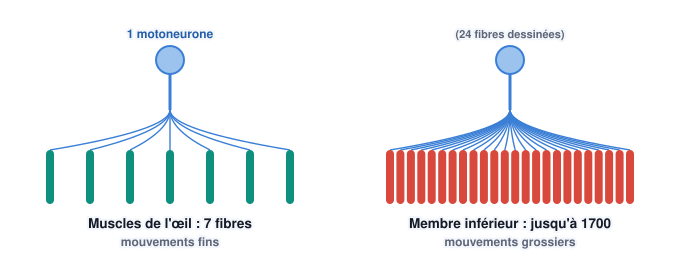

`https://cdn.jsdelivr.net/gh/alxhe3-lab/schemas-medecine@main/Physiologie/CM4/fig09-7581d4f5.svg`

## 10. Comment la vitesse change-t-elle avec la charge ?

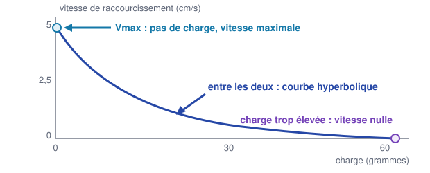

`https://cdn.jsdelivr.net/gh/alxhe3-lab/schemas-medecine@main/Physiologie/CM4/fig10-102e8446.svg`

## 11. Qui se contracte quand le coude se plie, puis se tend ?

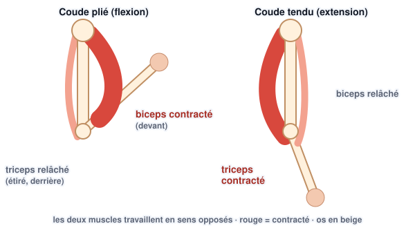

`https://cdn.jsdelivr.net/gh/alxhe3-lab/schemas-medecine@main/Physiologie/CM4/fig11-251a0828.svg`
